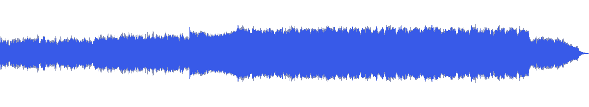
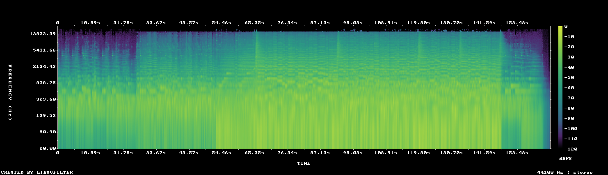

# MUS-01 — A Pale Blue Stillness

[Play original](<../../../assets/music/A_Pale_Blue_Stillness.mp3>) · [Interactive guide](../index.html#MUS-01) · [Library](../README.md)

**Editorial direction:** A space portfolio that grows from quiet scale into a substantial reveal.

Wide image and a large loudness range support chapter contrast; the restrained top end need not compete with tiny graphic details. These are editing suggestions, not model-verified genre/instrument/mood descriptions.

**Search:** Space, Portfolio, Reveal.

**Avoid / check:** The title does not mean a uniformly quiet bed. Do not cut to every detected attack.

**Vocals:** unverified. Audition the chosen range before using under speech; unverified does not mean instrumental.

**Previous context:** User-selected for the Sobiverse space portfolio.

**Motion references:** [REF-01](../../reference-library/studies/REF-01.md), [REF-17](../../reference-library/studies/REF-17.md), [REF-18](../../reference-library/studies/REF-18.md). These pair editing behaviours, not matching audio or shared authorship.

## Measured profile

| Field | Value |
| --- | --- |
| Duration | 2:43 (163.370s) |
| Original format | mp3 / 44100Hz / 2ch |
| Integrated level | -11.9 LUFS |
| Loudness range | 10.7 LU |
| Decoded true peak | 0.1 dBTP |
| Brightness, magnitude centroid | 1138Hz |
| Side/mid ratio | -4.3dB |
| Stereo correlation | 0.455 |
| Spectral-flux attack candidates | 3.55/s |
| Pulse candidate, unvalidated | 72.1BPM / autocorrelation 0.417 |
| Decoded near/full-scale samples | 3 (threshold ±0.999) |

Pulse estimates may be half/double-time; **no approved beat grid**. Attack detections are not guaranteed musical beats or sound effects. All levels are original-source values, not delivery targets.

## Audition these ranges

Computed from one-second starts, not claimed phrase boundaries. “Least-variable” is relative to this track and need not be genuinely steady. The rise is last-three-second mean RMS minus first-three-second mean; change can be small even in the winning window. Entry/exit notes and harmonic resolution require listening.

| Candidate | Source range | Measured shape |
| --- | --- | --- |
| 12s level rise | **0:24–0:36** | 5.5dB change / 2.25dB variation / 3.667 attacks/s |
| 30s least-variable passage | **1:17–1:47** | 0.4dB change / 0.71dB variation / 3.967 attacks/s |
| 30s attack-dense passage | **2:01–2:31** | -8.2dB change / 3.07dB variation / 4.367 attacks/s |
| 60s least-variable passage | **1:20–2:20** | -0.6dB change / 0.85dB variation / 4.133 attacks/s |

## Full-track structure

Regular 15-second analysis blocks; **not** inferred intro/verse/chorus sections. RMS is an amplitude measure, not LUFS.

| Source range | Mean 1s RMS dBFS | Level variation, std dB | Attacks/s |
| --- | ---: | ---: | ---: |
| 0:00–0:15 | -23.3 | 1.6 | 2.73 |
| 0:15–0:30 | -23.0 | 1.7 | 2.67 |
| 0:30–0:45 | -19.6 | 0.8 | 4.07 |
| 0:45–1:00 | -18.1 | 1.8 | 3.53 |
| 1:00–1:15 | -14.6 | 1.9 | 3.80 |
| 1:15–1:30 | -13.8 | 0.7 | 3.73 |
| 1:30–1:45 | -13.3 | 0.8 | 4.00 |
| 1:45–2:00 | -13.2 | 0.9 | 3.87 |
| 2:00–2:15 | -13.5 | 1.1 | 4.33 |
| 2:15–2:30 | -15.9 | 3.6 | 4.33 |
| 2:30–2:43 | -33.3 | 16.1 | 1.79 |

## Source and evidence

Original name: `A_Pale_Blue_Stillness.mp3`. SHA256: `3c996518aacd1dab2b7320dba442f5a2e429ec30aff15216577d9c00f4dd4fc6`. Source unchanged. [Raw analysis](../evidence/MUS-01/analysis.json), [probe/tags](../evidence/MUS-01/probe.json), [method](../PLAYBOOK.md). User-supplied; distribution rights not established. No human listening, semantic model or vocal-absence certification.
