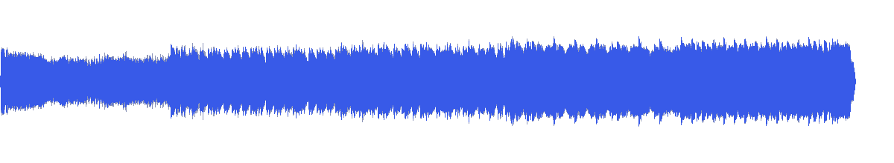
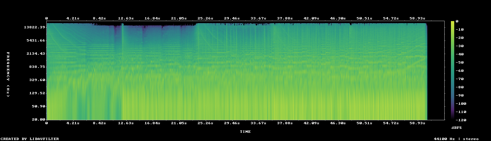

# MUS-02 — Apex Horizon

[Play original](<../../../assets/music/Apex_Horizon.mp3>) · [Interactive guide](../index.html#MUS-02) · [Library](../README.md)

**Editorial direction:** A concise launch, kinetic title sequence or one-minute graphic reel.

Relatively bright spectrum, frequent attack candidates and strong pulse autocorrelation give useful places to test short graphic accents. These are editing suggestions, not model-verified genre/instrument/mood descriptions.

**Search:** Kinetic, Product, Short film.

**Avoid / check:** Only 63 seconds long; it cannot cover a two-minute film unchanged. Confirm the pulse by audition before timing text to it.

**Vocals:** unverified. Audition the chosen range before using under speech; unverified does not mean instrumental.

**Motion references:** [REF-03](../../reference-library/studies/REF-03.md), [REF-06](../../reference-library/studies/REF-06.md), [REF-20](../../reference-library/studies/REF-20.md). These pair editing behaviours, not matching audio or shared authorship.

## Measured profile

| Field | Value |
| --- | --- |
| Duration | 1:03 (63.138s) |
| Original format | mp3 / 44100Hz / 2ch |
| Integrated level | -12.5 LUFS |
| Loudness range | 6.9 LU |
| Decoded true peak | 0.3 dBTP |
| Brightness, magnitude centroid | 2325Hz |
| Side/mid ratio | -7.7dB |
| Stereo correlation | 0.71 |
| Spectral-flux attack candidates | 3.659/s |
| Pulse candidate, unvalidated | 79.8BPM / autocorrelation 0.819 |
| Decoded near/full-scale samples | 5 (threshold ±0.999) |

**Duration limit:** cannot supply an uninterrupted two-minute film. A loop/arrangement would be a separate editing choice.

Pulse estimates may be half/double-time; **no approved beat grid**. Attack detections are not guaranteed musical beats or sound effects. All levels are original-source values, not delivery targets.

## Audition these ranges

Computed from one-second starts, not claimed phrase boundaries. “Least-variable” is relative to this track and need not be genuinely steady. The rise is last-three-second mean RMS minus first-three-second mean; change can be small even in the winning window. Entry/exit notes and harmonic resolution require listening.

| Candidate | Source range | Measured shape |
| --- | --- | --- |
| 12s level rise | **0:04–0:16** | 6.8dB change / 3.13dB variation / 4.083 attacks/s |
| 30s least-variable passage | **0:24–0:54** | 1.9dB change / 0.87dB variation / 3.867 attacks/s |
| 30s attack-dense passage | **0:07–0:37** | 7.8dB change / 2.62dB variation / 4.733 attacks/s |
| 60s least-variable passage | **0:00–1:00** | 5.6dB change / 3.17dB variation / 3.85 attacks/s |

## Full-track structure

Regular 15-second analysis blocks; **not** inferred intro/verse/chorus sections. RMS is an amplitude measure, not LUFS.

| Source range | Mean 1s RMS dBFS | Level variation, std dB | Attacks/s |
| --- | ---: | ---: | ---: |
| 0:00–0:15 | -20.0 | 2.9 | 3.13 |
| 0:15–0:30 | -15.6 | 0.8 | 4.93 |
| 0:30–0:45 | -13.8 | 0.8 | 3.93 |
| 0:45–1:00 | -12.9 | 0.8 | 3.40 |
| 1:00–1:03 | -101.6 | 54.3 | 0.00 |

## Source and evidence

Original name: `Apex_Horizon.mp3`. SHA256: `4783819ba3b3a91e40c6299d0c8693a89ece81ba7dd22daa1be9e8c2adb8f542`. Source unchanged. [Raw analysis](../evidence/MUS-02/analysis.json), [probe/tags](../evidence/MUS-02/probe.json), [method](../PLAYBOOK.md). User-supplied; distribution rights not established. No human listening, semantic model or vocal-absence certification.
