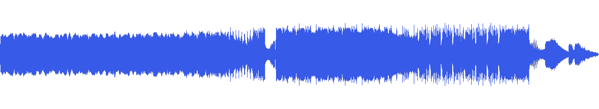
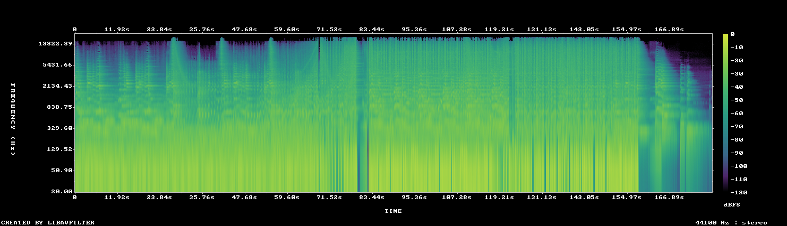

# MUS-03 — Architects of Motion

[Play original](<../../../assets/music/Architects_of_Motion.mp3>) · [Interactive guide](../index.html#MUS-03) · [Library](../README.md)

**Editorial direction:** A precise product film with a steady feature section and a later escalation.

The low-variation 30-second passage and a pronounced later rise support both readable specifications and a second-act reveal. These are editing suggestions, not model-verified genre/instrument/mood descriptions.

**Search:** Product, Kinetic, Technical.

**Avoid / check:** Do not treat its whole three minutes as one even loop; the strongest measured rise is well into the source.

**Vocals:** unverified. Audition the chosen range before using under speech; unverified does not mean instrumental.

**Previous context:** Latest user-selected music for the realme Make it real film; source 0–120s.

**Motion references:** [REF-09](../../reference-library/studies/REF-09.md), [REF-20](../../reference-library/studies/REF-20.md), [REF-22](../../reference-library/studies/REF-22.md). These pair editing behaviours, not matching audio or shared authorship.

## Measured profile

| Field | Value |
| --- | --- |
| Duration | 2:58 (178.808s) |
| Original format | mp3 / 44100Hz / 2ch |
| Integrated level | -12.8 LUFS |
| Loudness range | 6.6 LU |
| Decoded true peak | 1.1 dBTP |
| Brightness, magnitude centroid | 1879Hz |
| Side/mid ratio | -11.1dB |
| Stereo correlation | 0.854 |
| Spectral-flux attack candidates | 2.863/s |
| Pulse candidate, unvalidated | 69.4BPM / autocorrelation 0.714 |
| Decoded near/full-scale samples | 87 (threshold ±0.999) |

Pulse estimates may be half/double-time; **no approved beat grid**. Attack detections are not guaranteed musical beats or sound effects. All levels are original-source values, not delivery targets.

## Audition these ranges

Computed from one-second starts, not claimed phrase boundaries. “Least-variable” is relative to this track and need not be genuinely steady. The rise is last-three-second mean RMS minus first-three-second mean; change can be small even in the winning window. Entry/exit notes and harmonic resolution require listening.

| Candidate | Source range | Measured shape |
| --- | --- | --- |
| 12s level rise | **1:19–1:31** | 14.2dB change / 6.46dB variation / 3 attacks/s |
| 30s least-variable passage | **0:16–0:46** | 0.7dB change / 0.65dB variation / 2.367 attacks/s |
| 30s attack-dense passage | **1:32–2:02** | -2.0dB change / 1.45dB variation / 4.067 attacks/s |
| 60s least-variable passage | **0:00–1:00** | 1.3dB change / 0.87dB variation / 2.3 attacks/s |

## Full-track structure

Regular 15-second analysis blocks; **not** inferred intro/verse/chorus sections. RMS is an amplitude measure, not LUFS.

| Source range | Mean 1s RMS dBFS | Level variation, std dB | Attacks/s |
| --- | ---: | ---: | ---: |
| 0:00–0:15 | -16.9 | 0.8 | 0.67 |
| 0:15–0:30 | -17.2 | 0.9 | 1.20 |
| 0:30–0:45 | -16.9 | 0.5 | 3.20 |
| 0:45–1:00 | -16.4 | 1.0 | 4.13 |
| 1:00–1:15 | -16.1 | 1.2 | 3.67 |
| 1:15–1:30 | -15.2 | 5.8 | 3.40 |
| 1:30–1:45 | -11.9 | 0.9 | 3.60 |
| 1:45–2:00 | -12.7 | 1.8 | 4.40 |
| 2:00–2:15 | -13.4 | 1.5 | 3.60 |
| 2:15–2:30 | -13.0 | 1.2 | 3.87 |
| 2:30–2:45 | -20.5 | 10.2 | 2.40 |
| 2:45–2:58 | -37.2 | 8.2 | 0.00 |

## Source and evidence

Original name: `Architects_of_Motion.mp3`. SHA256: `f59ee0720afef762546df41a33d63a4f70d241f4940c330f4cf22c0b730a1bc6`. Source unchanged. [Raw analysis](../evidence/MUS-03/analysis.json), [probe/tags](../evidence/MUS-03/probe.json), [method](../PLAYBOOK.md). User-supplied; distribution rights not established. No human listening, semantic model or vocal-absence certification.
