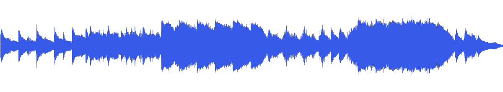
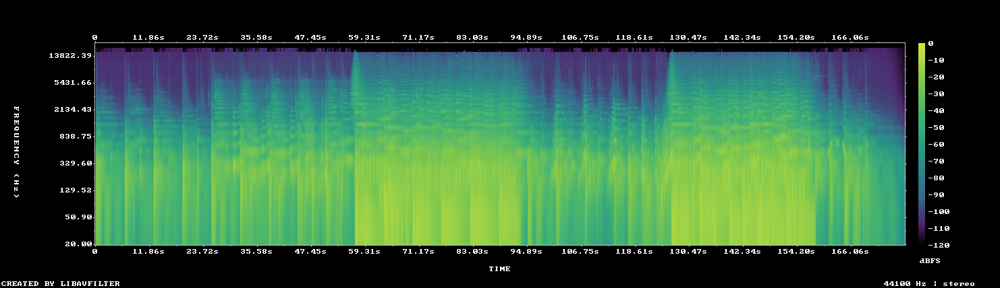

# MUS-04 — Beneath Polished Surfaces

[Play original](<../../../assets/music/Beneath_Polished_Surfaces.mp3>) · [Interactive guide](../index.html#MUS-04) · [Library](../README.md)

**Editorial direction:** A material-focused reveal: macro texture, deliberate negative space, then a larger product view.

Very restrained spectral brightness and a 15LU loudness range favour contrast between close detail and a reveal. These are editing suggestions, not model-verified genre/instrument/mood descriptions.

**Search:** Material, Editorial, Reveal.

**Avoid / check:** Not a constant low-level luxury bed; use a bounded passage and plan for its large level changes.

**Vocals:** unverified. Audition the chosen range before using under speech; unverified does not mean instrumental.

**Motion references:** [REF-09](../../reference-library/studies/REF-09.md), [REF-15](../../reference-library/studies/REF-15.md), [REF-19](../../reference-library/studies/REF-19.md). These pair editing behaviours, not matching audio or shared authorship.

## Measured profile

| Field | Value |
| --- | --- |
| Duration | 2:57 (177.920s) |
| Original format | mp3 / 44100Hz / 2ch |
| Integrated level | -11.7 LUFS |
| Loudness range | 15 LU |
| Decoded true peak | 0 dBTP |
| Brightness, magnitude centroid | 578Hz |
| Side/mid ratio | -6.3dB |
| Stereo correlation | 0.623 |
| Spectral-flux attack candidates | 2.349/s |
| Pulse candidate, unvalidated | 76.5BPM / autocorrelation 0.361 |
| Decoded near/full-scale samples | 2 (threshold ±0.999) |

Pulse estimates may be half/double-time; **no approved beat grid**. Attack detections are not guaranteed musical beats or sound effects. All levels are original-source values, not delivery targets.

## Audition these ranges

Computed from one-second starts, not claimed phrase boundaries. “Least-variable” is relative to this track and need not be genuinely steady. The rise is last-three-second mean RMS minus first-three-second mean; change can be small even in the winning window. Entry/exit notes and harmonic resolution require listening.

| Candidate | Source range | Measured shape |
| --- | --- | --- |
| 12s level rise | **0:16–0:28** | 13.7dB change / 7.05dB variation / 0.917 attacks/s |
| 30s least-variable passage | **2:06–2:36** | -1.9dB change / 0.99dB variation / 3.5 attacks/s |
| 30s attack-dense passage | **2:04–2:34** | 3.8dB change / 1.70dB variation / 3.667 attacks/s |
| 60s least-variable passage | **0:34–1:34** | 4.8dB change / 4.59dB variation / 2.883 attacks/s |

## Full-track structure

Regular 15-second analysis blocks; **not** inferred intro/verse/chorus sections. RMS is an amplitude measure, not LUFS.

| Source range | Mean 1s RMS dBFS | Level variation, std dB | Attacks/s |
| --- | ---: | ---: | ---: |
| 0:00–0:15 | -28.8 | 5.9 | 0.73 |
| 0:15–0:30 | -28.8 | 6.5 | 0.80 |
| 0:30–0:45 | -20.7 | 1.7 | 2.27 |
| 0:45–1:00 | -19.1 | 4.6 | 2.07 |
| 1:00–1:15 | -12.6 | 1.6 | 3.67 |
| 1:15–1:30 | -12.7 | 2.0 | 3.47 |
| 1:30–1:45 | -22.0 | 5.5 | 2.27 |
| 1:45–2:00 | -25.4 | 4.3 | 2.20 |
| 2:00–2:15 | -14.5 | 5.1 | 3.40 |
| 2:15–2:30 | -10.6 | 0.9 | 3.47 |
| 2:30–2:45 | -18.5 | 7.4 | 2.87 |
| 2:45–2:57 | -36.2 | 10.2 | 0.77 |

## Source and evidence

Original name: `Beneath_Polished_Surfaces.mp3`. SHA256: `6db2a08d20c87ec57a7a21d97195f3904d9c7bb6d443ee58ab703e1c1e2ba70e`. Source unchanged. [Raw analysis](../evidence/MUS-04/analysis.json), [probe/tags](../evidence/MUS-04/probe.json), [method](../PLAYBOOK.md). User-supplied; distribution rights not established. No human listening, semantic model or vocal-absence certification.
