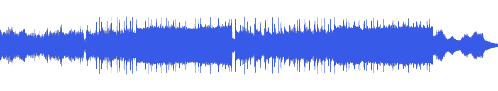
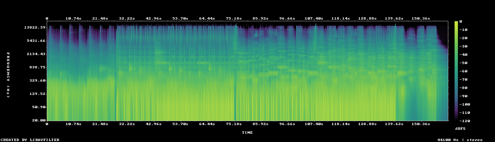

# MUS-05 — Beyond the Last Star

[Play original](<../../../assets/music/Beyond_the_Last_Star.mp3>) · [Interactive guide](../index.html#MUS-05) · [Library](../README.md)

**Editorial direction:** A distant environment, slow world journey or reflective space chapter.

Among the lowest attack densities and brightness values in this folder, leaving room to test longer camera movements. These are editing suggestions, not model-verified genre/instrument/mood descriptions.

**Search:** Space, Environment, Restrained.

**Avoid / check:** Low measured activity does not establish a specific ambient genre, instruments or absence of vocals.

**Vocals:** unverified. Audition the chosen range before using under speech; unverified does not mean instrumental.

**Motion references:** [REF-01](../../reference-library/studies/REF-01.md), [REF-04](../../reference-library/studies/REF-04.md), [REF-11](../../reference-library/studies/REF-11.md). These pair editing behaviours, not matching audio or shared authorship.

## Measured profile

| Field | Value |
| --- | --- |
| Duration | 2:41 (161.097s) |
| Original format | mp3 / 44100Hz / 2ch |
| Integrated level | -13.7 LUFS |
| Loudness range | 8.7 LU |
| Decoded true peak | -0.1 dBTP |
| Brightness, magnitude centroid | 492Hz |
| Side/mid ratio | -10.7dB |
| Stereo correlation | 0.842 |
| Spectral-flux attack candidates | 1.614/s |
| Pulse candidate, unvalidated | 60.5BPM / autocorrelation 0.439 |
| Decoded near/full-scale samples | 0 (threshold ±0.999) |

Pulse estimates may be half/double-time; **no approved beat grid**. Attack detections are not guaranteed musical beats or sound effects. All levels are original-source values, not delivery targets.

## Audition these ranges

Computed from one-second starts, not claimed phrase boundaries. “Least-variable” is relative to this track and need not be genuinely steady. The rise is last-three-second mean RMS minus first-three-second mean; change can be small even in the winning window. Entry/exit notes and harmonic resolution require listening.

| Candidate | Source range | Measured shape |
| --- | --- | --- |
| 12s level rise | **0:25–0:37** | 6.7dB change / 4.14dB variation / 1.333 attacks/s |
| 30s least-variable passage | **1:48–2:18** | 0.4dB change / 1.35dB variation / 2.533 attacks/s |
| 30s attack-dense passage | **1:49–2:19** | 1.1dB change / 1.40dB variation / 2.567 attacks/s |
| 60s least-variable passage | **1:16–2:16** | 3.5dB change / 2.67dB variation / 2.283 attacks/s |

## Full-track structure

Regular 15-second analysis blocks; **not** inferred intro/verse/chorus sections. RMS is an amplitude measure, not LUFS.

| Source range | Mean 1s RMS dBFS | Level variation, std dB | Attacks/s |
| --- | ---: | ---: | ---: |
| 0:00–0:15 | -21.6 | 2.6 | 0.20 |
| 0:15–0:30 | -20.2 | 2.7 | 0.60 |
| 0:30–0:45 | -15.2 | 3.3 | 1.60 |
| 0:45–1:00 | -13.1 | 1.6 | 2.20 |
| 1:00–1:15 | -12.8 | 1.6 | 2.53 |
| 1:15–1:30 | -16.2 | 3.8 | 1.93 |
| 1:30–1:45 | -14.7 | 2.7 | 2.07 |
| 1:45–2:00 | -13.7 | 2.3 | 2.47 |
| 2:00–2:15 | -12.5 | 1.3 | 2.60 |
| 2:15–2:30 | -23.1 | 8.9 | 1.00 |
| 2:30–2:41 | -33.4 | 11.7 | 0.18 |

## Source and evidence

Original name: `Beyond_the_Last_Star.mp3`. SHA256: `54feb794eb3278c55cb3188d3e45ff8926ebc1f91f79451d9b4000e5ae15e9a2`. Source unchanged. [Raw analysis](../evidence/MUS-05/analysis.json), [probe/tags](../evidence/MUS-05/probe.json), [method](../PLAYBOOK.md). User-supplied; distribution rights not established. No human listening, semantic model or vocal-absence certification.
