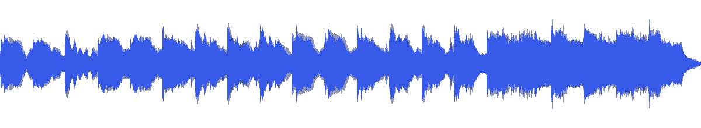
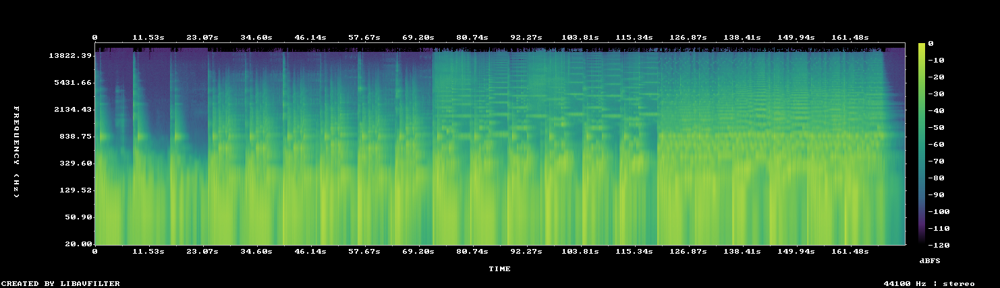

# MUS-06 — Cold Hull Settling

[Play original](<../../../assets/music/Cold_Hull_Settling.mp3>) · [Interactive guide](../index.html#MUS-06) · [Library](../README.md)

**Editorial direction:** A large structure or industrial environment with a late change of scale.

A comparatively wide stereo image and a large late rise offer contrast for environment-to-detail travel. These are editing suggestions, not model-verified genre/instrument/mood descriptions.

**Search:** Industrial, Space, Reveal.

**Avoid / check:** The industrial direction is an editorial proposal, not identification of ship or metal recordings. Its steadiest passage still varies noticeably.

**Vocals:** unverified. Audition the chosen range before using under speech; unverified does not mean instrumental.

**Motion references:** [REF-01](../../reference-library/studies/REF-01.md), [REF-17](../../reference-library/studies/REF-17.md), [REF-18](../../reference-library/studies/REF-18.md). These pair editing behaviours, not matching audio or shared authorship.

## Measured profile

| Field | Value |
| --- | --- |
| Duration | 2:53 (173.009s) |
| Original format | mp3 / 44100Hz / 2ch |
| Integrated level | -11.8 LUFS |
| Loudness range | 9.7 LU |
| Decoded true peak | 0 dBTP |
| Brightness, magnitude centroid | 821Hz |
| Side/mid ratio | -4.8dB |
| Stereo correlation | 0.506 |
| Spectral-flux attack candidates | 2.191/s |
| Pulse candidate, unvalidated | 61.5BPM / autocorrelation 0.432 |
| Decoded near/full-scale samples | 0 (threshold ±0.999) |

Pulse estimates may be half/double-time; **no approved beat grid**. Attack detections are not guaranteed musical beats or sound effects. All levels are original-source values, not delivery targets.

## Audition these ranges

Computed from one-second starts, not claimed phrase boundaries. “Least-variable” is relative to this track and need not be genuinely steady. The rise is last-three-second mean RMS minus first-three-second mean; change can be small even in the winning window. Entry/exit notes and harmonic resolution require listening.

| Candidate | Source range | Measured shape |
| --- | --- | --- |
| 12s level rise | **1:57–2:09** | 13.8dB change / 6.86dB variation / 2.5 attacks/s |
| 30s least-variable passage | **2:00–2:30** | -2.7dB change / 2.37dB variation / 3.3 attacks/s |
| 30s attack-dense passage | **2:13–2:43** | 6.8dB change / 2.73dB variation / 3.4 attacks/s |
| 60s least-variable passage | **1:45–2:45** | 0.3dB change / 4.57dB variation / 3.017 attacks/s |

## Full-track structure

Regular 15-second analysis blocks; **not** inferred intro/verse/chorus sections. RMS is an amplitude measure, not LUFS.

| Source range | Mean 1s RMS dBFS | Level variation, std dB | Attacks/s |
| --- | ---: | ---: | ---: |
| 0:00–0:15 | -20.4 | 4.9 | 0.87 |
| 0:15–0:30 | -20.9 | 6.4 | 1.33 |
| 0:30–0:45 | -17.9 | 4.5 | 2.20 |
| 0:45–1:00 | -17.6 | 4.5 | 2.00 |
| 1:00–1:15 | -17.9 | 5.0 | 1.87 |
| 1:15–1:30 | -17.9 | 5.7 | 2.00 |
| 1:30–1:45 | -18.3 | 5.7 | 2.20 |
| 1:45–2:00 | -19.9 | 6.5 | 2.13 |
| 2:00–2:15 | -14.5 | 1.7 | 3.20 |
| 2:15–2:30 | -14.4 | 2.9 | 3.40 |
| 2:30–2:45 | -14.2 | 2.6 | 3.33 |
| 2:45–2:53 | -32.5 | 13.4 | 1.37 |

## Source and evidence

Original name: `Cold_Hull_Settling.mp3`. SHA256: `ec02a9e954927acfe4db7703f157f3babdafef68854bfbde6bb409e2d8dc3bdc`. Source unchanged. [Raw analysis](../evidence/MUS-06/analysis.json), [probe/tags](../evidence/MUS-06/probe.json), [method](../PLAYBOOK.md). User-supplied; distribution rights not established. No human listening, semantic model or vocal-absence certification.
