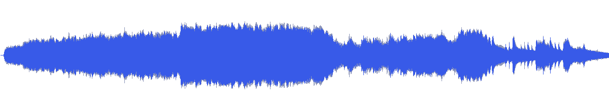
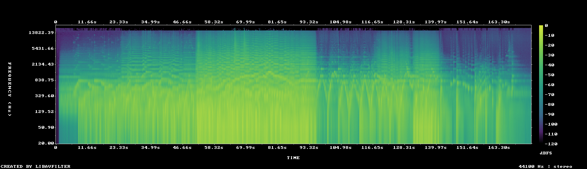

# MUS-07 — From a Silent Vantage Point

[Play original](<../../../assets/music/From_a_Silent_Vantage_Point.mp3>) · [Interactive guide](../index.html#MUS-07) · [Library](../README.md)

**Editorial direction:** A cinematic portfolio with genuinely different chapter intensities.

One of the largest loudness ranges and wider stereo images in the collection; a bounded middle passage is much steadier than the full source. These are editing suggestions, not model-verified genre/instrument/mood descriptions.

**Search:** Portfolio, Space, Reveal.

**Avoid / check:** Do not choose it as background merely because the title says silent. Its full-file contrast is substantial.

**Vocals:** unverified. Audition the chosen range before using under speech; unverified does not mean instrumental.

**Motion references:** [REF-01](../../reference-library/studies/REF-01.md), [REF-09](../../reference-library/studies/REF-09.md), [REF-17](../../reference-library/studies/REF-17.md). These pair editing behaviours, not matching audio or shared authorship.

## Measured profile

| Field | Value |
| --- | --- |
| Duration | 2:54 (174.968s) |
| Original format | mp3 / 44100Hz / 2ch |
| Integrated level | -11.2 LUFS |
| Loudness range | 17.9 LU |
| Decoded true peak | 0.2 dBTP |
| Brightness, magnitude centroid | 785Hz |
| Side/mid ratio | -4dB |
| Stereo correlation | 0.434 |
| Spectral-flux attack candidates | 2.949/s |
| Pulse candidate, unvalidated | 65.8BPM / autocorrelation 0.253 |
| Decoded near/full-scale samples | 66 (threshold ±0.999) |

Pulse estimates may be half/double-time; **no approved beat grid**. Attack detections are not guaranteed musical beats or sound effects. All levels are original-source values, not delivery targets.

## Audition these ranges

Computed from one-second starts, not claimed phrase boundaries. “Least-variable” is relative to this track and need not be genuinely steady. The rise is last-three-second mean RMS minus first-three-second mean; change can be small even in the winning window. Entry/exit notes and harmonic resolution require listening.

| Candidate | Source range | Measured shape |
| --- | --- | --- |
| 12s level rise | **0:01–0:13** | 12.5dB change / 5.42dB variation / 1.083 attacks/s |
| 30s least-variable passage | **0:59–1:29** | -1.0dB change / 0.88dB variation / 3.967 attacks/s |
| 30s attack-dense passage | **1:01–1:31** | -1.6dB change / 1.01dB variation / 4 attacks/s |
| 60s least-variable passage | **0:35–1:35** | 2.4dB change / 2.71dB variation / 3.717 attacks/s |

## Full-track structure

Regular 15-second analysis blocks; **not** inferred intro/verse/chorus sections. RMS is an amplitude measure, not LUFS.

| Source range | Mean 1s RMS dBFS | Level variation, std dB | Attacks/s |
| --- | ---: | ---: | ---: |
| 0:00–0:15 | -31.1 | 15.7 | 1.20 |
| 0:15–0:30 | -19.9 | 1.7 | 2.93 |
| 0:30–0:45 | -17.4 | 1.2 | 3.53 |
| 0:45–1:00 | -13.6 | 2.7 | 3.27 |
| 1:00–1:15 | -10.7 | 0.7 | 3.87 |
| 1:15–1:30 | -11.5 | 1.1 | 4.07 |
| 1:30–1:45 | -20.1 | 5.4 | 3.80 |
| 1:45–2:00 | -20.7 | 2.2 | 3.80 |
| 2:00–2:15 | -17.8 | 2.7 | 3.93 |
| 2:15–2:30 | -23.7 | 7.5 | 2.00 |
| 2:30–2:45 | -28.1 | 4.7 | 1.80 |
| 2:45–2:54 | -40.0 | 6.0 | 0.30 |

## Source and evidence

Original name: `From_a_Silent_Vantage_Point.mp3`. SHA256: `075478a14d527248ab00a6d829c73f4e5660c49df335f18d5dab35487d0071d7`. Source unchanged. [Raw analysis](../evidence/MUS-07/analysis.json), [probe/tags](../evidence/MUS-07/probe.json), [method](../PLAYBOOK.md). User-supplied; distribution rights not established. No human listening, semantic model or vocal-absence certification.
