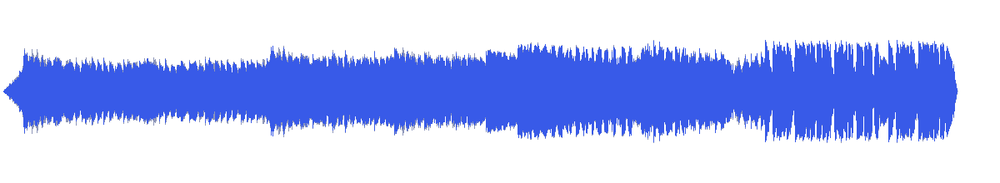
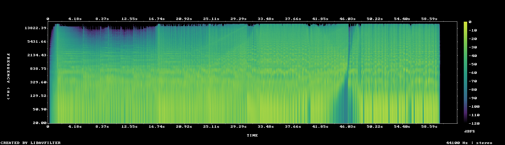

# MUS-08 — Glass and Alloy

[Play original](<../../../assets/music/Glass_and_Alloy.mp3>) · [Interactive guide](../index.html#MUS-08) · [Library](../README.md)

**Editorial direction:** A short technology ad with material macros, clean specification changes and a resolved product ending.

One of the brighter non-vocal sources and a practical short duration for a single product story. These are editing suggestions, not model-verified genre/instrument/mood descriptions.

**Search:** Product, Material, Short film.

**Avoid / check:** About 63 seconds total; a 120-second brief needs another arrangement or track. Busy passages still require SFX space.

**Vocals:** unverified. Audition the chosen range before using under speech; unverified does not mean instrumental.

**Previous context:** Used in the original 45-second realme film, source 15–60s.

**Motion references:** [REF-09](../../reference-library/studies/REF-09.md), [REF-19](../../reference-library/studies/REF-19.md), [REF-20](../../reference-library/studies/REF-20.md). These pair editing behaviours, not matching audio or shared authorship.

## Measured profile

| Field | Value |
| --- | --- |
| Duration | 1:02 (62.772s) |
| Original format | mp3 / 44100Hz / 2ch |
| Integrated level | -11.8 LUFS |
| Loudness range | 7.9 LU |
| Decoded true peak | 1.1 dBTP |
| Brightness, magnitude centroid | 3188Hz |
| Side/mid ratio | -8.1dB |
| Stereo correlation | 0.73 |
| Spectral-flux attack candidates | 2.963/s |
| Pulse candidate, unvalidated | 79.8BPM / autocorrelation 0.569 |
| Decoded near/full-scale samples | 138 (threshold ±0.999) |

**Duration limit:** cannot supply an uninterrupted two-minute film. A loop/arrangement would be a separate editing choice.

Pulse estimates may be half/double-time; **no approved beat grid**. Attack detections are not guaranteed musical beats or sound effects. All levels are original-source values, not delivery targets.

## Audition these ranges

Computed from one-second starts, not claimed phrase boundaries. “Least-variable” is relative to this track and need not be genuinely steady. The rise is last-three-second mean RMS minus first-three-second mean; change can be small even in the winning window. Entry/exit notes and harmonic resolution require listening.

| Candidate | Source range | Measured shape |
| --- | --- | --- |
| 12s level rise | **0:45–0:57** | 5.8dB change / 2.84dB variation / 3.417 attacks/s |
| 30s least-variable passage | **0:16–0:46** | 0.5dB change / 1.92dB variation / 3.2 attacks/s |
| 30s attack-dense passage | **0:29–0:59** | 4.0dB change / 2.14dB variation / 3.4 attacks/s |
| 60s least-variable passage | **0:00–1:00** | 13.3dB change / 4.53dB variation / 3.1 attacks/s |

## Full-track structure

Regular 15-second analysis blocks; **not** inferred intro/verse/chorus sections. RMS is an amplitude measure, not LUFS.

| Source range | Mean 1s RMS dBFS | Level variation, std dB | Attacks/s |
| --- | ---: | ---: | ---: |
| 0:00–0:15 | -21.1 | 5.6 | 2.67 |
| 0:15–0:30 | -16.7 | 1.4 | 3.00 |
| 0:30–0:45 | -13.5 | 1.1 | 3.33 |
| 0:45–1:00 | -13.1 | 2.6 | 3.40 |
| 1:00–1:02 | -99.1 | 40.9 | 0.00 |

## Source and evidence

Original name: `Glass_and_Alloy.mp3`. SHA256: `48fdefd29ed4ded85e687dd5361a960f42cb7a45c050824bd15d49be27f84c14`. Source unchanged. [Raw analysis](../evidence/MUS-08/analysis.json), [probe/tags](../evidence/MUS-08/probe.json), [method](../PLAYBOOK.md). User-supplied; distribution rights not established. No human listening, semantic model or vocal-absence certification.
