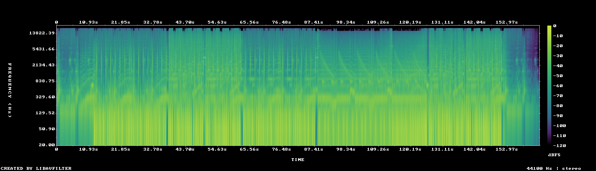

# MUS-09 — Iron Anatomy

[Play original](<../../../assets/music/Iron_Anatomy.mp3>) · [Interactive guide](../index.html#MUS-09) · [Library](../README.md)

**Editorial direction:** A technical product reveal: mechanism, material, scale, then explanation.

A strong early measured rise can establish the product before a more controlled later specification passage. These are editing suggestions, not model-verified genre/instrument/mood descriptions.

**Search:** Industrial, Technical, Product.

**Avoid / check:** Its stereo image is comparatively narrow. That is not a failed mono test, nor proof of phone-speaker performance.

**Vocals:** unverified. Audition the chosen range before using under speech; unverified does not mean instrumental.

**Motion references:** [REF-01](../../reference-library/studies/REF-01.md), [REF-09](../../reference-library/studies/REF-09.md), [REF-10](../../reference-library/studies/REF-10.md). These pair editing behaviours, not matching audio or shared authorship.

## Measured profile

| Field | Value |
| --- | --- |
| Duration | 2:43 (163.892s) |
| Original format | mp3 / 44100Hz / 2ch |
| Integrated level | -13 LUFS |
| Loudness range | 7.3 LU |
| Decoded true peak | 0.2 dBTP |
| Brightness, magnitude centroid | 1508Hz |
| Side/mid ratio | -17.1dB |
| Stereo correlation | 0.962 |
| Spectral-flux attack candidates | 2.197/s |
| Pulse candidate, unvalidated | 76.5BPM / autocorrelation 0.391 |
| Decoded near/full-scale samples | 27 (threshold ±0.999) |

Pulse estimates may be half/double-time; **no approved beat grid**. Attack detections are not guaranteed musical beats or sound effects. All levels are original-source values, not delivery targets.

## Audition these ranges

Computed from one-second starts, not claimed phrase boundaries. “Least-variable” is relative to this track and need not be genuinely steady. The rise is last-three-second mean RMS minus first-three-second mean; change can be small even in the winning window. Entry/exit notes and harmonic resolution require listening.

| Candidate | Source range | Measured shape |
| --- | --- | --- |
| 12s level rise | **0:03–0:15** | 15.1dB change / 5.90dB variation / 0.917 attacks/s |
| 30s least-variable passage | **2:01–2:31** | 0.7dB change / 1.10dB variation / 3.133 attacks/s |
| 30s attack-dense passage | **0:40–1:10** | 0.1dB change / 1.26dB variation / 3.167 attacks/s |
| 60s least-variable passage | **0:21–1:21** | -1.0dB change / 1.55dB variation / 2.95 attacks/s |

## Full-track structure

Regular 15-second analysis blocks; **not** inferred intro/verse/chorus sections. RMS is an amplitude measure, not LUFS.

| Source range | Mean 1s RMS dBFS | Level variation, std dB | Attacks/s |
| --- | ---: | ---: | ---: |
| 0:00–0:15 | -24.2 | 5.9 | 0.73 |
| 0:15–0:30 | -13.9 | 1.9 | 2.80 |
| 0:30–0:45 | -13.3 | 1.8 | 3.13 |
| 0:45–1:00 | -12.9 | 1.0 | 3.13 |
| 1:00–1:15 | -13.7 | 1.8 | 2.87 |
| 1:15–1:30 | -14.6 | 2.6 | 2.47 |
| 1:30–1:45 | -18.4 | 0.9 | 0.60 |
| 1:45–2:00 | -16.4 | 1.9 | 1.80 |
| 2:00–2:15 | -12.5 | 0.8 | 2.87 |
| 2:15–2:30 | -12.7 | 1.4 | 3.27 |
| 2:30–2:43 | -34.9 | 11.1 | 0.36 |

## Source and evidence

Original name: `Iron_Anatomy.mp3`. SHA256: `ccd45314ae7ac4e4111b6dc68c1adefdd0db331b24cd3026e537e714fd080c09`. Source unchanged. [Raw analysis](../evidence/MUS-09/analysis.json), [probe/tags](../evidence/MUS-09/probe.json), [method](../PLAYBOOK.md). User-supplied; distribution rights not established. No human listening, semantic model or vocal-absence certification.
