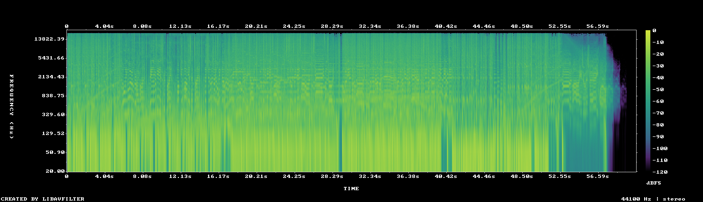

# MUS-10 — Ivan Is Loading

[Play original](<../../../assets/music/Ivan_Is_Loading.mp3>) · [Interactive guide](../index.html#MUS-10) · [Library](../README.md)

**Editorial direction:** A vocal-led narrative, glitch montage or music-video treatment where the words carry the story.

User-provided timed lyrics confirm vocals and a narrative; the source also has the highest measured brightness in the folder. These are editing suggestions, not model-verified genre/instrument/mood descriptions.

**Search:** Vocal, Story, Kinetic.

**Avoid / check:** Excluded by the user for earlier instrumental showcase work. Do not put under narration or use for unrelated product copy by default. The documented 42–54s bridge also includes vocal chops.

**Vocals:** confirmed vocals; user notes. The user’s lyric notes are available beside the source.

**Previous context:** Timed vocal notes are supplied beside the MP3. Explicitly rejected as showreel music because of vocals.

**Motion references:** [REF-14](../../reference-library/studies/REF-14.md), [REF-15](../../reference-library/studies/REF-15.md), [REF-20](../../reference-library/studies/REF-20.md). These pair editing behaviours, not matching audio or shared authorship.

## Measured profile

| Field | Value |
| --- | --- |
| Duration | 1:00 (60.630s) |
| Original format | mp3 / 44100Hz / 2ch |
| Integrated level | -11.8 LUFS |
| Loudness range | 7.3 LU |
| Decoded true peak | 1.4 dBTP |
| Brightness, magnitude centroid | 4076Hz |
| Side/mid ratio | -11.3dB |
| Stereo correlation | 0.863 |
| Spectral-flux attack candidates | 3.843/s |
| Pulse candidate, unvalidated | 163BPM / autocorrelation 0.649 |
| Decoded near/full-scale samples | 16 (threshold ±0.999) |

**Duration limit:** cannot supply an uninterrupted two-minute film. A loop/arrangement would be a separate editing choice.

Pulse estimates may be half/double-time; **no approved beat grid**. Attack detections are not guaranteed musical beats or sound effects. All levels are original-source values, not delivery targets.

## Audition these ranges

Computed from one-second starts, not claimed phrase boundaries. “Least-variable” is relative to this track and need not be genuinely steady. The rise is last-three-second mean RMS minus first-three-second mean; change can be small even in the winning window. Entry/exit notes and harmonic resolution require listening.

| Candidate | Source range | Measured shape |
| --- | --- | --- |
| 12s level rise | **0:27–0:39** | 2.1dB change / 1.05dB variation / 3.917 attacks/s |
| 30s least-variable passage | **0:00–0:30** | -0.7dB change / 0.84dB variation / 4.2 attacks/s |
| 30s attack-dense passage | **0:03–0:33** | 1.3dB change / 1.06dB variation / 4.2 attacks/s |
| 60s least-variable passage | **0:00–1:00** | -48.8dB change / 12.70dB variation / 3.883 attacks/s |

## Full-track structure

Regular 15-second analysis blocks; **not** inferred intro/verse/chorus sections. RMS is an amplitude measure, not LUFS.

| Source range | Mean 1s RMS dBFS | Level variation, std dB | Attacks/s |
| --- | ---: | ---: | ---: |
| 0:00–0:15 | -15.0 | 0.9 | 4.40 |
| 0:15–0:30 | -14.5 | 0.7 | 4.00 |
| 0:30–0:45 | -13.0 | 1.2 | 4.27 |
| 0:45–1:00 | -26.8 | 22.8 | 2.87 |

## Source and evidence

Original name: `Ivan_Is_Loading.mp3`. SHA256: `bd039dc8b6d650c129d94627ea15d227ef579ca00f37927f3b788fb12622fca4`. Source unchanged. [Raw analysis](../evidence/MUS-10/analysis.json), [probe/tags](../evidence/MUS-10/probe.json), [method](../PLAYBOOK.md). User-supplied; distribution rights not established. No human listening, semantic model or vocal-absence certification.
