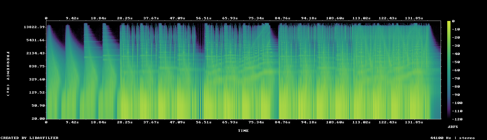

# MUS-11 — Losing the Tether

[Play original](<../../../assets/music/Losing_the_Tether.mp3>) · [Interactive guide](../index.html#MUS-11) · [Library](../README.md)

**Editorial direction:** An isolation-to-reveal sequence with a clear dramatic turn rather than continuous fast cuts.

Sparse attack candidates and a very large local level rise give a practical contrast point to audition. These are editing suggestions, not model-verified genre/instrument/mood descriptions.

**Search:** Story, Space, Reveal.

**Avoid / check:** The steadiest 30-second passage is still variable. Do not promise an even narration bed from the title alone.

**Vocals:** unverified. Audition the chosen range before using under speech; unverified does not mean instrumental.

**Motion references:** [REF-01](../../reference-library/studies/REF-01.md), [REF-14](../../reference-library/studies/REF-14.md), [REF-17](../../reference-library/studies/REF-17.md). These pair editing behaviours, not matching audio or shared authorship.

## Measured profile

| Field | Value |
| --- | --- |
| Duration | 2:21 (141.270s) |
| Original format | mp3 / 44100Hz / 2ch |
| Integrated level | -13.8 LUFS |
| Loudness range | 12.7 LU |
| Decoded true peak | 0 dBTP |
| Brightness, magnitude centroid | 683Hz |
| Side/mid ratio | -15.3dB |
| Stereo correlation | 0.942 |
| Spectral-flux attack candidates | 1.678/s |
| Pulse candidate, unvalidated | 72.1BPM / autocorrelation 0.395 |
| Decoded near/full-scale samples | 0 (threshold ±0.999) |

Pulse estimates may be half/double-time; **no approved beat grid**. Attack detections are not guaranteed musical beats or sound effects. All levels are original-source values, not delivery targets.

## Audition these ranges

Computed from one-second starts, not claimed phrase boundaries. “Least-variable” is relative to this track and need not be genuinely steady. The rise is last-three-second mean RMS minus first-three-second mean; change can be small even in the winning window. Entry/exit notes and harmonic resolution require listening.

| Candidate | Source range | Measured shape |
| --- | --- | --- |
| 12s level rise | **1:20–1:32** | 19.7dB change / 9.52dB variation / 1.833 attacks/s |
| 30s least-variable passage | **1:24–1:54** | -0.3dB change / 2.75dB variation / 2.367 attacks/s |
| 30s attack-dense passage | **1:23–1:53** | 0.1dB change / 2.76dB variation / 2.4 attacks/s |
| 60s least-variable passage | **0:21–1:21** | 8.3dB change / 4.66dB variation / 1.867 attacks/s |

## Full-track structure

Regular 15-second analysis blocks; **not** inferred intro/verse/chorus sections. RMS is an amplitude measure, not LUFS.

| Source range | Mean 1s RMS dBFS | Level variation, std dB | Attacks/s |
| --- | ---: | ---: | ---: |
| 0:00–0:15 | -27.8 | 3.4 | 0.00 |
| 0:15–0:30 | -23.0 | 6.5 | 0.47 |
| 0:30–0:45 | -15.0 | 3.7 | 2.07 |
| 0:45–1:00 | -14.2 | 2.7 | 2.00 |
| 1:00–1:15 | -14.8 | 3.5 | 2.07 |
| 1:15–1:30 | -17.1 | 8.7 | 2.00 |
| 1:30–1:45 | -13.4 | 2.5 | 2.33 |
| 1:45–2:00 | -13.9 | 3.2 | 2.47 |
| 2:00–2:15 | -13.8 | 2.3 | 2.27 |
| 2:15–2:21 | -38.7 | 15.1 | 0.32 |

## Source and evidence

Original name: `Losing_the_Tether.mp3`. SHA256: `0a1f3fb9187d04f38eebd3935b6e9ed0e417ba6dc7059f27a59d30d17646ef9f`. Source unchanged. [Raw analysis](../evidence/MUS-11/analysis.json), [probe/tags](../evidence/MUS-11/probe.json), [method](../PLAYBOOK.md). User-supplied; distribution rights not established. No human listening, semantic model or vocal-absence certification.
