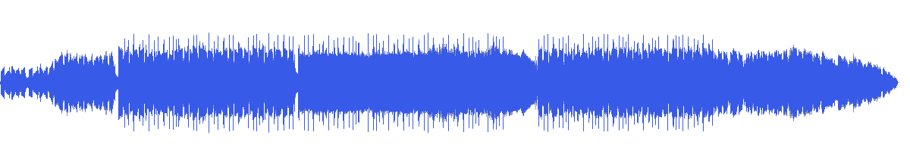
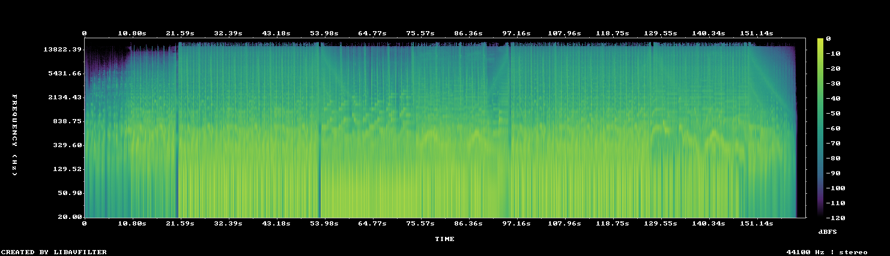

# MUS-12 — Midnight Curb Service

[Play original](<../../../assets/music/Midnight_Curb_Service.mp3>) · [Interactive guide](../index.html#MUS-12) · [Library](../README.md)

**Editorial direction:** A controlled editorial or lifestyle montage with readable captions.

Its least-variable passage is especially steady, allowing a test edit with longer holds and selective accents. These are editing suggestions, not model-verified genre/instrument/mood descriptions.

**Search:** Editorial, Portfolio, Background candidate.

**Avoid / check:** The night/lifestyle association is suggested by the name and editorial direction, not verified instrumentation. Vocals remain unverified.

**Vocals:** unverified. Audition the chosen range before using under speech; unverified does not mean instrumental.

**Motion references:** [REF-09](../../reference-library/studies/REF-09.md), [REF-15](../../reference-library/studies/REF-15.md), [REF-19](../../reference-library/studies/REF-19.md). These pair editing behaviours, not matching audio or shared authorship.

## Measured profile

| Field | Value |
| --- | --- |
| Duration | 2:41 (161.933s) |
| Original format | mp3 / 44100Hz / 2ch |
| Integrated level | -12.4 LUFS |
| Loudness range | 7.3 LU |
| Decoded true peak | 0.3 dBTP |
| Brightness, magnitude centroid | 1166Hz |
| Side/mid ratio | -11.1dB |
| Stereo correlation | 0.855 |
| Spectral-flux attack candidates | 2.872/s |
| Pulse candidate, unvalidated | 89.3BPM / autocorrelation 0.55 |
| Decoded near/full-scale samples | 53 (threshold ±0.999) |

Pulse estimates may be half/double-time; **no approved beat grid**. Attack detections are not guaranteed musical beats or sound effects. All levels are original-source values, not delivery targets.

## Audition these ranges

Computed from one-second starts, not claimed phrase boundaries. “Least-variable” is relative to this track and need not be genuinely steady. The rise is last-three-second mean RMS minus first-three-second mean; change can be small even in the winning window. Entry/exit notes and harmonic resolution require listening.

| Candidate | Source range | Measured shape |
| --- | --- | --- |
| 12s level rise | **0:05–0:17** | 10.2dB change / 4.85dB variation / 2.25 attacks/s |
| 30s least-variable passage | **1:36–2:06** | -0.3dB change / 0.59dB variation / 3.7 attacks/s |
| 30s attack-dense passage | **1:38–2:08** | -0.8dB change / 0.90dB variation / 3.8 attacks/s |
| 60s least-variable passage | **0:27–1:27** | 0.3dB change / 0.96dB variation / 3.033 attacks/s |

## Full-track structure

Regular 15-second analysis blocks; **not** inferred intro/verse/chorus sections. RMS is an amplitude measure, not LUFS.

| Source range | Mean 1s RMS dBFS | Level variation, std dB | Attacks/s |
| --- | ---: | ---: | ---: |
| 0:00–0:15 | -25.9 | 5.3 | 1.73 |
| 0:15–0:30 | -16.0 | 3.6 | 3.07 |
| 0:30–0:45 | -13.1 | 1.0 | 3.40 |
| 0:45–1:00 | -13.4 | 1.0 | 3.00 |
| 1:00–1:15 | -13.7 | 1.1 | 2.80 |
| 1:15–1:30 | -13.1 | 0.6 | 3.00 |
| 1:30–1:45 | -14.8 | 2.3 | 2.80 |
| 1:45–2:00 | -12.9 | 0.6 | 3.80 |
| 2:00–2:15 | -15.1 | 2.4 | 3.60 |
| 2:15–2:30 | -17.4 | 2.1 | 3.40 |
| 2:30–2:41 | -36.8 | 23.2 | 0.50 |

## Source and evidence

Original name: `Midnight_Curb_Service.mp3`. SHA256: `6cda127bd347119ac9e0080b88a638f29494429a64ebf923ea9f66919ebf1b8b`. Source unchanged. [Raw analysis](../evidence/MUS-12/analysis.json), [probe/tags](../evidence/MUS-12/probe.json), [method](../PLAYBOOK.md). User-supplied; distribution rights not established. No human listening, semantic model or vocal-absence certification.
