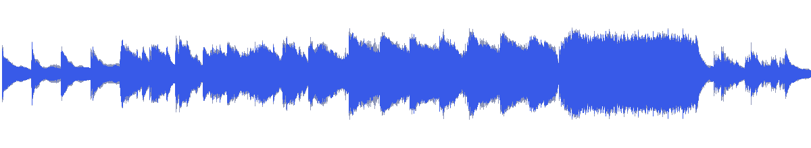
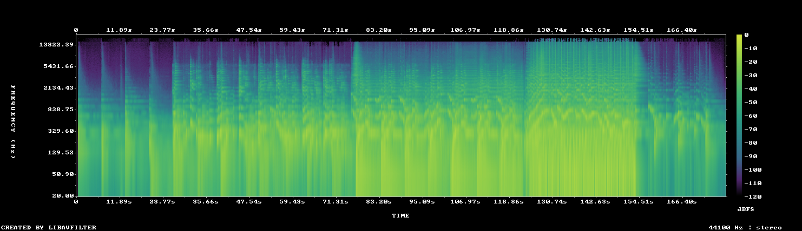

# MUS-13 — Morning on the Marble Floor

[Play original](<../../../assets/music/Morning_on_the_Marble_Floor.mp3>) · [Interactive guide](../index.html#MUS-13) · [Library](../README.md)

**Editorial direction:** An architectural or material film that opens gradually and expands into a full room or object.

Low attack density and subdued brightness coexist with a large 16LU range and a substantial early rise. These are editing suggestions, not model-verified genre/instrument/mood descriptions.

**Search:** Material, Editorial, Reveal.

**Avoid / check:** A quiet-sounding title does not make the complete source a flat morning ambience. Choose a bounded section for voiceover.

**Vocals:** unverified. Audition the chosen range before using under speech; unverified does not mean instrumental.

**Motion references:** [REF-09](../../reference-library/studies/REF-09.md), [REF-13](../../reference-library/studies/REF-13.md), [REF-17](../../reference-library/studies/REF-17.md). These pair editing behaviours, not matching audio or shared authorship.

## Measured profile

| Field | Value |
| --- | --- |
| Duration | 2:58 (178.286s) |
| Original format | mp3 / 44100Hz / 2ch |
| Integrated level | -11.2 LUFS |
| Loudness range | 16.2 LU |
| Decoded true peak | 0.4 dBTP |
| Brightness, magnitude centroid | 666Hz |
| Side/mid ratio | -6.6dB |
| Stereo correlation | 0.64 |
| Spectral-flux attack candidates | 1.84/s |
| Pulse candidate, unvalidated | 73.5BPM / autocorrelation 0.62 |
| Decoded near/full-scale samples | 284 (threshold ±0.999) |

Pulse estimates may be half/double-time; **no approved beat grid**. Attack detections are not guaranteed musical beats or sound effects. All levels are original-source values, not delivery targets.

## Audition these ranges

Computed from one-second starts, not claimed phrase boundaries. “Least-variable” is relative to this track and need not be genuinely steady. The rise is last-three-second mean RMS minus first-three-second mean; change can be small even in the winning window. Entry/exit notes and harmonic resolution require listening.

| Candidate | Source range | Measured shape |
| --- | --- | --- |
| 12s level rise | **0:23–0:35** | 17.2dB change / 7.48dB variation / 1.417 attacks/s |
| 30s least-variable passage | **2:04–2:34** | -3.2dB change / 1.14dB variation / 3.533 attacks/s |
| 30s attack-dense passage | **2:04–2:34** | -3.2dB change / 1.14dB variation / 3.533 attacks/s |
| 60s least-variable passage | **1:16–2:16** | 1.8dB change / 3.04dB variation / 2.367 attacks/s |

## Full-track structure

Regular 15-second analysis blocks; **not** inferred intro/verse/chorus sections. RMS is an amplitude measure, not LUFS.

| Source range | Mean 1s RMS dBFS | Level variation, std dB | Attacks/s |
| --- | ---: | ---: | ---: |
| 0:00–0:15 | -32.9 | 7.9 | 0.20 |
| 0:15–0:30 | -29.4 | 8.2 | 0.73 |
| 0:30–0:45 | -20.0 | 3.7 | 1.40 |
| 0:45–1:00 | -19.0 | 2.1 | 2.33 |
| 1:00–1:15 | -18.9 | 3.8 | 1.73 |
| 1:15–1:30 | -14.9 | 3.4 | 2.20 |
| 1:30–1:45 | -14.6 | 3.4 | 2.00 |
| 1:45–2:00 | -14.2 | 2.2 | 2.07 |
| 2:00–2:15 | -12.1 | 3.2 | 3.00 |
| 2:15–2:30 | -10.6 | 0.6 | 3.40 |
| 2:30–2:45 | -25.4 | 9.0 | 1.87 |
| 2:45–2:58 | -33.5 | 8.4 | 1.05 |

## Source and evidence

Original name: `Morning_on_the_Marble_Floor.mp3`. SHA256: `0598179b8bb580d4aade46125f0d45472ac607081ade0fedc61dea829c50aeb8`. Source unchanged. [Raw analysis](../evidence/MUS-13/analysis.json), [probe/tags](../evidence/MUS-13/probe.json), [method](../PLAYBOOK.md). User-supplied; distribution rights not established. No human listening, semantic model or vocal-absence certification.
