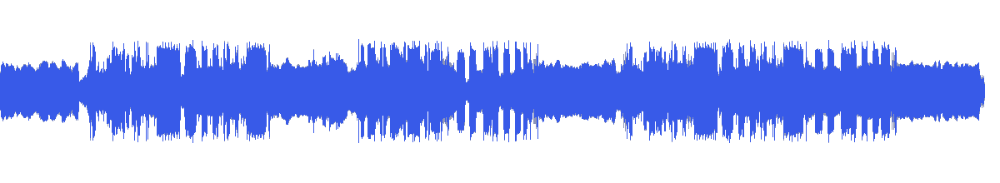
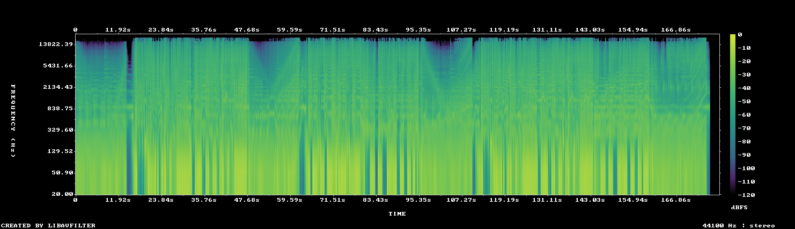

# MUS-14 — Point of Impact

[Play original](<../../../assets/music/Point_of_Impact.mp3>) · [Interactive guide](../index.html#MUS-14) · [Library](../README.md)

**Editorial direction:** A graphic reel or feature montage built around large type and decisive scene changes.

High relative brightness, a clear early rise and relatively strong pulse autocorrelation give accents to audition for a driven edit. These are editing suggestions, not model-verified genre/instrument/mood descriptions.

**Search:** Kinetic, Product, Technical.

**Avoid / check:** The pulse estimate is not an approved beat grid; a prior beat-grid check failed. Do not snap edits automatically.

**Vocals:** unverified. Audition the chosen range before using under speech; unverified does not mean instrumental.

**Previous context:** Used in the earlier 120-second realme extended edition, source 14–134s.

**Motion references:** [REF-05](../../reference-library/studies/REF-05.md), [REF-10](../../reference-library/studies/REF-10.md), [REF-20](../../reference-library/studies/REF-20.md). These pair editing behaviours, not matching audio or shared authorship.

## Measured profile

| Field | Value |
| --- | --- |
| Duration | 2:58 (178.782s) |
| Original format | mp3 / 44100Hz / 2ch |
| Integrated level | -13.1 LUFS |
| Loudness range | 8.7 LU |
| Decoded true peak | 2.2 dBTP |
| Brightness, magnitude centroid | 3056Hz |
| Side/mid ratio | -11.2dB |
| Stereo correlation | 0.86 |
| Spectral-flux attack candidates | 3.188/s |
| Pulse candidate, unvalidated | 121BPM / autocorrelation 0.717 |
| Decoded near/full-scale samples | 257 (threshold ±0.999) |

Pulse estimates may be half/double-time; **no approved beat grid**. Attack detections are not guaranteed musical beats or sound effects. All levels are original-source values, not delivery targets.

## Audition these ranges

Computed from one-second starts, not claimed phrase boundaries. “Least-variable” is relative to this track and need not be genuinely steady. The rise is last-three-second mean RMS minus first-three-second mean; change can be small even in the winning window. Entry/exit notes and harmonic resolution require listening.

| Candidate | Source range | Measured shape |
| --- | --- | --- |
| 12s level rise | **0:13–0:25** | 11.4dB change / 5.74dB variation / 2.833 attacks/s |
| 30s least-variable passage | **1:55–2:25** | -0.2dB change / 2.76dB variation / 4.267 attacks/s |
| 30s attack-dense passage | **1:49–2:19** | 6.8dB change / 3.74dB variation / 4.633 attacks/s |
| 60s least-variable passage | **1:51–2:51** | -4.5dB change / 3.55dB variation / 3.333 attacks/s |

## Full-track structure

Regular 15-second analysis blocks; **not** inferred intro/verse/chorus sections. RMS is an amplitude measure, not LUFS.

| Source range | Mean 1s RMS dBFS | Level variation, std dB | Attacks/s |
| --- | ---: | ---: | ---: |
| 0:00–0:15 | -21.2 | 2.7 | 0.87 |
| 0:15–0:30 | -15.6 | 4.4 | 3.60 |
| 0:30–0:45 | -14.0 | 3.2 | 4.67 |
| 0:45–1:00 | -17.3 | 3.4 | 1.87 |
| 1:00–1:15 | -14.5 | 4.6 | 4.80 |
| 1:15–1:30 | -15.1 | 3.6 | 4.40 |
| 1:30–1:45 | -17.6 | 3.6 | 2.93 |
| 1:45–2:00 | -17.3 | 3.9 | 3.93 |
| 2:00–2:15 | -13.4 | 3.1 | 4.73 |
| 2:15–2:30 | -14.5 | 3.1 | 3.33 |
| 2:30–2:45 | -15.3 | 3.5 | 2.33 |
| 2:45–2:58 | -32.5 | 32.3 | 0.58 |

## Source and evidence

Original name: `Point_of_Impact.mp3`. SHA256: `841cd9780861fed76a4af00ecaa3524ea5b99733f2066010d6cba0a5203a3f62`. Source unchanged. [Raw analysis](../evidence/MUS-14/analysis.json), [probe/tags](../evidence/MUS-14/probe.json), [method](../PLAYBOOK.md). User-supplied; distribution rights not established. No human listening, semantic model or vocal-absence certification.
