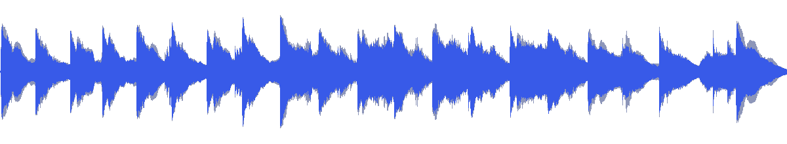
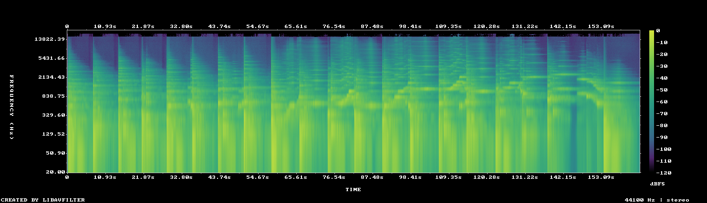

# MUS-15 — Slow Gravity

[Play original](<../../../assets/music/Slow_Gravity.mp3>) · [Interactive guide](../index.html#MUS-15) · [Library](../README.md)

**Editorial direction:** Continuous spatial travel and big changes of scale, timed to evolving phrases instead of a beat grid.

A wide image, large dynamic range and extremely weak pulse autocorrelation support testing a freer camera-led edit. These are editing suggestions, not model-verified genre/instrument/mood descriptions.

**Search:** Space, Environment, Story.

**Avoid / check:** The least-variable 30-second window is still highly variable. Not a first choice for an even background or rigid beat-synced kinetic reel.

**Vocals:** unverified. Audition the chosen range before using under speech; unverified does not mean instrumental.

**Motion references:** [REF-01](../../reference-library/studies/REF-01.md), [REF-04](../../reference-library/studies/REF-04.md), [REF-17](../../reference-library/studies/REF-17.md). These pair editing behaviours, not matching audio or shared authorship.

## Measured profile

| Field | Value |
| --- | --- |
| Duration | 2:44 (164.023s) |
| Original format | mp3 / 44100Hz / 2ch |
| Integrated level | -11.2 LUFS |
| Loudness range | 13.3 LU |
| Decoded true peak | 0.2 dBTP |
| Brightness, magnitude centroid | 828Hz |
| Side/mid ratio | -3.5dB |
| Stereo correlation | 0.386 |
| Spectral-flux attack candidates | 2.244/s |
| Pulse candidate, unvalidated | 117.2BPM / autocorrelation 0.099 |
| Decoded near/full-scale samples | 181 (threshold ±0.999) |

Pulse estimates may be half/double-time; **no approved beat grid**. Attack detections are not guaranteed musical beats or sound effects. All levels are original-source values, not delivery targets.

## Audition these ranges

Computed from one-second starts, not claimed phrase boundaries. “Least-variable” is relative to this track and need not be genuinely steady. The rise is last-three-second mean RMS minus first-three-second mean; change can be small even in the winning window. Entry/exit notes and harmonic resolution require listening.

| Candidate | Source range | Measured shape |
| --- | --- | --- |
| 12s level rise | **2:24–2:36** | 23.3dB change / 9.09dB variation / 2.25 attacks/s |
| 30s least-variable passage | **1:14–1:44** | -7.7dB change / 4.85dB variation / 3.133 attacks/s |
| 30s attack-dense passage | **1:30–2:00** | -7.6dB change / 5.23dB variation / 3.267 attacks/s |
| 60s least-variable passage | **1:00–2:00** | -3.0dB change / 5.23dB variation / 2.933 attacks/s |

## Full-track structure

Regular 15-second analysis blocks; **not** inferred intro/verse/chorus sections. RMS is an amplitude measure, not LUFS.

| Source range | Mean 1s RMS dBFS | Level variation, std dB | Attacks/s |
| --- | ---: | ---: | ---: |
| 0:00–0:15 | -21.3 | 8.5 | 1.67 |
| 0:15–0:30 | -19.7 | 7.2 | 1.67 |
| 0:30–0:45 | -21.6 | 8.3 | 2.00 |
| 0:45–1:00 | -19.7 | 8.2 | 2.27 |
| 1:00–1:15 | -19.6 | 4.8 | 2.47 |
| 1:15–1:30 | -17.6 | 5.3 | 2.73 |
| 1:30–1:45 | -17.8 | 5.1 | 3.40 |
| 1:45–2:00 | -17.4 | 5.3 | 3.13 |
| 2:00–2:15 | -21.5 | 5.2 | 2.27 |
| 2:15–2:30 | -27.5 | 8.2 | 1.33 |
| 2:30–2:44 | -24.9 | 11.7 | 1.71 |

## Source and evidence

Original name: `Slow_Gravity.mp3`. SHA256: `e4c488a3628d9aedea4491b5d37e39fef5e26199440be55e8acb585c5373d6df`. Source unchanged. [Raw analysis](../evidence/MUS-15/analysis.json), [probe/tags](../evidence/MUS-15/probe.json), [method](../PLAYBOOK.md). User-supplied; distribution rights not established. No human listening, semantic model or vocal-absence certification.
