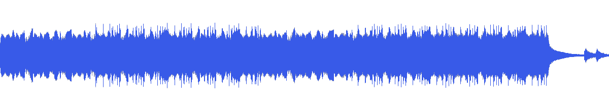
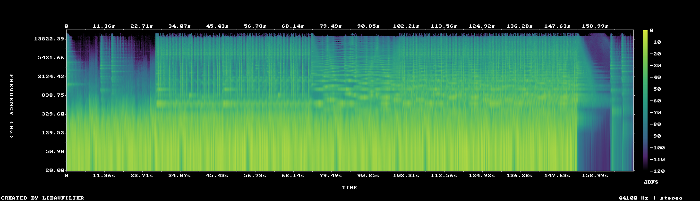

# MUS-16 — Slow Unraveling

[Play original](<../../../assets/music/Slow_Unraveling.mp3>) · [Interactive guide](../index.html#MUS-16) · [Library](../README.md)

**Editorial direction:** A more even process film, reflective editorial sequence or restrained background candidate.

The smallest full-track loudness range in the folder and subdued brightness make it worth auditioning when consistent levels matter. These are editing suggestions, not model-verified genre/instrument/mood descriptions.

**Search:** Restrained, Background candidate, Editorial.

**Avoid / check:** An even level is not evidence of instrumental content or voiceover intelligibility. Do not expect a huge climax without checking a section.

**Vocals:** unverified. Audition the chosen range before using under speech; unverified does not mean instrumental.

**Motion references:** [REF-12](../../reference-library/studies/REF-12.md), [REF-16](../../reference-library/studies/REF-16.md), [REF-21](../../reference-library/studies/REF-21.md). These pair editing behaviours, not matching audio or shared authorship.

## Measured profile

| Field | Value |
| --- | --- |
| Duration | 2:50 (170.345s) |
| Original format | mp3 / 44100Hz / 2ch |
| Integrated level | -13.4 LUFS |
| Loudness range | 4.3 LU |
| Decoded true peak | 0.2 dBTP |
| Brightness, magnitude centroid | 892Hz |
| Side/mid ratio | -12.6dB |
| Stereo correlation | 0.895 |
| Spectral-flux attack candidates | 2.207/s |
| Pulse candidate, unvalidated | 96.2BPM / autocorrelation 0.608 |
| Decoded near/full-scale samples | 11 (threshold ±0.999) |

Pulse estimates may be half/double-time; **no approved beat grid**. Attack detections are not guaranteed musical beats or sound effects. All levels are original-source values, not delivery targets.

## Audition these ranges

Computed from one-second starts, not claimed phrase boundaries. “Least-variable” is relative to this track and need not be genuinely steady. The rise is last-three-second mean RMS minus first-three-second mean; change can be small even in the winning window. Entry/exit notes and harmonic resolution require listening.

| Candidate | Source range | Measured shape |
| --- | --- | --- |
| 12s level rise | **0:21–0:33** | 3.3dB change / 1.63dB variation / 2 attacks/s |
| 30s least-variable passage | **1:13–1:43** | 2.4dB change / 1.44dB variation / 0.533 attacks/s |
| 30s attack-dense passage | **2:03–2:33** | 0.4dB change / 1.55dB variation / 4.167 attacks/s |
| 60s least-variable passage | **1:32–2:32** | 1.0dB change / 1.76dB variation / 3.417 attacks/s |

## Full-track structure

Regular 15-second analysis blocks; **not** inferred intro/verse/chorus sections. RMS is an amplitude measure, not LUFS.

| Source range | Mean 1s RMS dBFS | Level variation, std dB | Attacks/s |
| --- | ---: | ---: | ---: |
| 0:00–0:15 | -16.3 | 1.6 | 0.33 |
| 0:15–0:30 | -15.4 | 1.6 | 0.93 |
| 0:30–0:45 | -13.8 | 1.9 | 3.07 |
| 0:45–1:00 | -13.7 | 1.8 | 3.53 |
| 1:00–1:15 | -14.1 | 2.0 | 3.07 |
| 1:15–1:30 | -15.7 | 1.3 | 0.07 |
| 1:30–1:45 | -15.1 | 1.8 | 1.40 |
| 1:45–2:00 | -13.6 | 1.8 | 3.60 |
| 2:00–2:15 | -13.7 | 1.6 | 3.93 |
| 2:15–2:30 | -13.6 | 1.6 | 4.20 |
| 2:30–2:45 | -42.2 | 19.2 | 0.93 |
| 2:45–2:50 | -51.3 | 7.6 | 0.00 |

## Source and evidence

Original name: `Slow_Unraveling.mp3`. SHA256: `9af882a62f92671475edec262a77a02f28c2dd1d4f3eec13bb21243ce4c4d5c2`. Source unchanged. [Raw analysis](../evidence/MUS-16/analysis.json), [probe/tags](../evidence/MUS-16/probe.json), [method](../PLAYBOOK.md). User-supplied; distribution rights not established. No human listening, semantic model or vocal-absence certification.
