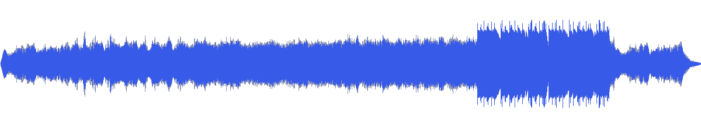
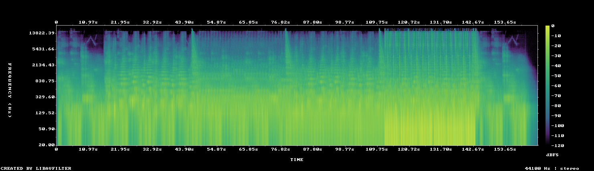

# MUS-17 — Steel In The Deep

[Play original](<../../../assets/music/Steel_In_The_Deep.mp3>) · [Interactive guide](../index.html#MUS-17) · [Library](../README.md)

**Editorial direction:** A structural or engineering story that moves between detail and scale.

Restrained spectral brightness, a large loudness range and a stable middle section provide two different editorial modes. These are editing suggestions, not model-verified genre/instrument/mood descriptions.

**Search:** Industrial, Technical, Reveal.

**Avoid / check:** Not literal underwater or metal sound evidence. Keep mechanism SFX separate and leave their transients space.

**Vocals:** unverified. Audition the chosen range before using under speech; unverified does not mean instrumental.

**Motion references:** [REF-01](../../reference-library/studies/REF-01.md), [REF-09](../../reference-library/studies/REF-09.md), [REF-10](../../reference-library/studies/REF-10.md). These pair editing behaviours, not matching audio or shared authorship.

## Measured profile

| Field | Value |
| --- | --- |
| Duration | 2:44 (164.624s) |
| Original format | mp3 / 44100Hz / 2ch |
| Integrated level | -13.4 LUFS |
| Loudness range | 12.1 LU |
| Decoded true peak | 0.4 dBTP |
| Brightness, magnitude centroid | 616Hz |
| Side/mid ratio | -8.7dB |
| Stereo correlation | 0.763 |
| Spectral-flux attack candidates | 2.017/s |
| Pulse candidate, unvalidated | 79.8BPM / autocorrelation 0.514 |
| Decoded near/full-scale samples | 123 (threshold ±0.999) |

Pulse estimates may be half/double-time; **no approved beat grid**. Attack detections are not guaranteed musical beats or sound effects. All levels are original-source values, not delivery targets.

## Audition these ranges

Computed from one-second starts, not claimed phrase boundaries. “Least-variable” is relative to this track and need not be genuinely steady. The rise is last-three-second mean RMS minus first-three-second mean; change can be small even in the winning window. Entry/exit notes and harmonic resolution require listening.

| Candidate | Source range | Measured shape |
| --- | --- | --- |
| 12s level rise | **1:48–2:00** | 8.4dB change / 4.00dB variation / 3.167 attacks/s |
| 30s least-variable passage | **1:22–1:52** | -0.0dB change / 0.88dB variation / 3.067 attacks/s |
| 30s attack-dense passage | **1:54–2:24** | -2.3dB change / 1.50dB variation / 3.533 attacks/s |
| 60s least-variable passage | **0:21–1:21** | 1.2dB change / 1.37dB variation / 1.967 attacks/s |

## Full-track structure

Regular 15-second analysis blocks; **not** inferred intro/verse/chorus sections. RMS is an amplitude measure, not LUFS.

| Source range | Mean 1s RMS dBFS | Level variation, std dB | Attacks/s |
| --- | ---: | ---: | ---: |
| 0:00–0:15 | -26.2 | 2.8 | 0.00 |
| 0:15–0:30 | -20.3 | 2.2 | 0.40 |
| 0:30–0:45 | -20.6 | 1.5 | 0.53 |
| 0:45–1:00 | -19.6 | 1.0 | 2.73 |
| 1:00–1:15 | -19.3 | 0.9 | 3.07 |
| 1:15–1:30 | -18.0 | 1.2 | 3.27 |
| 1:30–1:45 | -17.2 | 1.0 | 3.27 |
| 1:45–2:00 | -12.8 | 4.1 | 3.00 |
| 2:00–2:15 | -9.1 | 1.0 | 3.40 |
| 2:15–2:30 | -16.3 | 8.6 | 2.40 |
| 2:30–2:44 | -30.4 | 11.3 | 0.07 |

## Source and evidence

Original name: `Steel_In_The_Deep.mp3`. SHA256: `677cb9ce3375e191a0c5ea88242528f3afaffea2fabe68557e26883aef994db7`. Source unchanged. [Raw analysis](../evidence/MUS-17/analysis.json), [probe/tags](../evidence/MUS-17/probe.json), [method](../PLAYBOOK.md). User-supplied; distribution rights not established. No human listening, semantic model or vocal-absence certification.
