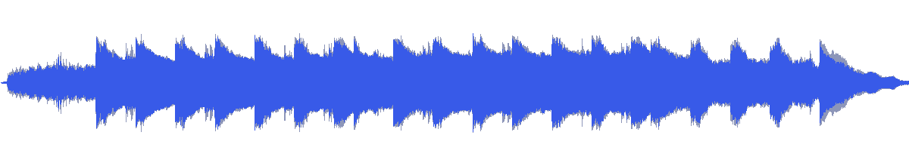
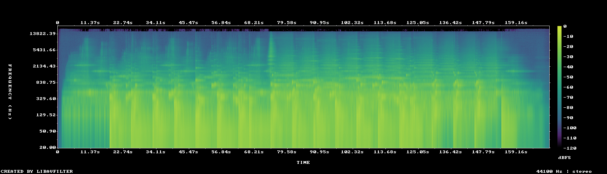

# MUS-18 — Stillness of the Outer Rim

[Play original](<../../../assets/music/Stillness_of_the_Outer_Rim.mp3>) · [Interactive guide](../index.html#MUS-18) · [Library](../README.md)

**Editorial direction:** A space chapter with an expanding particle field or an environment reveal.

A wide stereo image, low brightness and substantial early level growth suggest long movement followed by an opening-out gesture. These are editing suggestions, not model-verified genre/instrument/mood descriptions.

**Search:** Space, Environment, Reveal.

**Avoid / check:** Not a consistently silent bed; the full source spans almost 12LU. Treat particle hits selectively.

**Vocals:** unverified. Audition the chosen range before using under speech; unverified does not mean instrumental.

**Motion references:** [REF-01](../../reference-library/studies/REF-01.md), [REF-17](../../reference-library/studies/REF-17.md), [REF-18](../../reference-library/studies/REF-18.md). These pair editing behaviours, not matching audio or shared authorship.

## Measured profile

| Field | Value |
| --- | --- |
| Duration | 2:50 (170.527s) |
| Original format | mp3 / 44100Hz / 2ch |
| Integrated level | -11.8 LUFS |
| Loudness range | 11.8 LU |
| Decoded true peak | 0 dBTP |
| Brightness, magnitude centroid | 629Hz |
| Side/mid ratio | -4dB |
| Stereo correlation | 0.433 |
| Spectral-flux attack candidates | 2.686/s |
| Pulse candidate, unvalidated | 64.7BPM / autocorrelation 0.375 |
| Decoded near/full-scale samples | 0 (threshold ±0.999) |

Pulse estimates may be half/double-time; **no approved beat grid**. Attack detections are not guaranteed musical beats or sound effects. All levels are original-source values, not delivery targets.

## Audition these ranges

Computed from one-second starts, not claimed phrase boundaries. “Least-variable” is relative to this track and need not be genuinely steady. The rise is last-three-second mean RMS minus first-three-second mean; change can be small even in the winning window. Entry/exit notes and harmonic resolution require listening.

| Candidate | Source range | Measured shape |
| --- | --- | --- |
| 12s level rise | **0:15–0:27** | 13.5dB change / 6.01dB variation / 2.583 attacks/s |
| 30s least-variable passage | **1:37–2:07** | -2.0dB change / 2.32dB variation / 3.333 attacks/s |
| 30s attack-dense passage | **1:28–1:58** | -4.3dB change / 2.39dB variation / 3.5 attacks/s |
| 60s least-variable passage | **1:05–2:05** | 0.9dB change / 2.41dB variation / 3.317 attacks/s |

## Full-track structure

Regular 15-second analysis blocks; **not** inferred intro/verse/chorus sections. RMS is an amplitude measure, not LUFS.

| Source range | Mean 1s RMS dBFS | Level variation, std dB | Attacks/s |
| --- | ---: | ---: | ---: |
| 0:00–0:15 | -33.1 | 12.1 | 0.67 |
| 0:15–0:30 | -17.9 | 5.5 | 2.87 |
| 0:30–0:45 | -15.7 | 2.7 | 3.00 |
| 0:45–1:00 | -15.6 | 3.1 | 2.93 |
| 1:00–1:15 | -15.3 | 2.6 | 3.07 |
| 1:15–1:30 | -15.2 | 2.3 | 3.33 |
| 1:30–1:45 | -14.6 | 2.7 | 3.47 |
| 1:45–2:00 | -14.7 | 2.2 | 3.47 |
| 2:00–2:15 | -16.7 | 3.8 | 3.20 |
| 2:15–2:30 | -19.3 | 4.3 | 3.07 |
| 2:30–2:45 | -26.4 | 7.9 | 1.47 |
| 2:45–2:50 | -49.8 | 6.6 | 0.00 |

## Source and evidence

Original name: `Stillness_of_the_Outer_Rim.mp3`. SHA256: `28e6040d27d98a1106577b43a8add295c9561c44b3ced6f1629551b8c2cfad86`. Source unchanged. [Raw analysis](../evidence/MUS-18/analysis.json), [probe/tags](../evidence/MUS-18/probe.json), [method](../PLAYBOOK.md). User-supplied; distribution rights not established. No human listening, semantic model or vocal-absence certification.
