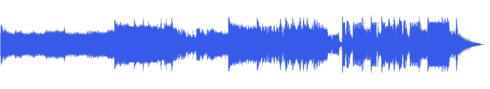
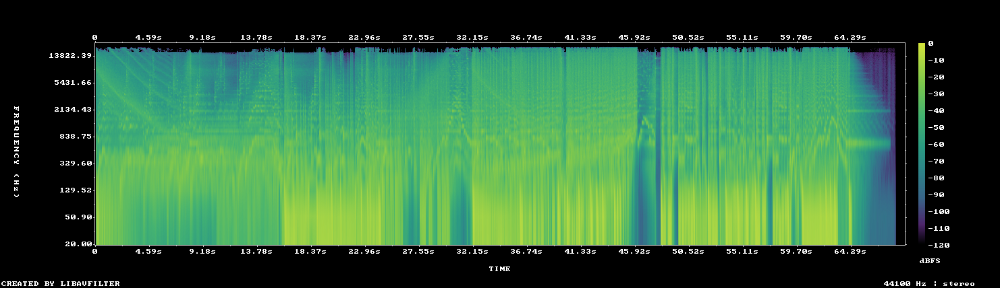

# MUS-19 — Tactile Precision

[Play original](<../../../assets/music/Tactile_Precision.mp3>) · [Interactive guide](../index.html#MUS-19) · [Library](../README.md)

**Editorial direction:** A concise interface, craft-process or detailed product sequence.

High relative spectral brightness and a pronounced early rise offer positions for small graphic actions and a reveal. These are editing suggestions, not model-verified genre/instrument/mood descriptions.

**Search:** Product, Technical, Short film.

**Avoid / check:** The title does not prove that it is quiet click music. Its steadiest window is not especially even, and it lasts only about 69 seconds.

**Vocals:** unverified. Audition the chosen range before using under speech; unverified does not mean instrumental.

**Motion references:** [REF-02](../../reference-library/studies/REF-02.md), [REF-12](../../reference-library/studies/REF-12.md), [REF-21](../../reference-library/studies/REF-21.md). These pair editing behaviours, not matching audio or shared authorship.

## Measured profile

| Field | Value |
| --- | --- |
| Duration | 1:08 (68.885s) |
| Original format | mp3 / 44100Hz / 2ch |
| Integrated level | -12.7 LUFS |
| Loudness range | 8.4 LU |
| Decoded true peak | 2 dBTP |
| Brightness, magnitude centroid | 3181Hz |
| Side/mid ratio | -10.5dB |
| Stereo correlation | 0.838 |
| Spectral-flux attack candidates | 2.57/s |
| Pulse candidate, unvalidated | 60.5BPM / autocorrelation 0.606 |
| Decoded near/full-scale samples | 313 (threshold ±0.999) |

**Duration limit:** cannot supply an uninterrupted two-minute film. A loop/arrangement would be a separate editing choice.

Pulse estimates may be half/double-time; **no approved beat grid**. Attack detections are not guaranteed musical beats or sound effects. All levels are original-source values, not delivery targets.

## Audition these ranges

Computed from one-second starts, not claimed phrase boundaries. “Least-variable” is relative to this track and need not be genuinely steady. The rise is last-three-second mean RMS minus first-three-second mean; change can be small even in the winning window. Entry/exit notes and harmonic resolution require listening.

| Candidate | Source range | Measured shape |
| --- | --- | --- |
| 12s level rise | **0:09–0:21** | 11.1dB change / 5.06dB variation / 2.083 attacks/s |
| 30s least-variable passage | **0:16–0:46** | -0.5dB change / 3.60dB variation / 3.233 attacks/s |
| 30s attack-dense passage | **0:16–0:46** | -0.5dB change / 3.60dB variation / 3.233 attacks/s |
| 60s least-variable passage | **0:05–1:05** | 8.5dB change / 4.74dB variation / 2.8 attacks/s |

## Full-track structure

Regular 15-second analysis blocks; **not** inferred intro/verse/chorus sections. RMS is an amplitude measure, not LUFS.

| Source range | Mean 1s RMS dBFS | Level variation, std dB | Attacks/s |
| --- | ---: | ---: | ---: |
| 0:00–0:15 | -22.4 | 1.9 | 1.60 |
| 0:15–0:30 | -15.9 | 3.9 | 3.33 |
| 0:30–0:45 | -14.2 | 3.3 | 3.07 |
| 0:45–1:00 | -14.7 | 4.6 | 2.87 |
| 1:00–1:08 | -27.1 | 20.3 | 1.58 |

## Source and evidence

Original name: `Tactile_Precision.mp3`. SHA256: `cea4ceeb7c9cb64ac8cec54bc32239f768b1f4f86df8e2d9e2e622ca5eb20c12`. Source unchanged. [Raw analysis](../evidence/MUS-19/analysis.json), [probe/tags](../evidence/MUS-19/probe.json), [method](../PLAYBOOK.md). User-supplied; distribution rights not established. No human listening, semantic model or vocal-absence certification.
