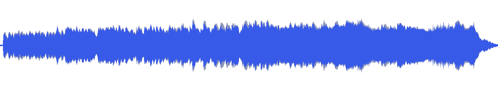
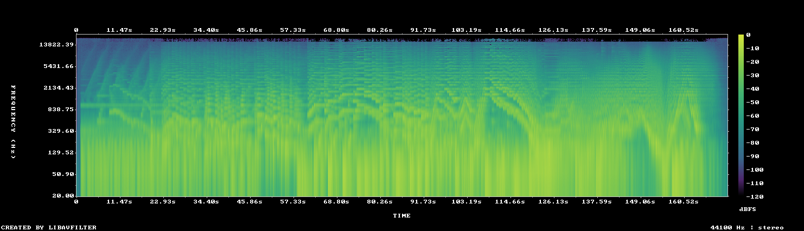

# MUS-20 — The Coldest Reach

[Play original](<../../../assets/music/The_Coldest_Reach.mp3>) · [Interactive guide](../index.html#MUS-20) · [Library](../README.md)

**Editorial direction:** A space/product hybrid with readable detail sections and a broader feature reveal.

Moderate brightness and a broad dynamic range support alternation between restrained detail and larger movement. These are editing suggestions, not model-verified genre/instrument/mood descriptions.

**Search:** Space, Product, Portfolio.

**Avoid / check:** Keep narration tests section-specific; neither the title nor the meter establishes lack of vocals.

**Vocals:** unverified. Audition the chosen range before using under speech; unverified does not mean instrumental.

**Previous context:** User-selected for the yellow realme reveal revision, source 18–138s, before Architects of Motion.

**Motion references:** [REF-09](../../reference-library/studies/REF-09.md), [REF-17](../../reference-library/studies/REF-17.md), [REF-18](../../reference-library/studies/REF-18.md). These pair editing behaviours, not matching audio or shared authorship.

## Measured profile

| Field | Value |
| --- | --- |
| Duration | 2:51 (171.990s) |
| Original format | mp3 / 44100Hz / 2ch |
| Integrated level | -12 LUFS |
| Loudness range | 10.3 LU |
| Decoded true peak | -0.1 dBTP |
| Brightness, magnitude centroid | 1175Hz |
| Side/mid ratio | -7.2dB |
| Stereo correlation | 0.684 |
| Spectral-flux attack candidates | 2.837/s |
| Pulse candidate, unvalidated | 61.5BPM / autocorrelation 0.316 |
| Decoded near/full-scale samples | 0 (threshold ±0.999) |

Pulse estimates may be half/double-time; **no approved beat grid**. Attack detections are not guaranteed musical beats or sound effects. All levels are original-source values, not delivery targets.

## Audition these ranges

Computed from one-second starts, not claimed phrase boundaries. “Least-variable” is relative to this track and need not be genuinely steady. The rise is last-three-second mean RMS minus first-three-second mean; change can be small even in the winning window. Entry/exit notes and harmonic resolution require listening.

| Candidate | Source range | Measured shape |
| --- | --- | --- |
| 12s level rise | **0:14–0:26** | 5.8dB change / 2.59dB variation / 1.75 attacks/s |
| 30s least-variable passage | **1:29–1:59** | -0.5dB change / 1.35dB variation / 3.533 attacks/s |
| 30s attack-dense passage | **1:50–2:20** | 0.4dB change / 2.08dB variation / 3.933 attacks/s |
| 60s least-variable passage | **0:58–1:58** | 2.9dB change / 1.77dB variation / 3.2 attacks/s |

## Full-track structure

Regular 15-second analysis blocks; **not** inferred intro/verse/chorus sections. RMS is an amplitude measure, not LUFS.

| Source range | Mean 1s RMS dBFS | Level variation, std dB | Attacks/s |
| --- | ---: | ---: | ---: |
| 0:00–0:15 | -25.5 | 11.6 | 0.67 |
| 0:15–0:30 | -18.9 | 2.5 | 1.87 |
| 0:30–0:45 | -17.1 | 2.0 | 2.87 |
| 0:45–1:00 | -17.0 | 1.9 | 2.73 |
| 1:00–1:15 | -15.0 | 1.9 | 3.00 |
| 1:15–1:30 | -13.7 | 1.8 | 2.93 |
| 1:30–1:45 | -13.4 | 1.4 | 3.53 |
| 1:45–2:00 | -13.4 | 1.5 | 3.67 |
| 2:00–2:15 | -13.6 | 2.4 | 3.87 |
| 2:15–2:30 | -15.8 | 1.9 | 3.73 |
| 2:30–2:45 | -14.5 | 2.1 | 3.60 |
| 2:45–2:51 | -38.3 | 7.7 | 0.14 |

## Source and evidence

Original name: `The_Coldest_Reach.mp3`. SHA256: `599a420ba422ea3b21ebfd9328a82c97e35cc0f00dc22713a5d4811315dff73f`. Source unchanged. [Raw analysis](../evidence/MUS-20/analysis.json), [probe/tags](../evidence/MUS-20/probe.json), [method](../PLAYBOOK.md). User-supplied; distribution rights not established. No human listening, semantic model or vocal-absence certification.
