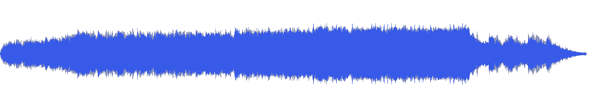
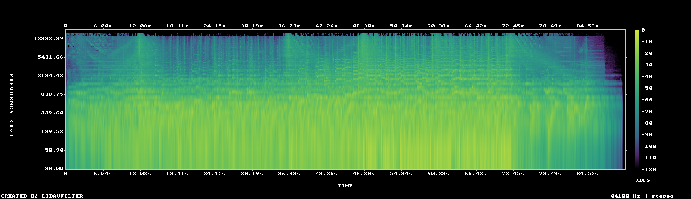

# MUS-21 — The Golden Hour Rise

[Play original](<../../../assets/music/The_Golden_Hour_Rise.mp3>) · [Interactive guide](../index.html#MUS-21) · [Library](../README.md)

**Editorial direction:** A portfolio lift, opening title or closing reveal with a readable middle passage.

The early measured rise contrasts with a stable middle window; the relatively wide image can support a larger closing composition. These are editing suggestions, not model-verified genre/instrument/mood descriptions.

**Search:** Portfolio, Reveal, Short film.

**Avoid / check:** The name alone does not verify a warm or celebratory mood. About 91 seconds total, so it cannot fill two minutes unchanged.

**Vocals:** unverified. Audition the chosen range before using under speech; unverified does not mean instrumental.

**Previous context:** Previously accepted by the user as a possible showcase track.

**Motion references:** [REF-04](../../reference-library/studies/REF-04.md), [REF-15](../../reference-library/studies/REF-15.md), [REF-19](../../reference-library/studies/REF-19.md). These pair editing behaviours, not matching audio or shared authorship.

## Measured profile

| Field | Value |
| --- | --- |
| Duration | 1:30 (90.567s) |
| Original format | mp3 / 44100Hz / 2ch |
| Integrated level | -11.7 LUFS |
| Loudness range | 10.5 LU |
| Decoded true peak | 0.3 dBTP |
| Brightness, magnitude centroid | 1270Hz |
| Side/mid ratio | -5.4dB |
| Stereo correlation | 0.557 |
| Spectral-flux attack candidates | 3.169/s |
| Pulse candidate, unvalidated | 79.8BPM / autocorrelation 0.567 |
| Decoded near/full-scale samples | 15 (threshold ±0.999) |

**Duration limit:** cannot supply an uninterrupted two-minute film. A loop/arrangement would be a separate editing choice.

Pulse estimates may be half/double-time; **no approved beat grid**. Attack detections are not guaranteed musical beats or sound effects. All levels are original-source values, not delivery targets.

## Audition these ranges

Computed from one-second starts, not claimed phrase boundaries. “Least-variable” is relative to this track and need not be genuinely steady. The rise is last-three-second mean RMS minus first-three-second mean; change can be small even in the winning window. Entry/exit notes and harmonic resolution require listening.

| Candidate | Source range | Measured shape |
| --- | --- | --- |
| 12s level rise | **0:02–0:14** | 10.8dB change / 4.14dB variation / 1.583 attacks/s |
| 30s least-variable passage | **0:42–1:12** | 2.5dB change / 0.97dB variation / 4.067 attacks/s |
| 30s attack-dense passage | **0:25–0:55** | 4.5dB change / 1.96dB variation / 4.233 attacks/s |
| 60s least-variable passage | **0:11–1:11** | 4.6dB change / 2.21dB variation / 4.05 attacks/s |

## Full-track structure

Regular 15-second analysis blocks; **not** inferred intro/verse/chorus sections. RMS is an amplitude measure, not LUFS.

| Source range | Mean 1s RMS dBFS | Level variation, std dB | Attacks/s |
| --- | ---: | ---: | ---: |
| 0:00–0:15 | -23.3 | 5.1 | 1.53 |
| 0:15–0:30 | -16.8 | 0.8 | 4.20 |
| 0:30–0:45 | -15.3 | 1.4 | 4.20 |
| 0:45–1:00 | -12.4 | 1.0 | 3.87 |
| 1:00–1:15 | -14.1 | 4.4 | 3.93 |
| 1:15–1:30 | -31.0 | 13.2 | 1.40 |

## Source and evidence

Original name: `The_Golden_Hour_Rise.mp3`. SHA256: `871fb37c11f988c4c0274bfa90760e0bdc99ac01860e6b467ec0d1cad565fa78`. Source unchanged. [Raw analysis](../evidence/MUS-21/analysis.json), [probe/tags](../evidence/MUS-21/probe.json), [method](../PLAYBOOK.md). User-supplied; distribution rights not established. No human listening, semantic model or vocal-absence certification.
