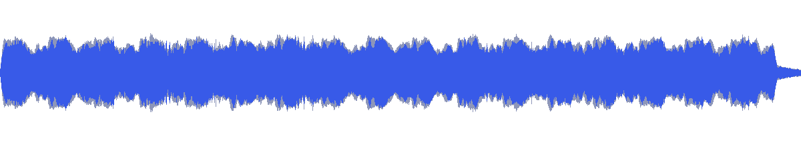
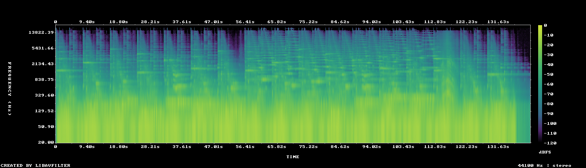

# MUS-22 — The Slowest Orbit

[Play original](<../../../assets/music/The_Slowest_Orbit.mp3>) · [Interactive guide](../index.html#MUS-22) · [Library](../README.md)

**Editorial direction:** A restrained orbit, slow product rotation or low-key spatial sequence.

Lowest full-track LUFS and spectral brightness in the collection, plus a comparatively small dynamic range. These are editing suggestions, not model-verified genre/instrument/mood descriptions.

**Search:** Space, Restrained, Background candidate.

**Avoid / check:** Slow in the title is not a verified tempo. Dense micro-attacks can coexist with low brightness; do not mistake every detection for a cut cue.

**Vocals:** unverified. Audition the chosen range before using under speech; unverified does not mean instrumental.

**Motion references:** [REF-01](../../reference-library/studies/REF-01.md), [REF-17](../../reference-library/studies/REF-17.md), [REF-18](../../reference-library/studies/REF-18.md). These pair editing behaviours, not matching audio or shared authorship.

## Measured profile

| Field | Value |
| --- | --- |
| Duration | 2:21 (141.035s) |
| Original format | mp3 / 44100Hz / 2ch |
| Integrated level | -14.6 LUFS |
| Loudness range | 5.1 LU |
| Decoded true peak | -0.9 dBTP |
| Brightness, magnitude centroid | 416Hz |
| Side/mid ratio | -7.5dB |
| Stereo correlation | 0.697 |
| Spectral-flux attack candidates | 3.021/s |
| Pulse candidate, unvalidated | 60.5BPM / autocorrelation 0.456 |
| Decoded near/full-scale samples | 0 (threshold ±0.999) |

Pulse estimates may be half/double-time; **no approved beat grid**. Attack detections are not guaranteed musical beats or sound effects. All levels are original-source values, not delivery targets.

## Audition these ranges

Computed from one-second starts, not claimed phrase boundaries. “Least-variable” is relative to this track and need not be genuinely steady. The rise is last-three-second mean RMS minus first-three-second mean; change can be small even in the winning window. Entry/exit notes and harmonic resolution require listening.

| Candidate | Source range | Measured shape |
| --- | --- | --- |
| 12s level rise | **0:05–0:17** | 2.9dB change / 3.15dB variation / 3.167 attacks/s |
| 30s least-variable passage | **0:28–0:58** | 1.8dB change / 1.70dB variation / 3.533 attacks/s |
| 30s attack-dense passage | **0:25–0:55** | -3.0dB change / 1.81dB variation / 3.567 attacks/s |
| 60s least-variable passage | **0:06–1:06** | 1.4dB change / 2.24dB variation / 3.267 attacks/s |

## Full-track structure

Regular 15-second analysis blocks; **not** inferred intro/verse/chorus sections. RMS is an amplitude measure, not LUFS.

| Source range | Mean 1s RMS dBFS | Level variation, std dB | Attacks/s |
| --- | ---: | ---: | ---: |
| 0:00–0:15 | -15.9 | 3.1 | 3.00 |
| 0:15–0:30 | -15.2 | 2.0 | 3.00 |
| 0:30–0:45 | -14.9 | 1.6 | 3.80 |
| 0:45–1:00 | -14.5 | 1.9 | 3.20 |
| 1:00–1:15 | -16.2 | 3.1 | 2.93 |
| 1:15–1:30 | -16.0 | 2.6 | 2.93 |
| 1:30–1:45 | -15.5 | 2.1 | 3.20 |
| 1:45–2:00 | -15.4 | 2.4 | 3.27 |
| 2:00–2:15 | -15.2 | 2.5 | 2.87 |
| 2:15–2:21 | -37.0 | 13.8 | 0.50 |

## Source and evidence

Original name: `The_Slowest_Orbit.mp3`. SHA256: `f1b3006bf9527ac37518510bf40733e34fa5e1aaafa816a6995928f869bec327`. Source unchanged. [Raw analysis](../evidence/MUS-22/analysis.json), [probe/tags](../evidence/MUS-22/probe.json), [method](../PLAYBOOK.md). User-supplied; distribution rights not established. No human listening, semantic model or vocal-absence certification.
