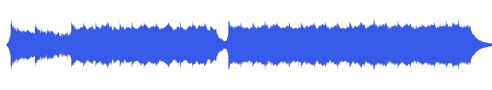
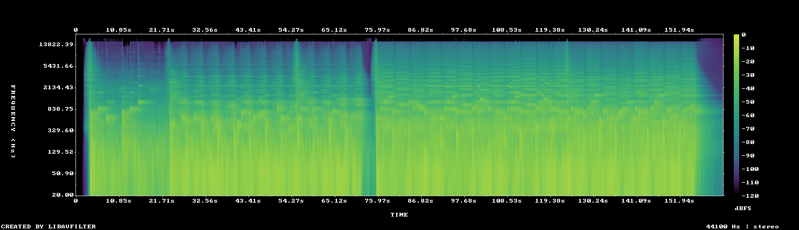

# MUS-23 — The Weight of Starlight

[Play original](<../../../assets/music/The_Weight_of_Starlight.mp3>) · [Interactive guide](../index.html#MUS-23) · [Library](../README.md)

**Editorial direction:** An initially controlled space/material chapter with an abrupt expansion later in the source.

Modest full-file loudness range conceals a very large local rise; that local contrast is more useful than the title for an edit. These are editing suggestions, not model-verified genre/instrument/mood descriptions.

**Search:** Space, Material, Reveal.

**Avoid / check:** Do not assume the middle is uniformly quiet. Audition the later rise before choosing a long passage.

**Vocals:** unverified. Audition the chosen range before using under speech; unverified does not mean instrumental.

**Motion references:** [REF-09](../../reference-library/studies/REF-09.md), [REF-17](../../reference-library/studies/REF-17.md), [REF-18](../../reference-library/studies/REF-18.md). These pair editing behaviours, not matching audio or shared authorship.

## Measured profile

| Field | Value |
| --- | --- |
| Duration | 2:42 (162.795s) |
| Original format | mp3 / 44100Hz / 2ch |
| Integrated level | -12.7 LUFS |
| Loudness range | 6.2 LU |
| Decoded true peak | 0 dBTP |
| Brightness, magnitude centroid | 767Hz |
| Side/mid ratio | -5.8dB |
| Stereo correlation | 0.586 |
| Spectral-flux attack candidates | 2.881/s |
| Pulse candidate, unvalidated | 60.5BPM / autocorrelation 0.365 |
| Decoded near/full-scale samples | 1 (threshold ±0.999) |

Pulse estimates may be half/double-time; **no approved beat grid**. Attack detections are not guaranteed musical beats or sound effects. All levels are original-source values, not delivery targets.

## Audition these ranges

Computed from one-second starts, not claimed phrase boundaries. “Least-variable” is relative to this track and need not be genuinely steady. The rise is last-three-second mean RMS minus first-three-second mean; change can be small even in the winning window. Entry/exit notes and harmonic resolution require listening.

| Candidate | Source range | Measured shape |
| --- | --- | --- |
| 12s level rise | **1:12–1:24** | 21.0dB change / 9.79dB variation / 2.583 attacks/s |
| 30s least-variable passage | **1:16–1:46** | 0.9dB change / 1.20dB variation / 3.433 attacks/s |
| 30s attack-dense passage | **1:34–2:04** | 1.3dB change / 1.44dB variation / 3.633 attacks/s |
| 60s least-variable passage | **1:23–2:23** | 0.7dB change / 1.33dB variation / 3.517 attacks/s |

## Full-track structure

Regular 15-second analysis blocks; **not** inferred intro/verse/chorus sections. RMS is an amplitude measure, not LUFS.

| Source range | Mean 1s RMS dBFS | Level variation, std dB | Attacks/s |
| --- | ---: | ---: | ---: |
| 0:00–0:15 | -33.5 | 34.8 | 1.87 |
| 0:15–0:30 | -19.4 | 4.0 | 2.20 |
| 0:30–0:45 | -15.1 | 1.2 | 2.93 |
| 0:45–1:00 | -14.8 | 1.4 | 2.87 |
| 1:00–1:15 | -19.8 | 8.9 | 2.27 |
| 1:15–1:30 | -14.8 | 1.2 | 3.33 |
| 1:30–1:45 | -14.8 | 1.3 | 3.47 |
| 1:45–2:00 | -14.6 | 1.5 | 3.67 |
| 2:00–2:15 | -14.0 | 1.3 | 3.53 |
| 2:15–2:30 | -14.4 | 1.2 | 3.60 |
| 2:30–2:42 | -27.6 | 15.3 | 1.80 |

## Source and evidence

Original name: `The_Weight_of_Starlight.mp3`. SHA256: `3d8700e731ea194843f350ff4393f6cf7d5d989bad2594af54cd66bc005d3f4a`. Source unchanged. [Raw analysis](../evidence/MUS-23/analysis.json), [probe/tags](../evidence/MUS-23/probe.json), [method](../PLAYBOOK.md). User-supplied; distribution rights not established. No human listening, semantic model or vocal-absence certification.
