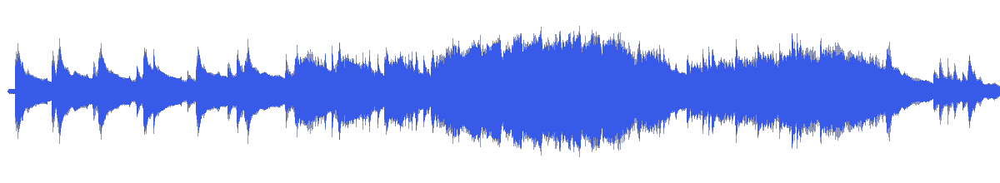
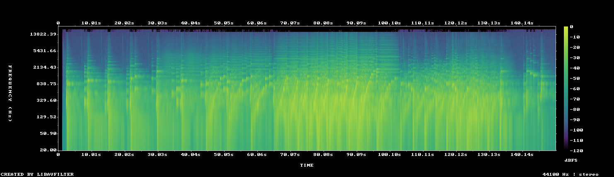

# MUS-24 — The Weight of Stillness

[Play original](<../../../assets/music/The_Weight_of_Stillness.mp3>) · [Interactive guide](../index.html#MUS-24) · [Library](../README.md)

**Editorial direction:** A dramatic long-form reveal or wide camera journey with substantial intensity changes.

Largest loudness range, widest measured stereo image and highest integrated loudness in this folder: this is a contrast candidate, not an automatic quiet bed. These are editing suggestions, not model-verified genre/instrument/mood descriptions.

**Search:** Story, Portfolio, Reveal.

**Avoid / check:** Especially misleading title for background selection. Gain down, audition the exact range, and check any intended dialogue passage.

**Vocals:** unverified. Audition the chosen range before using under speech; unverified does not mean instrumental.

**Motion references:** [REF-01](../../reference-library/studies/REF-01.md), [REF-14](../../reference-library/studies/REF-14.md), [REF-17](../../reference-library/studies/REF-17.md). These pair editing behaviours, not matching audio or shared authorship.

## Measured profile

| Field | Value |
| --- | --- |
| Duration | 2:30 (150.152s) |
| Original format | mp3 / 44100Hz / 2ch |
| Integrated level | -10.5 LUFS |
| Loudness range | 18.3 LU |
| Decoded true peak | 0.3 dBTP |
| Brightness, magnitude centroid | 800Hz |
| Side/mid ratio | -2.9dB |
| Stereo correlation | 0.321 |
| Spectral-flux attack candidates | 2.031/s |
| Pulse candidate, unvalidated | 150BPM / autocorrelation 0.21 |
| Decoded near/full-scale samples | 101 (threshold ±0.999) |

Pulse estimates may be half/double-time; **no approved beat grid**. Attack detections are not guaranteed musical beats or sound effects. All levels are original-source values, not delivery targets.

## Audition these ranges

Computed from one-second starts, not claimed phrase boundaries. “Least-variable” is relative to this track and need not be genuinely steady. The rise is last-three-second mean RMS minus first-three-second mean; change can be small even in the winning window. Entry/exit notes and harmonic resolution require listening.

| Candidate | Source range | Measured shape |
| --- | --- | --- |
| 12s level rise | **0:26–0:38** | 12.1dB change / 5.31dB variation / 1 attacks/s |
| 30s least-variable passage | **1:07–1:37** | -1.4dB change / 1.92dB variation / 3.867 attacks/s |
| 30s attack-dense passage | **1:06–1:36** | 0.5dB change / 2.12dB variation / 3.933 attacks/s |
| 60s least-variable passage | **1:09–2:09** | -2.3dB change / 4.18dB variation / 3.117 attacks/s |

## Full-track structure

Regular 15-second analysis blocks; **not** inferred intro/verse/chorus sections. RMS is an amplitude measure, not LUFS.

| Source range | Mean 1s RMS dBFS | Level variation, std dB | Attacks/s |
| --- | ---: | ---: | ---: |
| 0:00–0:15 | -35.7 | 29.8 | 0.73 |
| 0:15–0:30 | -26.4 | 5.8 | 1.07 |
| 0:30–0:45 | -24.9 | 4.3 | 0.67 |
| 0:45–1:00 | -19.1 | 1.7 | 2.33 |
| 1:00–1:15 | -16.0 | 3.6 | 3.33 |
| 1:15–1:30 | -10.4 | 1.2 | 4.00 |
| 1:30–1:45 | -16.9 | 5.0 | 2.47 |
| 1:45–2:00 | -17.7 | 2.6 | 2.67 |
| 2:00–2:15 | -16.6 | 3.4 | 2.53 |
| 2:15–2:30 | -32.0 | 6.6 | 0.53 |

## Source and evidence

Original name: `The_Weight_of_Stillness.mp3`. SHA256: `9cdc392841923ae04fb2573e489b73eebc233f2241424a336268b4ea3704f8e9`. Source unchanged. [Raw analysis](../evidence/MUS-24/analysis.json), [probe/tags](../evidence/MUS-24/probe.json), [method](../PLAYBOOK.md). User-supplied; distribution rights not established. No human listening, semantic model or vocal-absence certification.
