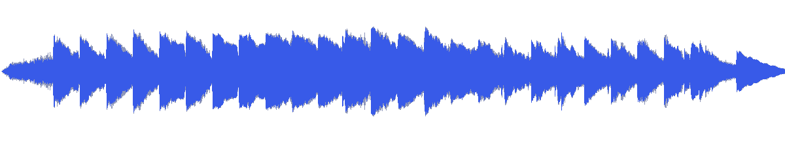
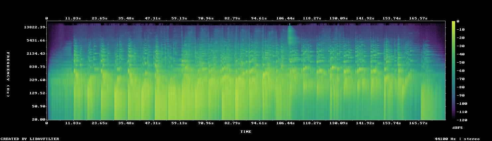

# MUS-25 — Twelve Degrees of White

[Play original](<../../../assets/music/Twelve_Degrees_of_White.mp3>) · [Interactive guide](../index.html#MUS-25) · [Library](../README.md)

**Editorial direction:** A minimal material/architectural opening that grows into a more substantial scene.

Low brightness and attack density combined with a very large early level rise support contrast between negative space and developed artwork. These are editing suggestions, not model-verified genre/instrument/mood descriptions.

**Search:** Material, Editorial, Reveal.

**Avoid / check:** Not a flat white-room ambience throughout; the full source has almost 13LU of range.

**Vocals:** unverified. Audition the chosen range before using under speech; unverified does not mean instrumental.

**Motion references:** [REF-09](../../reference-library/studies/REF-09.md), [REF-13](../../reference-library/studies/REF-13.md), [REF-19](../../reference-library/studies/REF-19.md). These pair editing behaviours, not matching audio or shared authorship.

## Measured profile

| Field | Value |
| --- | --- |
| Duration | 2:57 (177.398s) |
| Original format | mp3 / 44100Hz / 2ch |
| Integrated level | -11.4 LUFS |
| Loudness range | 12.8 LU |
| Decoded true peak | -0.2 dBTP |
| Brightness, magnitude centroid | 576Hz |
| Side/mid ratio | -10dB |
| Stereo correlation | 0.818 |
| Spectral-flux attack candidates | 1.753/s |
| Pulse candidate, unvalidated | 79.8BPM / autocorrelation 0.312 |
| Decoded near/full-scale samples | 0 (threshold ±0.999) |

Pulse estimates may be half/double-time; **no approved beat grid**. Attack detections are not guaranteed musical beats or sound effects. All levels are original-source values, not delivery targets.

## Audition these ranges

Computed from one-second starts, not claimed phrase boundaries. “Least-variable” is relative to this track and need not be genuinely steady. The rise is last-three-second mean RMS minus first-three-second mean; change can be small even in the winning window. Entry/exit notes and harmonic resolution require listening.

| Candidate | Source range | Measured shape |
| --- | --- | --- |
| 12s level rise | **0:05–0:17** | 17.0dB change / 8.69dB variation / 0.583 attacks/s |
| 30s least-variable passage | **0:54–1:24** | -2.6dB change / 2.16dB variation / 2.5 attacks/s |
| 30s attack-dense passage | **1:12–1:42** | -4.9dB change / 2.97dB variation / 2.7 attacks/s |
| 60s least-variable passage | **0:36–1:36** | -5.1dB change / 2.99dB variation / 2.4 attacks/s |

## Full-track structure

Regular 15-second analysis blocks; **not** inferred intro/verse/chorus sections. RMS is an amplitude measure, not LUFS.

| Source range | Mean 1s RMS dBFS | Level variation, std dB | Attacks/s |
| --- | ---: | ---: | ---: |
| 0:00–0:15 | -33.9 | 13.9 | 0.40 |
| 0:15–0:30 | -18.4 | 4.8 | 1.47 |
| 0:30–0:45 | -14.0 | 4.3 | 2.00 |
| 0:45–1:00 | -14.3 | 3.9 | 2.07 |
| 1:00–1:15 | -12.1 | 1.9 | 2.47 |
| 1:15–1:30 | -12.3 | 2.7 | 2.73 |
| 1:30–1:45 | -13.8 | 3.1 | 2.67 |
| 1:45–2:00 | -20.3 | 3.9 | 1.73 |
| 2:00–2:15 | -18.3 | 4.6 | 2.07 |
| 2:15–2:30 | -20.4 | 5.0 | 1.20 |
| 2:30–2:45 | -21.7 | 7.2 | 1.53 |
| 2:45–2:57 | -34.1 | 9.3 | 0.48 |

## Source and evidence

Original name: `Twelve_Degrees_of_White.mp3`. SHA256: `3e44674023217bdd1596539280595f60ef6050acd624dac71f1004510385efb0`. Source unchanged. [Raw analysis](../evidence/MUS-25/analysis.json), [probe/tags](../evidence/MUS-25/probe.json), [method](../PLAYBOOK.md). User-supplied; distribution rights not established. No human listening, semantic model or vocal-absence certification.
