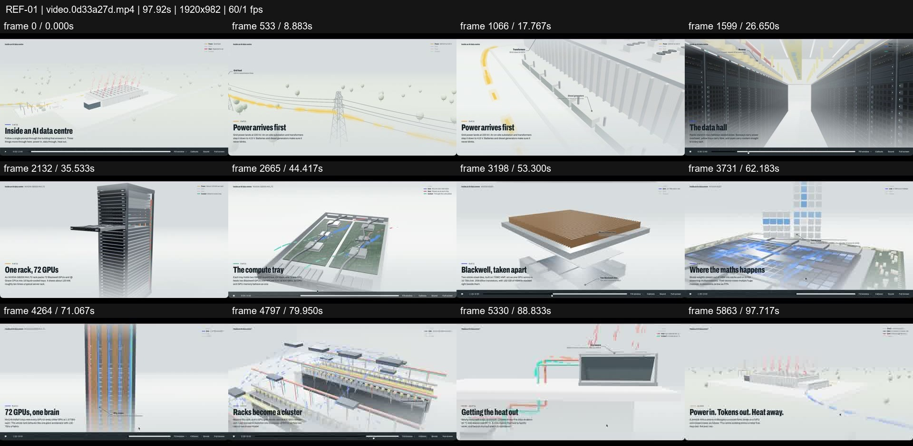
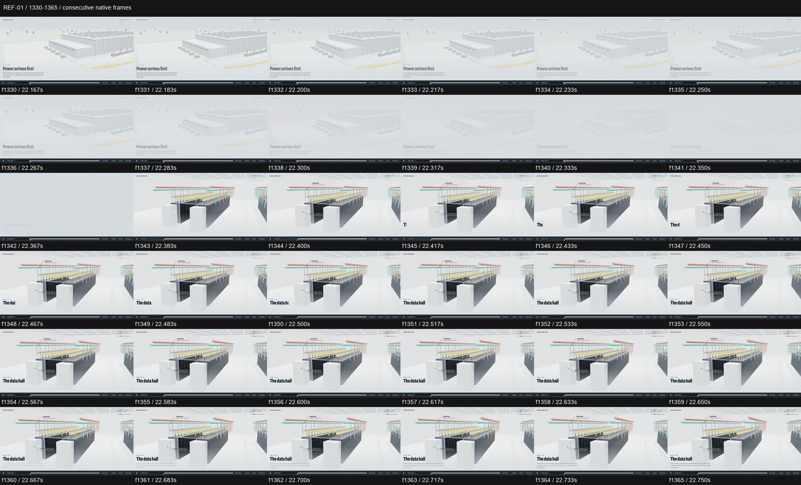

# REF-01 — AI data centre — power-to-chip 3D journey

[Play source](<../../../assets/Reference Vid/REF-01-ai-data-centre-power-to-chip-3d-journey.mp4>) · [Library](../README.md) · [Playbook](../PLAYBOOK.md)

1920×982 · 60/1 fps · 97.920s container · 5,872 native frames · last visual PTS 97.850s. Frame numbers are zero-based. Chapter times below are approximate unless a frame number is given.

**Find for:** technical explainer, 3D, exploded view, macro-to-micro, camera journey.

## Art direction

Pale grey architectural world, yellow power paths, coloured cooling pipes, condensed black headings anchored at lower left and restrained object callouts. The stage changes scale while the information hierarchy stays familiar.

## Sequence and timing

| Source time (seconds) | Visible action |
| --- | --- |
| 0–7.2 | Wide establishing view and title; navigation remains visible. |
| 7.2–22.37 | White wash into power infrastructure; yellow path leads toward the building. |
| 22.38–28.63 | Interior aisle tracking; at f1719 / 28.650s, cut to one rack. |
| 28.65–43.2 | Rack rotation, tray extraction, then a white wash into the tray view. |
| 43.2–58.95 | Move into the chip; layers separate around 52.7–54s, then hold for reading. |
| 58.95–80.4 | Compute grid, interconnect, rack cluster; widen the system again. |
| 80.4–97.85 | Cooling hardware and heat exchanger; return to the opening world. |

## Motion recipe to adapt

Keep a fixed explanatory anchor while the camera moves through meaningful scales. Animate the actual route or mechanism: power travels, a tray slides, chip layers separate. Preserve screen direction and give exploded views a reading interval before the next dive.

## Best use and cautions

Use for engineering, architecture and systems explanation. The controlled white washes and reading holds are part of its pacing. Do not copy embedded playback controls or accept the technical labels as verified engineering facts.

## Enlarged consecutive-frame study

Native frames 1330–1365, 22.167–22.750s. Each thumbnail is 320×164; no intervening frames omitted in this strip.

## Audio evidence

earshot measured **-38.2 LUFS integrated**, **-24.3 dBTP** and 248 detected onsets/events. No dependable steady pulse was detected (clarity 0.079). Comparison anchor **f1343 / 22.383s** → nearest detected event **22.345s** (-38.3ms audio minus visual). Proximity alone does not establish a perceptually synced effect.

[Raw earshot report](../evidence/REF-01/audio-timeline.json). Its input filename records the pre-rename path. Measurements come from decoded lossy audio; tags are model hypotheses, not human listening. Automatic cut detection can flag flashes or fast motion and cannot judge a morph's perceptual continuity. Reassess timing against the selected music in a new production; these loudness values are not mix targets.

## Every-frame audit

All native frames were decoded and indexed in presentation order; all chronological sheets were visually inspected at thumbnail resolution. This does not mean every frame was checked at full resolution. [Frame metrics / PTS](../evidence/REF-01/frames.csv) · [Decode and palette metadata](../evidence/REF-01/study.json).

Chronological sheets: [001](../evidence/REF-01/all-frames/page-001.jpg) · [002](../evidence/REF-01/all-frames/page-002.jpg) · [003](../evidence/REF-01/all-frames/page-003.jpg) · [004](../evidence/REF-01/all-frames/page-004.jpg) · [005](../evidence/REF-01/all-frames/page-005.jpg) · [006](../evidence/REF-01/all-frames/page-006.jpg) · [007](../evidence/REF-01/all-frames/page-007.jpg) · [008](../evidence/REF-01/all-frames/page-008.jpg) · [009](../evidence/REF-01/all-frames/page-009.jpg) · [010](../evidence/REF-01/all-frames/page-010.jpg) · [011](../evidence/REF-01/all-frames/page-011.jpg) · [012](../evidence/REF-01/all-frames/page-012.jpg) · [013](../evidence/REF-01/all-frames/page-013.jpg) · [014](../evidence/REF-01/all-frames/page-014.jpg) · [015](../evidence/REF-01/all-frames/page-015.jpg) · [016](../evidence/REF-01/all-frames/page-016.jpg) · [017](../evidence/REF-01/all-frames/page-017.jpg) · [018](../evidence/REF-01/all-frames/page-018.jpg) · [019](../evidence/REF-01/all-frames/page-019.jpg) · [020](../evidence/REF-01/all-frames/page-020.jpg) · [021](../evidence/REF-01/all-frames/page-021.jpg) · [022](../evidence/REF-01/all-frames/page-022.jpg) · [023](../evidence/REF-01/all-frames/page-023.jpg) · [024](../evidence/REF-01/all-frames/page-024.jpg) · [025](../evidence/REF-01/all-frames/page-025.jpg)

Original filename: `video.0d33a27d.mp4`. SHA-256: `0d33a27d6a801fb87c71d3af8a1c3a5c22b64341dc1b820749cd0dc378c9c633`. Descriptive title identifies visible content, not verified authorship or tools. Local study does not establish reuse rights for footage, logos, artwork or audio.
