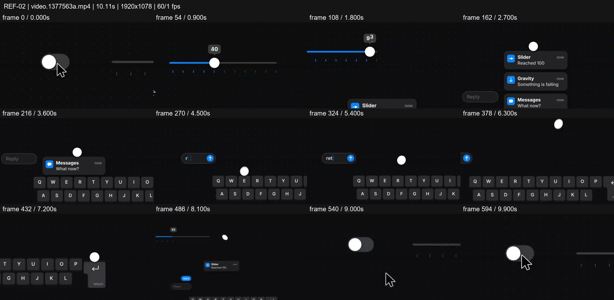
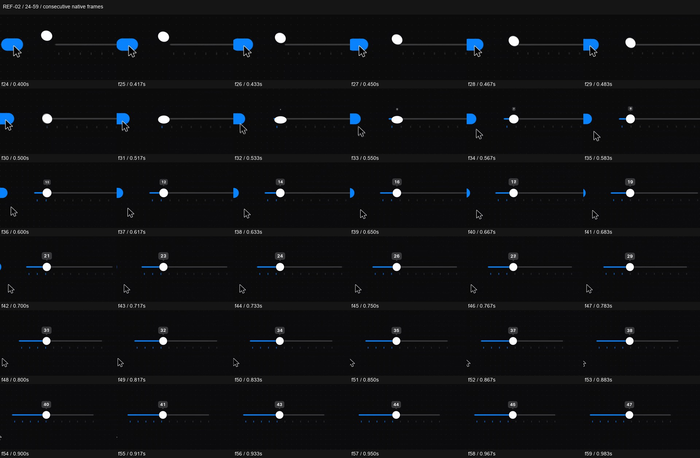

# REF-02 — Dark UI — toggle, slider and keyboard relay

[Play source](<../../../assets/Reference Vid/REF-02-dark-ui-toggle-slider-keyboard-relay.mp4>) · [Library](../README.md) · [Playbook](../PLAYBOOK.md)

1920×1078 · 60/1 fps · 10.112s container · 604 native frames · last visual PTS 10.050s. Frame numbers are zero-based. Chapter times below are approximate unless a frame number is given.

**Find for:** UI morph, dark mode, microinteraction, squash stretch, causal motion.

## Art direction

Near-black dotted stage, blue active controls, a white ball and cursor. The small cast of shapes feels cohesive because the ball passes energy between functional UI states.

## Sequence and timing

| Source time (seconds) | Visible action |
| --- | --- |
| 0–0.55 | Toggle action launches the ball toward the slider. |
| 0.55–1.8 | Ball squashes on the rail, becomes its thumb; numerical progress rises to 100. |
| 1.8–3.2 | Toast arrival and ball fall; notifications recede as keyboard enters. |
| 3.2–6.0 | Keys depress in sequence; typing creates visible results. |
| 6.0–8.4 | Stretched flight into Return, then pull back to reveal the chain. |
| 8.65–10.05 | Return to the toggle and let the loop read. |

## Motion recipe to adapt

Make contact change the next object. In detail f24–59, the blue track lengthens while the ball settles and the cursor departs; this is overlapping action, not one isolated tween after another. Vary flight stretch, contact squash and settle instead of applying one spring everywhere.

## Best use and cautions

Use for interaction systems and playful software stings. Keep a readable state after each action and maintain the ball's position across handoffs; avoid unrelated floating controls.

## Enlarged consecutive-frame study

Native frames 24–59, 0.400–0.983s. Each thumbnail is 320×180; no intervening frames omitted in this strip.

## Audio evidence

earshot measured **-18.9 LUFS integrated**, **-3.8 dBTP** and 50 detected onsets/events. Pulse estimate: 119.7 BPM, clarity 0.257 (weak); this is an estimate, not a recovered score. Comparison anchor **f32 / 0.533s** → nearest detected event **0.582s** (+48.7ms audio minus visual). Proximity alone does not establish a perceptually synced effect.

[Raw earshot report](../evidence/REF-02/audio-timeline.json). Its input filename records the pre-rename path. Measurements come from decoded lossy audio; tags are model hypotheses, not human listening. Automatic cut detection can flag flashes or fast motion and cannot judge a morph's perceptual continuity. Reassess timing against the selected music in a new production; these loudness values are not mix targets.

## Every-frame audit

All native frames were decoded and indexed in presentation order; all chronological sheets were visually inspected at thumbnail resolution. This does not mean every frame was checked at full resolution. [Frame metrics / PTS](../evidence/REF-02/frames.csv) · [Decode and palette metadata](../evidence/REF-02/study.json).

Chronological sheets: [001](../evidence/REF-02/all-frames/page-001.jpg) · [002](../evidence/REF-02/all-frames/page-002.jpg) · [003](../evidence/REF-02/all-frames/page-003.jpg)

Original filename: `video.1377563a.mp4`. SHA-256: `1377563a6ceea51d39c183cab87a7fac45ec671c4af18425b563e25d924582a5`. Descriptive title identifies visible content, not verified authorship or tools. Local study does not establish reuse rights for footage, logos, artwork or audio.
