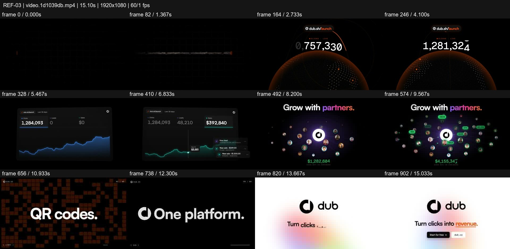
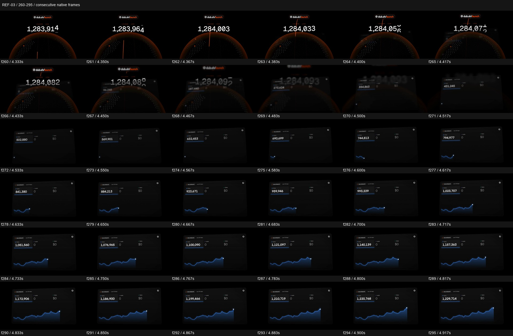

# REF-03 — Dub — growth dashboard and partner launch

[Play source](<../../../assets/Reference Vid/REF-03-dub-growth-dashboard-partner-launch.mp4>) · [Library](../README.md) · [Playbook](../PLAYBOOK.md)

1920×1080 · 60/1 fps · 15.104s container · 904 native frames · last visual PTS 15.050s. Frame numbers are zero-based. Chapter times below are approximate unless a frame number is given.

**Find for:** SaaS launch, analytics, kinetic type, feature burst, CTA.

## Art direction

Black and orange hook gives way to blue/purple analytics, green sales proof and a bright closing card. Tilt, scale and numerical changes sell working software rather than a slide of feature labels.

## Sequence and timing

| Source time (seconds) | Visible action |
| --- | --- |
| 0–2.1 | Orange stroke reveals the short URL. |
| 2.1–4.4 | Orbital globe and rolling click total. |
| 4.4–4.65 | Globe recedes while dashboard enters in perspective; both coexist during the handoff. |
| 4.65–7.4 | Click chart changes to sales; notifications add proof. |
| 7.4–10.45 | Dashboard contracts into the partner orbit and payout labels. |
| 10.45–12.25 | Rapid feature plates: links, QR, domains, conversions, affiliates, payouts. |
| 12.3–15.05 | Platform message, expanding logo iris, resolved CTA. |

## Motion recipe to adapt

Build one product story: reach becomes results, results become partners, then accelerate through supporting features. Reserve the fastest typography for the short burst and give the final call to action a longer landing. Match the changing data to visible controls.

## Best use and cautions

Use for product launches, funnels and analytics. Palette changes encode chapter roles. Brand names, revenue counts and product claims are source content, not ready-made claims for a new project.

## Enlarged consecutive-frame study

Native frames 260–295, 4.333–4.917s. Each thumbnail is 320×180; no intervening frames omitted in this strip.

## Audio evidence

earshot measured **-13.6 LUFS integrated**, **-0.4 dBTP** and 73 detected onsets/events. Pulse estimate: 120.0 BPM, clarity 0.728 (clear); this is an estimate, not a recovered score. Comparison anchor **f272 / 4.533s** → nearest detected event **4.584s** (+50.7ms audio minus visual). Proximity alone does not establish a perceptually synced effect.

[Raw earshot report](../evidence/REF-03/audio-timeline.json). Its input filename records the pre-rename path. Measurements come from decoded lossy audio; tags are model hypotheses, not human listening. Automatic cut detection can flag flashes or fast motion and cannot judge a morph's perceptual continuity. Reassess timing against the selected music in a new production; these loudness values are not mix targets.

## Every-frame audit

All native frames were decoded and indexed in presentation order; all chronological sheets were visually inspected at thumbnail resolution. This does not mean every frame was checked at full resolution. [Frame metrics / PTS](../evidence/REF-03/frames.csv) · [Decode and palette metadata](../evidence/REF-03/study.json).

Chronological sheets: [001](../evidence/REF-03/all-frames/page-001.jpg) · [002](../evidence/REF-03/all-frames/page-002.jpg) · [003](../evidence/REF-03/all-frames/page-003.jpg) · [004](../evidence/REF-03/all-frames/page-004.jpg)

Original filename: `video.1d1039db.mp4`. SHA-256: `1d1039db19d6bc52cd92d81fa7291fbd09fa4f515cc43d8e8a03be51521f3c68`. Descriptive title identifies visible content, not verified authorship or tools. Local study does not establish reuse rights for footage, logos, artwork or audio.
