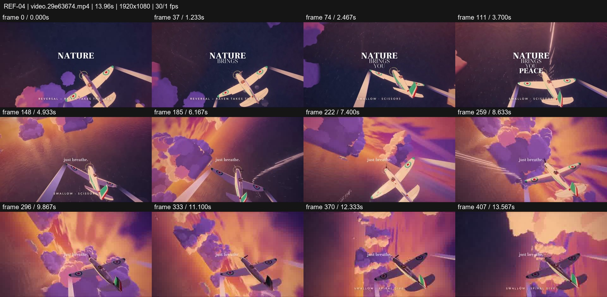
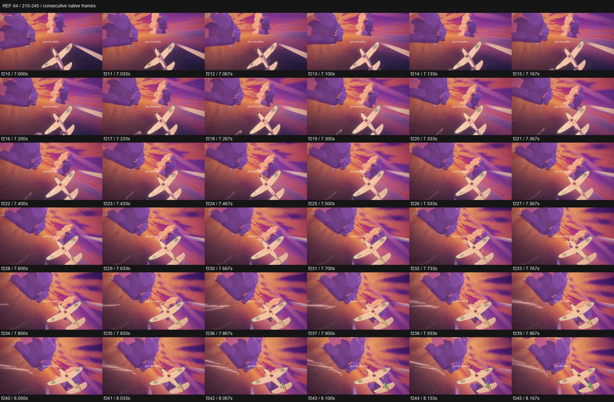

# REF-04 — Sunset plane chase — painterly clouds and banking camera

[Play source](<../../../assets/Reference Vid/REF-04-sunset-plane-chase-painterly-clouds.mp4>) · [Library](../README.md) · [Playbook](../PLAYBOOK.md)

1920×1080 · 30/1 fps · 13.955s container · 417 native frames · last visual PTS 13.867s. Frame numbers are zero-based. Chapter times below are approximate unless a frame number is given.

**Find for:** cinematic 3D, painterly, camera roll, parallax, atmosphere.

## Art direction

Violet and coral clouds, gold horizon and ocean, vintage aircraft and contrails. A rear pursuit view carries foreground cloud occlusions and a strongly banking horizon.

## Sequence and timing

| Source time (seconds) | Visible action |
| --- | --- |
| 0–3.8 | NATURE / BRINGS / YOU / PEACE appears over the flight. |
| 3.9–5 | Small 'just breathe.' line replaces the large opening words. |
| 5–7.3 | Aircraft and horizon bank; depth changes through the clouds. |
| 7.3–8.17 | Enlarged strip shows cloud approach, roll and contrail sweep. |
| 8.2–13.87 | Continue the bank, dip and climb rather than cutting to new title cards. |

## Motion recipe to adapt

Treat the camera as a follower in a world: roll the horizon, vary near/far cloud speeds, let objects occlude and maintain a stable aircraft silhouette. Small quiet text gives the moving world room to perform.

## Best use and cautions

Use for atmospheric interludes and cinematic journeys. This needs authored scenery, textures and depth; scaling a single sky image will not reproduce the spatial effect. Exact camera lens and renderer cannot be inferred from the MP4.

## Enlarged consecutive-frame study

Native frames 210–245, 7.000–8.167s. Each thumbnail is 320×180; no intervening frames omitted in this strip.

## Audio evidence

earshot measured **-19.2 LUFS integrated**, **-5.9 dBTP** and 33 detected onsets/events. No dependable steady pulse was detected (clarity 0.15). Comparison anchor **f210 / 7.000s** → nearest detected event **7.278s** (+278.0ms audio minus visual). Proximity alone does not establish a perceptually synced effect.

[Raw earshot report](../evidence/REF-04/audio-timeline.json). Its input filename records the pre-rename path. Measurements come from decoded lossy audio; tags are model hypotheses, not human listening. Automatic cut detection can flag flashes or fast motion and cannot judge a morph's perceptual continuity. Reassess timing against the selected music in a new production; these loudness values are not mix targets.

## Every-frame audit

All native frames were decoded and indexed in presentation order; all chronological sheets were visually inspected at thumbnail resolution. This does not mean every frame was checked at full resolution. [Frame metrics / PTS](../evidence/REF-04/frames.csv) · [Decode and palette metadata](../evidence/REF-04/study.json).

Chronological sheets: [001](../evidence/REF-04/all-frames/page-001.jpg) · [002](../evidence/REF-04/all-frames/page-002.jpg)

Original filename: `video.29e63674.mp4`. SHA-256: `29e63674460c643d51e78dba3d80fcd6e75089ddd8b6baa80d987e8c1b0fa122`. Descriptive title identifies visible content, not verified authorship or tools. Local study does not establish reuse rights for footage, logos, artwork or audio.
