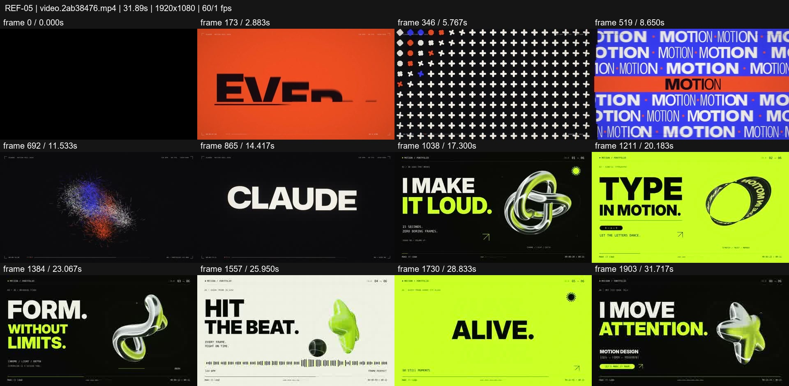
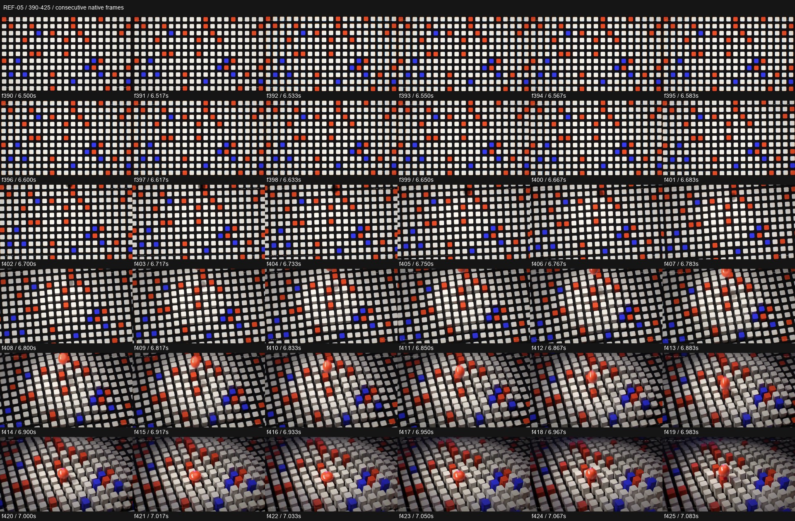

# REF-05 — Kinetic type + acid chrome — double reel

[Play source](<../../../assets/Reference Vid/REF-05-kinetic-type-and-acid-chrome-double-reel.mp4>) · [Library](../README.md) · [Playbook](../PLAYBOOK.md)

1920×1080 · 60/1 fps · 31.893s container · 1,910 native frames · last visual PTS 31.817s. Frame numbers are zero-based. Chapter times below are approximate unless a frame number is given.

**Find for:** showreel, kinetic typography, pattern, 3D material, acid graphics.

## Art direction

Two separate short reels joined in one file. First: orange/cream/blue, dot grids, type and particles. Second: black, acid lime and cream, chrome forms, outlined type rings and rhythmic word plates.

## Sequence and timing

| Source time (seconds) | Visible action |
| --- | --- |
| 0–0.85 | First source label, then bouncing orange ball and full-frame expansion. |
| 2.8–4.5 | EVERY / FRAME / is / CODE with scale and glitch changes. |
| 4.65–7.1 | Flat dot matrix becomes a lit cube height field; inspect f390–425. |
| 8.35–12.2 | Ribbons, MOTION, particle sphere, knot, spiral and radial burst. |
| 12.2–15.85 | Recap wall and first identity lockup. |
| 15.9–16.75 | Second source label separates the two reels. |
| 16.8–24.35 | Chrome knot, typographic ring and hollow triangle; narrow bar wipes connect plates. |
| 24.35–29.2 | Star/ball stage, then BOLD / PRECISE / ALIVE. |
| 29.35–31.82 | Final statement and rotating material form. |

## Motion recipe to adapt

Carry a small visual vocabulary across scales and materials. The f390–425 study shows the grid cells gaining height and shadows while the camera tilts; the volume is developed from the pattern. In the second reel, bar wipes preserve palette and rhythm between distinct hero forms.

## Best use and cautions

Use for a high-energy portfolio. Study the halves separately; the mid-file label is a compilation boundary, not a model for a finished film's transition. Onscreen model names are unverified labels. Do not reproduce the source identity as your own.

## Enlarged consecutive-frame study

Native frames 390–425, 6.500–7.083s. Each thumbnail is 320×180; no intervening frames omitted in this strip.

## Audio evidence

earshot measured **-14.3 LUFS integrated**, **-0.3 dBTP** and 209 detected onsets/events. Pulse estimate: 143.6 BPM, clarity 0.5 (clear); this is an estimate, not a recovered score. Comparison anchor **f408 / 6.800s** → nearest detected event **6.818s** (+18.0ms audio minus visual). Proximity alone does not establish a perceptually synced effect.

[Raw earshot report](../evidence/REF-05/audio-timeline.json). Its input filename records the pre-rename path. Measurements come from decoded lossy audio; tags are model hypotheses, not human listening. Automatic cut detection can flag flashes or fast motion and cannot judge a morph's perceptual continuity. Reassess timing against the selected music in a new production; these loudness values are not mix targets.

## Every-frame audit

All native frames were decoded and indexed in presentation order; all chronological sheets were visually inspected at thumbnail resolution. This does not mean every frame was checked at full resolution. [Frame metrics / PTS](../evidence/REF-05/frames.csv) · [Decode and palette metadata](../evidence/REF-05/study.json).

Chronological sheets: [001](../evidence/REF-05/all-frames/page-001.jpg) · [002](../evidence/REF-05/all-frames/page-002.jpg) · [003](../evidence/REF-05/all-frames/page-003.jpg) · [004](../evidence/REF-05/all-frames/page-004.jpg) · [005](../evidence/REF-05/all-frames/page-005.jpg) · [006](../evidence/REF-05/all-frames/page-006.jpg) · [007](../evidence/REF-05/all-frames/page-007.jpg) · [008](../evidence/REF-05/all-frames/page-008.jpg)

Original filename: `video.2ab38476.mp4`. SHA-256: `2ab384769328dc407b520245b5dfccd982f3d3b339022b6482cef721afaa90b4`. Descriptive title identifies visible content, not verified authorship or tools. Local study does not establish reuse rights for footage, logos, artwork or audio.
