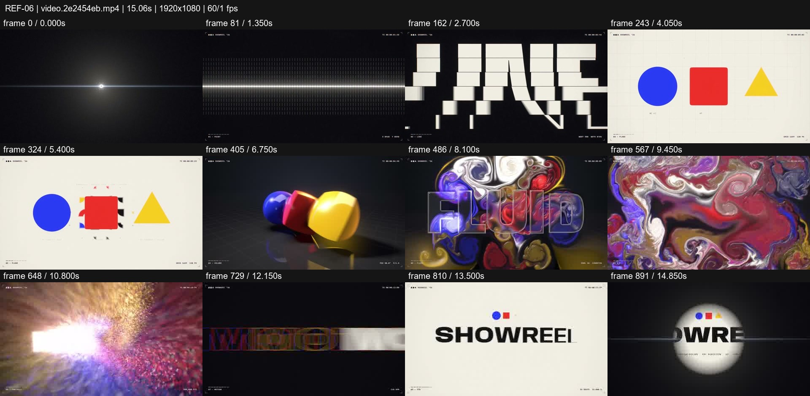
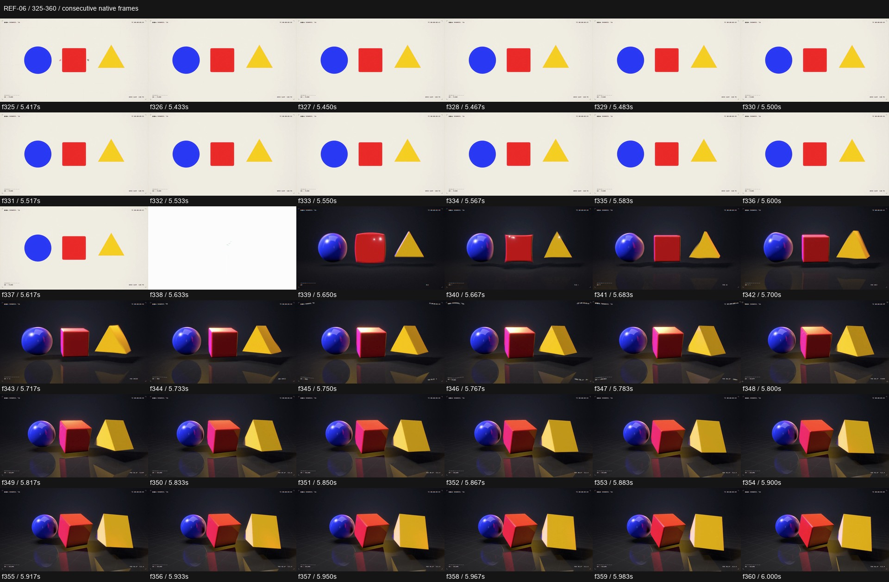

# REF-06 — Point → line → plane → volume → fluid

[Play source](<../../../assets/Reference Vid/REF-06-point-line-plane-volume-fluid-showreel.mp4>) · [Library](../README.md) · [Playbook](../PLAYBOOK.md)

1920×1080 · 60/1 fps · 15.061s container · 900 native frames · last visual PTS 14.983s. Frame numbers are zero-based. Chapter times below are approximate unless a frame number is given.

**Find for:** dimensional morph, Bauhaus, 3D material, particle typography, loop.

## Art direction

An explicit dimensional progression gives a varied reel a story. Blue circle, red square and yellow triangle survive the switch from cream flat graphics to a dark reflective stage.

## Sequence and timing

| Source time (seconds) | Visible action |
| --- | --- |
| 0–1.7 | Pin light, POINT, rings and extending line. |
| 1.7–3.6 | Replicated LINE and RGB strip wipe into the plane. |
| 3.73–5.62 | Flat circle/square/triangle, swaps and pattern burst. |
| 5.633–6.8 | One bright bridge frame at f338, then lit 3D forms from f339; camera/material change keeps shape registration. |
| 6.8–9.6 | Forms merge into a chrome ball and fluid pattern; enter the texture. |
| 9.65–12.85 | Particle field forms MOTION; sliced type and fast recap. |
| 13–14.98 | Iris to SHOWREEL, then close back to the pin light. |

## Motion recipe to adapt

Use a conceptual ladder to earn each technique. Match shape positions at the flat-to-volume boundary, introduce reflections/contact shadows, then let the geometry turn. This transition includes a bright interruption; it is not proof of an uninterrupted mesh extrusion.

## Best use and cautions

Use for a dimensional studio reel or transformation narrative. The loop is a designed return to the first motif. Avoid naming five styles over identical moving rectangles.

## Enlarged consecutive-frame study

Native frames 325–360, 5.417–6.000s. Each thumbnail is 320×180; no intervening frames omitted in this strip.

## Audio evidence

earshot measured **-12.4 LUFS integrated**, **-0.6 dBTP** and 70 detected onsets/events. Pulse estimate: 127.8 BPM, clarity 0.414 (clear); this is an estimate, not a recovered score. Comparison anchor **f339 / 5.650s** → nearest detected event **5.667s** (+17.0ms audio minus visual). Proximity alone does not establish a perceptually synced effect.

[Raw earshot report](../evidence/REF-06/audio-timeline.json). Its input filename records the pre-rename path. Measurements come from decoded lossy audio; tags are model hypotheses, not human listening. Automatic cut detection can flag flashes or fast motion and cannot judge a morph's perceptual continuity. Reassess timing against the selected music in a new production; these loudness values are not mix targets.

## Every-frame audit

All native frames were decoded and indexed in presentation order; all chronological sheets were visually inspected at thumbnail resolution. This does not mean every frame was checked at full resolution. [Frame metrics / PTS](../evidence/REF-06/frames.csv) · [Decode and palette metadata](../evidence/REF-06/study.json).

Chronological sheets: [001](../evidence/REF-06/all-frames/page-001.jpg) · [002](../evidence/REF-06/all-frames/page-002.jpg) · [003](../evidence/REF-06/all-frames/page-003.jpg) · [004](../evidence/REF-06/all-frames/page-004.jpg)

Original filename: `video.2e2454eb.mp4`. SHA-256: `2e2454ebeef6c636163085b9aa646f635439a18fafe3fa92e3c376dfdf8edd7a`. Descriptive title identifies visible content, not verified authorship or tools. Local study does not establish reuse rights for footage, logos, artwork or audio.
