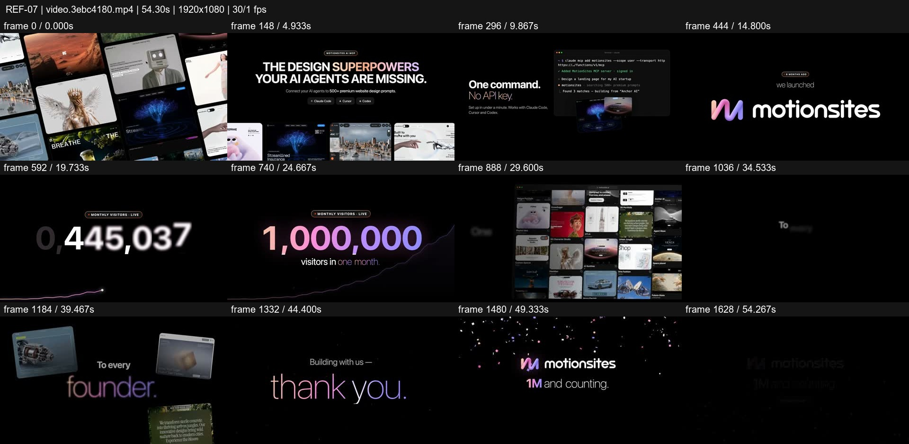
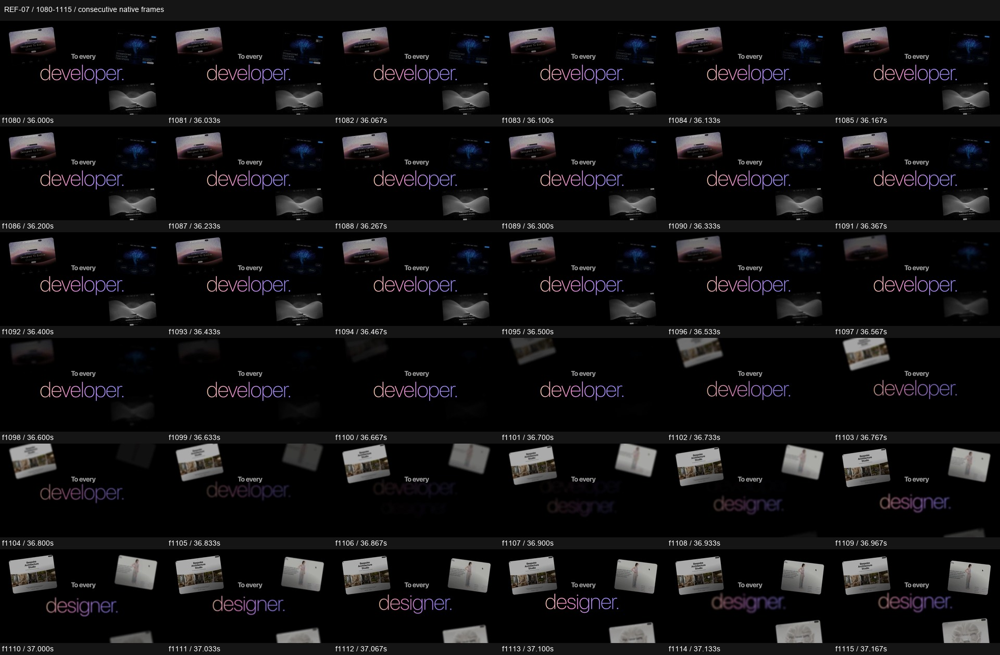

# REF-07 — Motionsites — launch and one-million milestone

[Play source](<../../../assets/Reference Vid/REF-07-motionsites-launch-million-milestone.mp4>) · [Library](../README.md) · [Playbook](../PLAYBOOK.md)

1920×1080 · 30/1 fps · 54.300s container · 1,629 native frames · last visual PTS 54.267s. Frame numbers are zero-based. Chapter times below are approximate unless a frame number is given.

**Find for:** website wall, social proof, milestone, terminal, community.

## Art direction

Black space, real site imagery, light type and pink/purple accents. Large proof walls and a numerical milestone alternate with quieter product and thank-you passages.

## Sequence and timing

| Source time (seconds) | Visible action |
| --- | --- |
| 0–5.6 | Website wall recedes, then benefit headline and card fan. |
| 5.8–11.3 | Terminal command beside the claim; visual examples enter the foreground. |
| 12.5–18.2 | Wordmark, Today, then a build toward the milestone. |
| 18.3–25.3 | Counter reaches 1M with a rising curve and deliberate reading time. |
| 25.4–34 | Site wall expands around the central statement. |
| 34.5–41.2 | Developer / designer / founder passages with changing orbiting examples. |
| 41.4–54.27 | Thank-you, identity, confetti and final milestone hold. |

## Motion recipe to adapt

Use real visual proof as spatial material. Keep a clean hole in the proof wall for the message. At f1080–1115, outgoing developer examples blur/recede as designer examples rotate forward and the noun changes; the stage stays continuous.

## Best use and cautions

Use for community milestones or proof-led launches, not a constant-speed montage. No audio stream is present. The 1M count is a source claim, not verified audience data.

## Enlarged consecutive-frame study

Native frames 1080–1115, 36.000–37.167s. Each thumbnail is 320×180; no intervening frames omitted in this strip.

## Audio evidence

No audio stream (ffprobe); this is a visual-only reference.

[Audio-stream absence record](../evidence/REF-07/audio-timeline.json). No audio analysis or sync inference was made for this silent source.

## Every-frame audit

All native frames were decoded and indexed in presentation order; all chronological sheets were visually inspected at thumbnail resolution. This does not mean every frame was checked at full resolution. [Frame metrics / PTS](../evidence/REF-07/frames.csv) · [Decode and palette metadata](../evidence/REF-07/study.json).

Chronological sheets: [001](../evidence/REF-07/all-frames/page-001.jpg) · [002](../evidence/REF-07/all-frames/page-002.jpg) · [003](../evidence/REF-07/all-frames/page-003.jpg) · [004](../evidence/REF-07/all-frames/page-004.jpg) · [005](../evidence/REF-07/all-frames/page-005.jpg) · [006](../evidence/REF-07/all-frames/page-006.jpg) · [007](../evidence/REF-07/all-frames/page-007.jpg)

Original filename: `video.3ebc4180.mp4`. SHA-256: `3ebc4180bb4bb24413d2958a9728211ce0f5012d07a0f22812c39309f579f3c7`. Descriptive title identifies visible content, not verified authorship or tools. Local study does not establish reuse rights for footage, logos, artwork or audio.
