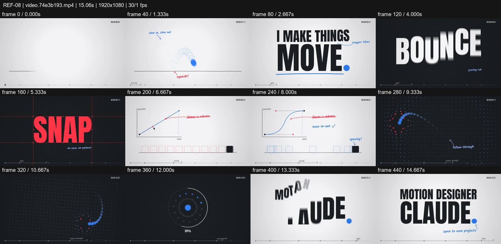
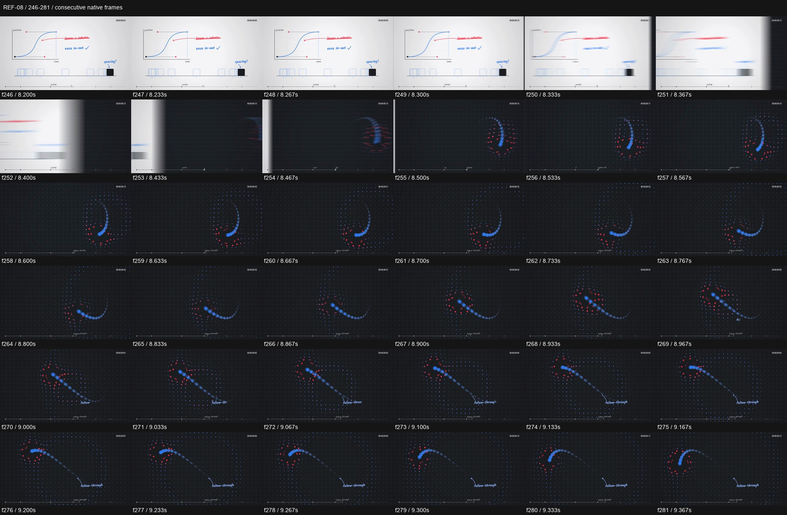

# REF-08 — Blue dot — annotated animation principles lab

[Play source](<../../../assets/Reference Vid/REF-08-blue-dot-animation-principles-type-lab.mp4>) · [Library](../README.md) · [Playbook](../PLAYBOOK.md)

1920×1080 · 30/1 fps · 15.061s container · 449 native frames · last visual PTS 14.933s. Frame numbers are zero-based. Chapter times below are approximate unless a frame number is given.

**Find for:** animation principles, kinetic type, easing, follow-through, educational.

## Art direction

White sketchbook and dark dotted lab stages, blue main action and red annotations. Ghost positions, trajectories and graphs make the motion mechanism visible.

## Sequence and timing

| Source time (seconds) | Visible action |
| --- | --- |
| 0–1.8 | Ball bounce, trajectory echoes and contact annotation. |
| 1.85–3.6 | Staggered letters assemble I MAKE THINGS MOVE with baseline notes. |
| 3.7–5.5 | BOUNCE / STRETCH / SPIN, then red SNAP interruption at f154 / 5.133s. |
| 5.6–8.3 | Linear versus curved easing graph and spacing ruler. |
| 8.33–8.5 | Blurred lateral wipe moves the white graph off as the dark follow-through field arrives. |
| 8.5–11 | Moving dot chain and delayed followers. |
| 11–14.93 | Smaller panel/radial traces, dot reveal and closing type. |

## Motion recipe to adapt

Make motion legible with secondary marks that show where it came from. A hard snap earns contrast because the surrounding movements are elastic. Preserve lead/follow delay across the chain, and clear annotations before the next demonstration.

## Best use and cautions

Use for educational motion or a process reel. The enlarged frames support a lateral blurred handoff, not a verified 3D hinge. Onscreen 'stagger 45ms' is an annotation, not measured source code.

## Enlarged consecutive-frame study

Native frames 246–281, 8.200–9.367s. Each thumbnail is 320×180; no intervening frames omitted in this strip.

## Audio evidence

earshot measured **-11.7 LUFS integrated**, **-0.0 dBTP** and 63 detected onsets/events. Pulse estimate: 127.7 BPM, clarity 0.673 (clear); this is an estimate, not a recovered score. Comparison anchor **f154 / 5.133s** → nearest detected event **5.197s** (+63.7ms audio minus visual). Proximity alone does not establish a perceptually synced effect.

[Raw earshot report](../evidence/REF-08/audio-timeline.json). Its input filename records the pre-rename path. Measurements come from decoded lossy audio; tags are model hypotheses, not human listening. Automatic cut detection can flag flashes or fast motion and cannot judge a morph's perceptual continuity. Reassess timing against the selected music in a new production; these loudness values are not mix targets.

## Every-frame audit

All native frames were decoded and indexed in presentation order; all chronological sheets were visually inspected at thumbnail resolution. This does not mean every frame was checked at full resolution. [Frame metrics / PTS](../evidence/REF-08/frames.csv) · [Decode and palette metadata](../evidence/REF-08/study.json).

Chronological sheets: [001](../evidence/REF-08/all-frames/page-001.jpg) · [002](../evidence/REF-08/all-frames/page-002.jpg)

Original filename: `video.74e3b193.mp4`. SHA-256: `74e3b193a3c497ae3d7fdb4775e00565ab42ed1f33ede216c5439171f78d6ab6`. Descriptive title identifies visible content, not verified authorship or tools. Local study does not establish reuse rights for footage, logos, artwork or audio.
