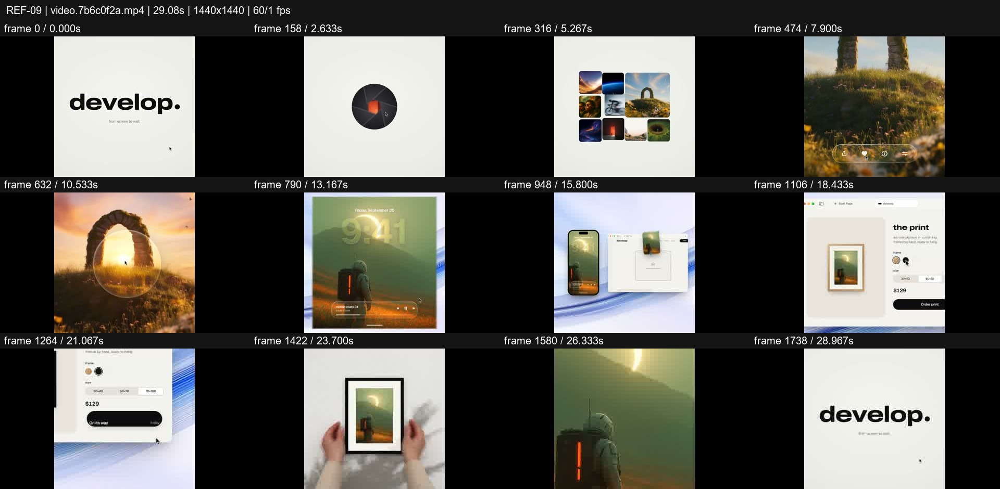
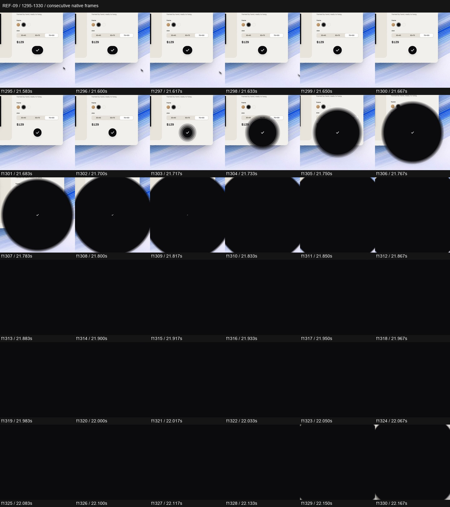

# REF-09 — Develop — gallery to phone to framed print

[Play source](<../../../assets/Reference Vid/REF-09-develop-gallery-phone-to-framed-print.mp4>) · [Library](../README.md) · [Playbook](../PLAYBOOK.md)

1440×1440 · 60/1 fps · 29.077s container · 1,741 native frames · last visual PTS 29.000s. Frame numbers are zero-based. Chapter times below are approximate unless a frame number is given.

**Find for:** product story, iris, artwork continuity, device, physical reveal.

## Art direction

Cream/black UI surrounds vivid artwork. One selected image travels through a gallery, editing tools, phone, browser, print order and real hands holding the result.

## Sequence and timing

| Source time (seconds) | Visible action |
| --- | --- |
| 0–3.6 | Wordmark → dot → pill → aperture → artwork tile. |
| 3.6–7.4 | Gallery fans out; selected artwork grows to full frame and copy reads. |
| 7.4–11.2 | Enter the image, editing UI and lens reveal into another artwork. |
| 11.8–15 | Clock overlay, phone pullback and browser rise. |
| 16.3–19.6 | Screen-to-wall proposition and print configuration. |
| 19.7–21.7 | Frame/size/order states resolve into a confirmation tick. |
| 21.717–22.17 | Confirmation button grows into a black iris; inspect f1303 onward. |
| 22.2–26.45 | Framed artwork appears, real hands catch it, camera enters the print. |
| 26.5–29 | Reverse shape sequence returns to the identity. |

## Motion recipe to adapt

Keep the artwork as the persistent protagonist and let its frame change context. Trigger the next scene from the current interface: a confirmation button becomes the occluding iris. Use physical scale and hands to make the product promise tangible.

## Best use and cautions

Use for digital-to-physical products and polished consumer launches. Do not lose the selected image between devices, or replace the physical proof with arbitrary cards. Source artwork and audio remain study material.

## Enlarged consecutive-frame study

Native frames 1295–1330, 21.583–22.167s. Each thumbnail is 240×240; no intervening frames omitted in this strip.

## Audio evidence

earshot measured **-14.1 LUFS integrated**, **-0.4 dBTP** and 159 detected onsets/events. Pulse estimate: 119.9 BPM, clarity 0.502 (clear); this is an estimate, not a recovered score. Comparison anchor **f1303 / 21.717s** → nearest detected event **21.866s** (+149.3ms audio minus visual). Proximity alone does not establish a perceptually synced effect.

[Raw earshot report](../evidence/REF-09/audio-timeline.json). Its input filename records the pre-rename path. Measurements come from decoded lossy audio; tags are model hypotheses, not human listening. Automatic cut detection can flag flashes or fast motion and cannot judge a morph's perceptual continuity. Reassess timing against the selected music in a new production; these loudness values are not mix targets.

## Every-frame audit

All native frames were decoded and indexed in presentation order; all chronological sheets were visually inspected at thumbnail resolution. This does not mean every frame was checked at full resolution. [Frame metrics / PTS](../evidence/REF-09/frames.csv) · [Decode and palette metadata](../evidence/REF-09/study.json).

Chronological sheets: [001](../evidence/REF-09/all-frames/page-001.jpg) · [002](../evidence/REF-09/all-frames/page-002.jpg) · [003](../evidence/REF-09/all-frames/page-003.jpg) · [004](../evidence/REF-09/all-frames/page-004.jpg) · [005](../evidence/REF-09/all-frames/page-005.jpg) · [006](../evidence/REF-09/all-frames/page-006.jpg) · [007](../evidence/REF-09/all-frames/page-007.jpg) · [008](../evidence/REF-09/all-frames/page-008.jpg) · [009](../evidence/REF-09/all-frames/page-009.jpg) · [010](../evidence/REF-09/all-frames/page-010.jpg) · [011](../evidence/REF-09/all-frames/page-011.jpg)

Original filename: `video.7b6c0f2a.mp4`. SHA-256: `7b6c0f2adc0b3e1fee655e2b772b170453943a5df04fa8888532c27bf6a5bf59`. Descriptive title identifies visible content, not verified authorship or tools. Local study does not establish reuse rights for footage, logos, artwork or audio.
