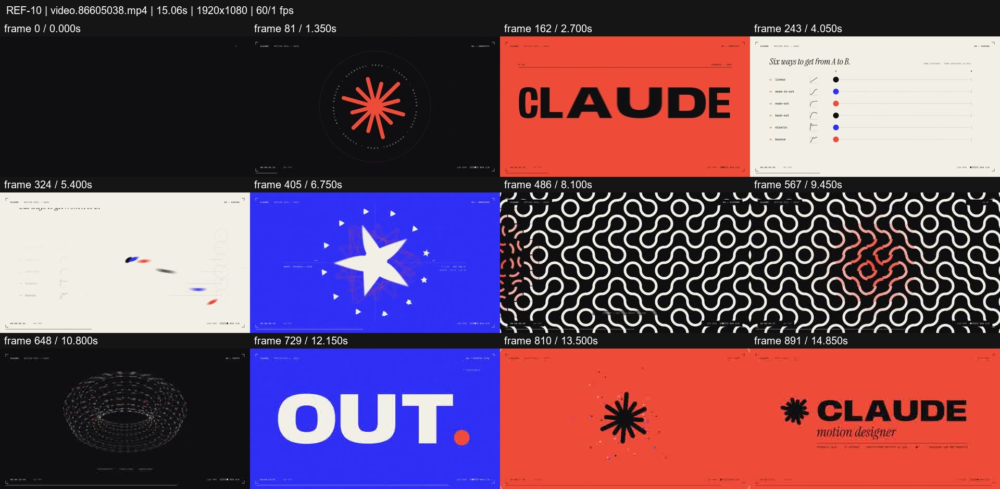
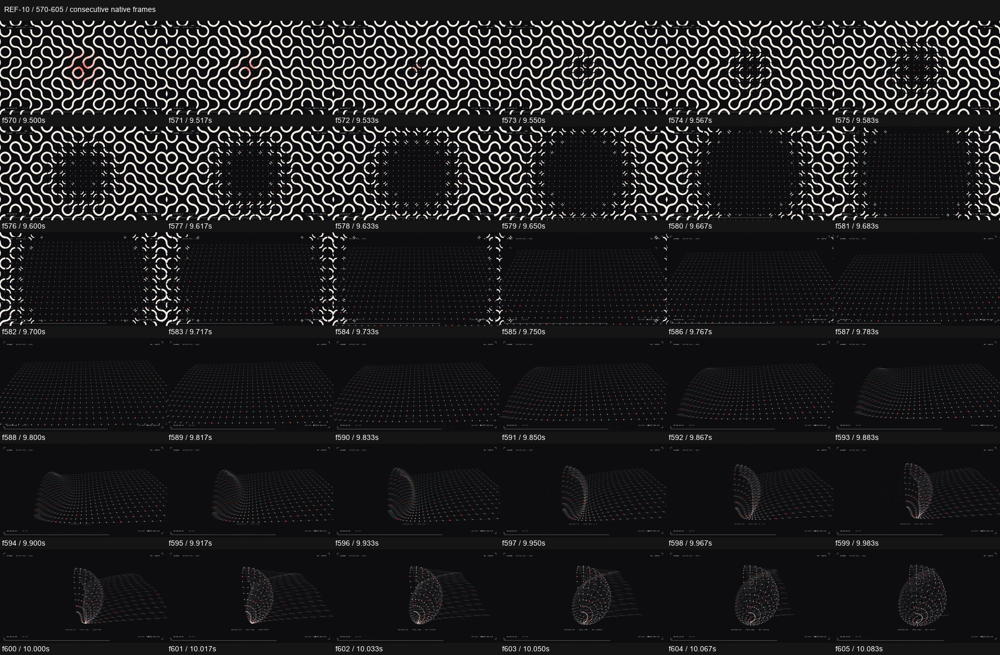

# REF-10 — Red/blue — easing races and pattern-to-torus reel

[Play source](<../../../assets/Reference Vid/REF-10-red-blue-easing-races-pattern-to-torus.mp4>) · [Library](../README.md) · [Playbook](../PLAYBOOK.md)

1920×1080 · 60/1 fps · 15.061s container · 900 native frames · last visual PTS 14.983s. Frame numbers are zero-based. Chapter times below are approximate unless a frame number is given.

**Find for:** easing, pattern morph, torus, kinetic type, logo loop.

## Art direction

Red-orange asterisk, cream/blue contrast, graph-like lanes and a high-density monochrome tile field. The same planar pattern becomes a dotted surface and a curled volume.

## Sequence and timing

| Source time (seconds) | Visible action |
| --- | --- |
| 0–3.3 | Asterisk from dot, radial construction and identity hold. |
| 3.3–5.35 | Letters decompose; six lanes race at different rates. |
| 5.35–7.3 | Dots combine into an iris, then circle/triangle/star/square. |
| 7.5–9.5 | Square multiplies into curved tile field with a red wave. |
| 9.5–10.08 | Pattern clears into a dotted plane, tilts and curls; inspect f570–605. |
| 10.08–11.1 | Complete the torus-like mesh volume. |
| 11.25–13.1 | EASE / IN / EASE / OUT / NEVER / LINEAR in fast colour plates. |
| 13.1–15 | Return to the asterisk and resolved identity. |

## Motion recipe to adapt

Demonstrate timing through visible comparisons, then evolve the same pattern into depth. The enlarged interval shows a textured plane becoming a sparse mesh before curling; design that intermediate representation, rather than swapping unrelated 2D and 3D shots.

## Best use and cautions

Use for motion systems, generative pattern and geometry reels. NEVER LINEAR is the source's slogan; constant velocity remains appropriate for some technical moves and is not a new universal rule.

## Enlarged consecutive-frame study

Native frames 570–605, 9.500–10.083s. Each thumbnail is 320×180; no intervening frames omitted in this strip.

## Audio evidence

earshot measured **-13.1 LUFS integrated**, **-1.4 dBTP** and 82 detected onsets/events. Pulse estimate: 127.7 BPM, clarity 0.61 (clear); this is an estimate, not a recovered score. Comparison anchor **f600 / 10.000s** → nearest detected event **10.290s** (+290.0ms audio minus visual). Proximity alone does not establish a perceptually synced effect.

[Raw earshot report](../evidence/REF-10/audio-timeline.json). Its input filename records the pre-rename path. Measurements come from decoded lossy audio; tags are model hypotheses, not human listening. Automatic cut detection can flag flashes or fast motion and cannot judge a morph's perceptual continuity. Reassess timing against the selected music in a new production; these loudness values are not mix targets.

## Every-frame audit

All native frames were decoded and indexed in presentation order; all chronological sheets were visually inspected at thumbnail resolution. This does not mean every frame was checked at full resolution. [Frame metrics / PTS](../evidence/REF-10/frames.csv) · [Decode and palette metadata](../evidence/REF-10/study.json).

Chronological sheets: [001](../evidence/REF-10/all-frames/page-001.jpg) · [002](../evidence/REF-10/all-frames/page-002.jpg) · [003](../evidence/REF-10/all-frames/page-003.jpg) · [004](../evidence/REF-10/all-frames/page-004.jpg)

Original filename: `video.86605038.mp4`. SHA-256: `866050388d924e61ba95cc391fbde3dbd23becc92dde3bb3d15a699c21ed7ae7`. Descriptive title identifies visible content, not verified authorship or tools. Local study does not establish reuse rights for footage, logos, artwork or audio.
