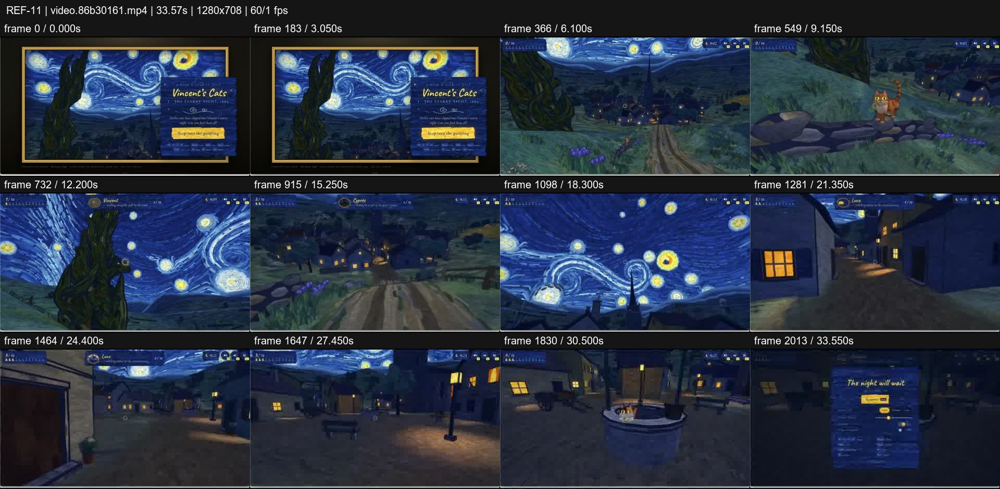
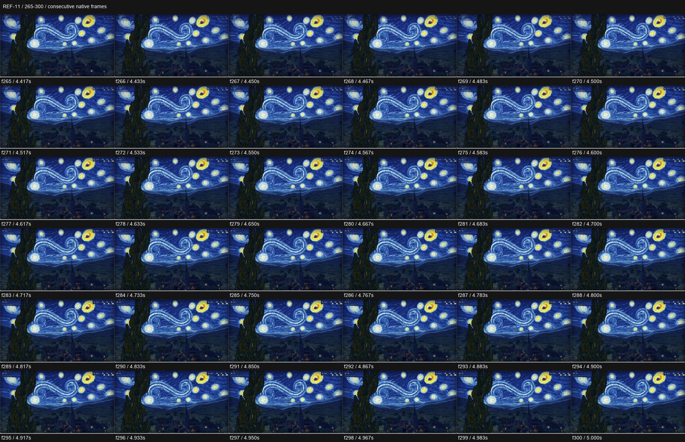

# REF-11 — Vincent's Cats — journey inside Starry Night

[Play source](<../../../assets/Reference Vid/REF-11-vincents-cats-starry-night-world-journey.mp4>) · [Library](../README.md) · [Playbook](../PLAYBOOK.md)

1280×708 · 60/1 fps · 33.567s container · 2,014 native frames · last visual PTS 33.550s. Frame numbers are zero-based. Chapter times below are approximate unless a frame number is given.

**Find for:** painterly, immersive world, environment, camera journey, HUD.

## Art direction

Brush-textured blue/gold world, framed painting entry, cats, collectible lights and a small navigation HUD. The painting's material language continues through paths, buildings and sky.

## Sequence and timing

| Source time (seconds) | Visible action |
| --- | --- |
| 0–3.4 | Framed artwork, title and invitation. |
| 3.4–5.7 | Overlay clears; move into the painting. |
| 5.8–10 | Landscape path, foreground cat and collectible lights. |
| 10–17 | Cypress and village traversal with depth changes. |
| 17.8–22 | Sky view and approach into the street. |
| 22–31 | Pass near façades, then find the well and cats. |
| 32.6–33.55 | Completion overlay resolves the journey. |

## Motion recipe to adapt

Carry a consistent painted texture across the whole spatial route. Let nearby façades and trees pass faster than distant sky, and keep the HUD as an orienting layer. Entry, discovery and completion form an arc even without rapid cutting.

## Best use and cautions

Use for an immersive illustrated world. No audio stream is present. The selected detail f265–300 documents the early painting view and overlay clearance; use later atlas pages for the deep street traversal, not this strip alone.

## Enlarged consecutive-frame study

Native frames 265–300, 4.417–5.000s. Each thumbnail is 320×177; no intervening frames omitted in this strip.

## Audio evidence

No audio stream (ffprobe); this is a visual-only reference.

[Audio-stream absence record](../evidence/REF-11/audio-timeline.json). No audio analysis or sync inference was made for this silent source.

## Every-frame audit

All native frames were decoded and indexed in presentation order; all chronological sheets were visually inspected at thumbnail resolution. This does not mean every frame was checked at full resolution. [Frame metrics / PTS](../evidence/REF-11/frames.csv) · [Decode and palette metadata](../evidence/REF-11/study.json).

Chronological sheets: [001](../evidence/REF-11/all-frames/page-001.jpg) · [002](../evidence/REF-11/all-frames/page-002.jpg) · [003](../evidence/REF-11/all-frames/page-003.jpg) · [004](../evidence/REF-11/all-frames/page-004.jpg) · [005](../evidence/REF-11/all-frames/page-005.jpg) · [006](../evidence/REF-11/all-frames/page-006.jpg) · [007](../evidence/REF-11/all-frames/page-007.jpg) · [008](../evidence/REF-11/all-frames/page-008.jpg) · [009](../evidence/REF-11/all-frames/page-009.jpg)

Original filename: `video.86b30161.mp4`. SHA-256: `86b3016105d84f9996f07def7021bcf02b9726c4f29ac377337eee370c8b32f9`. Descriptive title identifies visible content, not verified authorship or tools. Local study does not establish reuse rights for footage, logos, artwork or audio.
