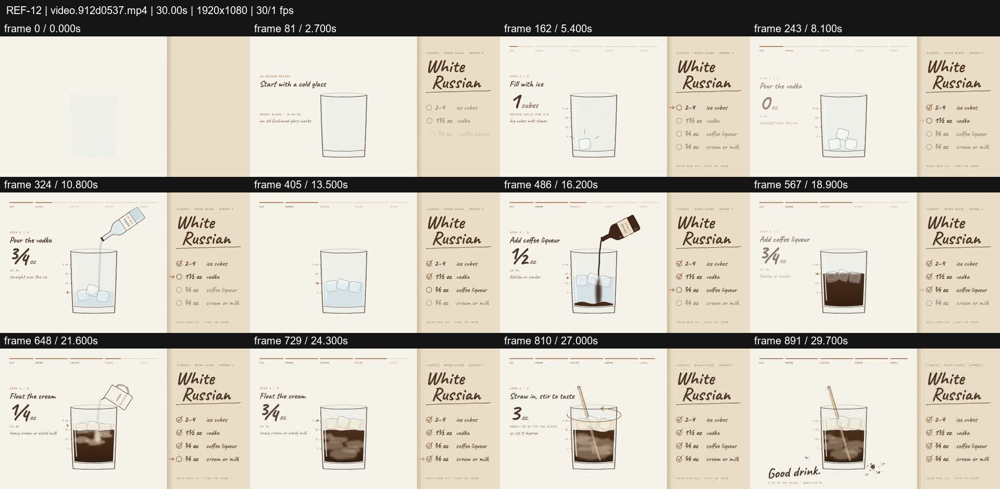
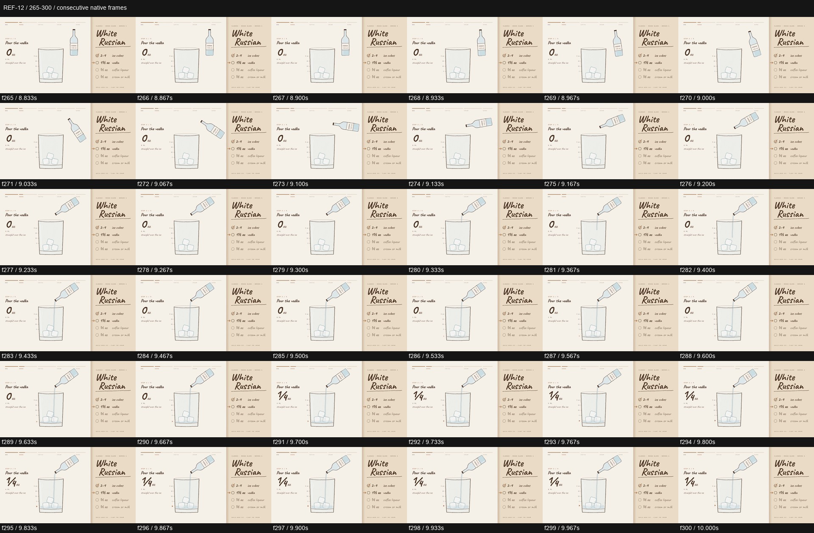

# REF-12 — White Russian — hand-drawn recipe sequence

[Play source](<../../../assets/Reference Vid/REF-12-white-russian-hand-drawn-recipe.mp4>) · [Library](../README.md) · [Playbook](../PLAYBOOK.md)

1920×1080 · 30/1 fps · 30.000s container · 900 native frames · last visual PTS 29.967s. Frame numbers are zero-based. Chapter times below are approximate unless a frame number is given.

**Find for:** hand drawn, process explainer, liquid, sequential state, editorial.

## Art direction

Cream paper, brown line work and handwritten headings. A stable recipe list, current instruction and glass divide the page into functional zones.

## Sequence and timing

| Source time (seconds) | Visible action |
| --- | --- |
| 0–3.8 | Title, ingredient list and empty glass establish the process. |
| 4–7.3 | Three ice-drop cycles with a changing count. |
| 8.3–12.6 | Vodka bottle arrives, tilts and pours; quantity and liquid level change. |
| 13.3–18.2 | Coffee bottle and dark liquid layer. |
| 19.4–24 | Cream jug, pouring stream and white swirl. |
| 24–27 | Spoon stirs the liquid. |
| 28.2–29.97 | Completion line and resolved glass. |

## Motion recipe to adapt

Make every state have a cause: rotate the bottle before the stream begins, grow the liquid after contact and tick the checklist after completion. In f265–300 the bottle accelerates into its pouring pose while the volume starts rising. The glass remains the visual anchor.

## Best use and cautions

Use for recipes, assembly and step-by-step explainers. Stable layout and restrained camera are strengths here. No audio stream is present. Recipe quantities are on-screen content, not guidance validated by this study.

## Enlarged consecutive-frame study

Native frames 265–300, 8.833–10.000s. Each thumbnail is 320×180; no intervening frames omitted in this strip.

## Audio evidence

No audio stream (ffprobe); this is a visual-only reference.

[Audio-stream absence record](../evidence/REF-12/audio-timeline.json). No audio analysis or sync inference was made for this silent source.

## Every-frame audit

All native frames were decoded and indexed in presentation order; all chronological sheets were visually inspected at thumbnail resolution. This does not mean every frame was checked at full resolution. [Frame metrics / PTS](../evidence/REF-12/frames.csv) · [Decode and palette metadata](../evidence/REF-12/study.json).

Chronological sheets: [001](../evidence/REF-12/all-frames/page-001.jpg) · [002](../evidence/REF-12/all-frames/page-002.jpg) · [003](../evidence/REF-12/all-frames/page-003.jpg) · [004](../evidence/REF-12/all-frames/page-004.jpg)

Original filename: `video.912d0537.mp4`. SHA-256: `912d053789a8d959f7523c7a0b945560992c8e93b6f15d356c96d0f3372ad192`. Descriptive title identifies visible content, not verified authorship or tools. Local study does not establish reuse rights for footage, logos, artwork or audio.
