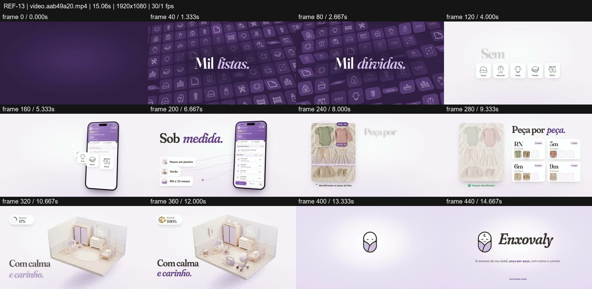
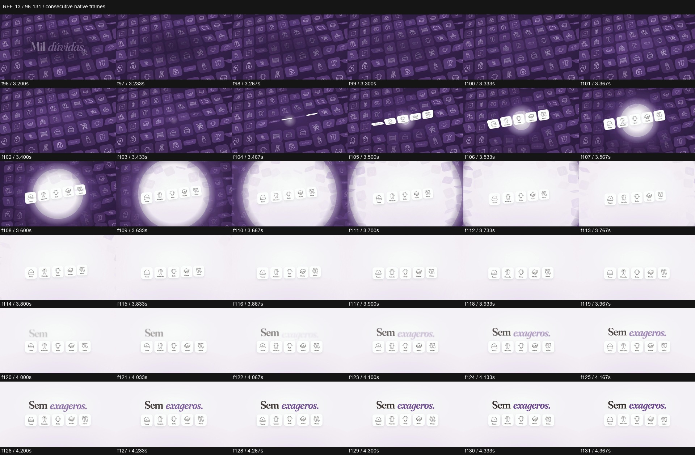

# REF-13 — Enxovaly — lavender planner to furnished nursery

[Play source](<../../../assets/Reference Vid/REF-13-enxovaly-lavender-planner-to-nursery.mp4>) · [Library](../README.md) · [Playbook](../PLAYBOOK.md)

1920×1080 · 30/1 fps · 15.061s container · 449 native frames · last visual PTS 14.933s. Frame numbers are zero-based. Chapter times below are approximate unless a frame number is given.

**Find for:** soft editorial, SaaS launch, phone, isometric room, selection.

## Art direction

Lavender/ivory and purple; bold serif with italic emphasis, fine dotted connectors, white icon cards, phone and an isometric nursery. Portuguese text is treated as visible source copy.

## Sequence and timing

| Source time (seconds) | Visible action |
| --- | --- |
| 0–3.2 | Icon becomes a tilted wall; Mil listas / Mil dúvidas type. |
| 3.3–3.77 | Five selected icons lift from the wall; a white circular wash clears the environment. |
| 3.8–5.4 | Sem exageros reads, then phone rises around the selected icons. |
| 5.6–7.4 | Personalisation inputs connect and camera enters the phone. |
| 7.5–9.5 | Photo items receive outlines; sizes populate from the image. |
| 9.7–11.6 | Empty nursery fills with wardrobe, crib and accessories while progress rises. |
| 12.3–14.93 | White wash, symbol drawing and wordmark. |

## Motion recipe to adapt

Move from visual overload to a small chosen set, then let those choices produce a complete environment. Keep the selected icons registered while the world clears: f96–131 shows the five cards surviving the wash, which makes selection feel consequential.

## Best use and cautions

Use for personalisation, planning and a soft consumer brand. Avoid sterile empty-phone footage; show recognition, changing data and the resulting room. Do not infer exact fonts or claim the source language was fully transcribed.

## Enlarged consecutive-frame study

Native frames 96–131, 3.200–4.367s. Each thumbnail is 320×180; no intervening frames omitted in this strip.

## Audio evidence

earshot measured **-11.6 LUFS integrated**, **-1.4 dBTP** and 82 detected onsets/events. Pulse estimate: 120.0 BPM, clarity 0.352 (clear); this is an estimate, not a recovered score. Comparison anchor **f109 / 3.633s** → nearest detected event **4.064s** (+430.7ms audio minus visual). Proximity alone does not establish a perceptually synced effect.

[Raw earshot report](../evidence/REF-13/audio-timeline.json). Its input filename records the pre-rename path. Measurements come from decoded lossy audio; tags are model hypotheses, not human listening. Automatic cut detection can flag flashes or fast motion and cannot judge a morph's perceptual continuity. Reassess timing against the selected music in a new production; these loudness values are not mix targets.

## Every-frame audit

All native frames were decoded and indexed in presentation order; all chronological sheets were visually inspected at thumbnail resolution. This does not mean every frame was checked at full resolution. [Frame metrics / PTS](../evidence/REF-13/frames.csv) · [Decode and palette metadata](../evidence/REF-13/study.json).

Chronological sheets: [001](../evidence/REF-13/all-frames/page-001.jpg) · [002](../evidence/REF-13/all-frames/page-002.jpg)

Original filename: `video.aab49a20.mp4`. SHA-256: `aab49a200bde22ae0485779dec741aad06895d7931ec7c5d7c5e5ba262687af1`. Descriptive title identifies visible content, not verified authorship or tools. Local study does not establish reuse rights for footage, logos, artwork or audio.
