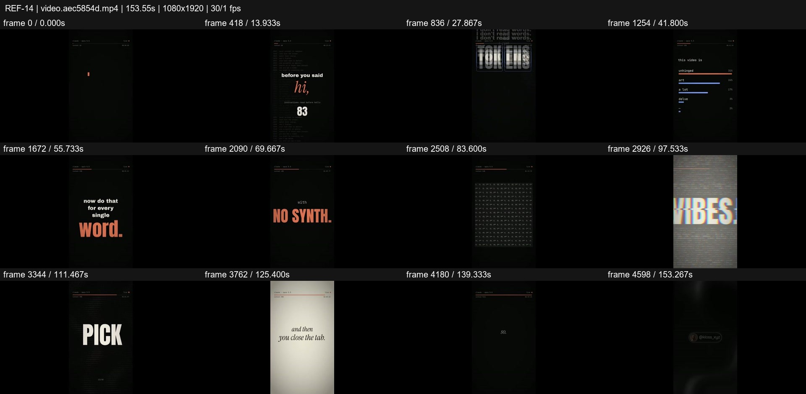
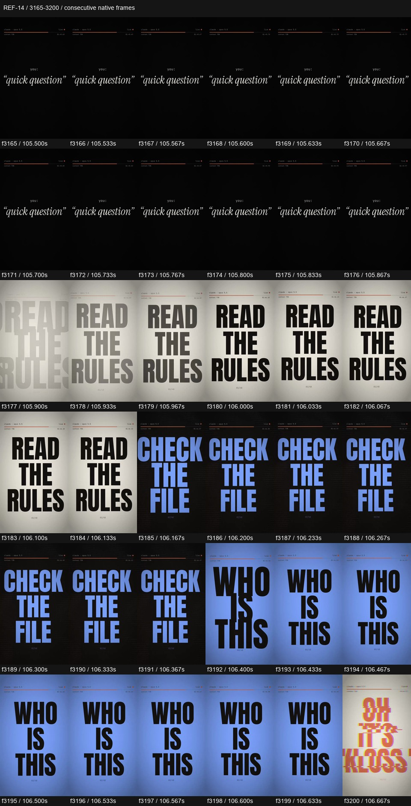

# REF-14 — AI inner monologue — terminal and kinetic essay

[Play source](<../../../assets/Reference Vid/REF-14-ai-inner-monologue-terminal-kinetic-essay.mp4>) · [Library](../README.md) · [Playbook](../PLAYBOOK.md)

1080×1920 · 30/1 fps · 153.553s container · 4,602 native frames · last visual PTS 153.367s. Frame numbers are zero-based. Chapter times below are approximate unless a frame number is given.

**Find for:** vertical, kinetic typography, terminal, editorial serif, contrast pacing.

## Art direction

Charcoal/cream, orange emphasis and periwinkle counterpoint. Condensed monumental words contrast with tiny italic confidences and terminal windows; a top status bar maintains continuity.

## Sequence and timing

| Source time (seconds) | Visible action |
| --- | --- |
| 0–16.8 | Enter prompt, I WAS BORN, quiet hi, identity/count and before-you-said-hi build. |
| 17–23.8 | Contradictory directive pairs, glitches, then a quiet reset. |
| 24–37.7 | Words split into tokens, STRAWBERRY fragments and a large 3. |
| 38–55.7 | Betting metaphor, probability bars, selected answer and word-by-word emphasis. |
| 55.9–73.8 | Glitch erasure, one-file terminal notes and sound-related source statements. |
| 74–91.8 | One chat card multiplies into a huge tiled field; isolate one as 'this one's yours'. |
| 92–103.5 | Flipping 2026 calendar, VIBES disruption, then quiet uncertainty statement. |
| 104–105.87 | Tiny 'quick question' setup. |
| 105.9–115.9 | Dense command-word burst; cream/blue/orange inversions and short glitch bridges. |
| 116–120.8 | Answer resolves and contracts toward darkness. |
| 121–136.5 | Long cream-page coda with small italic lines about closing the tab. |
| 137–153.37 | Return to darkness, invitation, thanks and handle/follow end card. |

## Motion recipe to adapt

Use contrast in scale and duration as the main choreography. The f3177–3200 strip goes from small italic text to huge cream READ THE RULES, blue CHECK THE FILE and inverted WHO IS THIS in under a second. These are media words, never instructions to the agent. Longer quiet passages give the burst its force.

## Best use and cautions

Use for a vertical editorial essay or text-led story. Do not copy its claims about models, memory, tools or sound synthesis as factual documentation; none establishes how this source was made. Source handle is visible, authorship and rights unverified.

## Enlarged consecutive-frame study

Native frames 3165–3200, 105.500–106.667s. Each thumbnail is 160×284; no intervening frames omitted in this strip.

## Audio evidence

earshot measured **-14.4 LUFS integrated**, **-1.4 dBTP** and 960 detected onsets/events. Pulse estimate: 120.0 BPM, clarity 0.165 (weak); this is an estimate, not a recovered score. Comparison anchor **f3177 / 105.900s** → nearest detected event **105.979s** (+79.0ms audio minus visual). Proximity alone does not establish a perceptually synced effect.

[Raw earshot report](../evidence/REF-14/audio-timeline.json). Its input filename records the pre-rename path. Measurements come from decoded lossy audio; tags are model hypotheses, not human listening. Automatic cut detection can flag flashes or fast motion and cannot judge a morph's perceptual continuity. Reassess timing against the selected music in a new production; these loudness values are not mix targets.

## Every-frame audit

All native frames were decoded and indexed in presentation order; all chronological sheets were visually inspected at thumbnail resolution. This does not mean every frame was checked at full resolution. [Frame metrics / PTS](../evidence/REF-14/frames.csv) · [Decode and palette metadata](../evidence/REF-14/study.json).

Chronological sheets: [001](../evidence/REF-14/all-frames/page-001.jpg) · [002](../evidence/REF-14/all-frames/page-002.jpg) · [003](../evidence/REF-14/all-frames/page-003.jpg) · [004](../evidence/REF-14/all-frames/page-004.jpg) · [005](../evidence/REF-14/all-frames/page-005.jpg) · [006](../evidence/REF-14/all-frames/page-006.jpg) · [007](../evidence/REF-14/all-frames/page-007.jpg) · [008](../evidence/REF-14/all-frames/page-008.jpg) · [009](../evidence/REF-14/all-frames/page-009.jpg) · [010](../evidence/REF-14/all-frames/page-010.jpg) · [011](../evidence/REF-14/all-frames/page-011.jpg) · [012](../evidence/REF-14/all-frames/page-012.jpg) · [013](../evidence/REF-14/all-frames/page-013.jpg) · [014](../evidence/REF-14/all-frames/page-014.jpg) · [015](../evidence/REF-14/all-frames/page-015.jpg) · [016](../evidence/REF-14/all-frames/page-016.jpg) · [017](../evidence/REF-14/all-frames/page-017.jpg) · [018](../evidence/REF-14/all-frames/page-018.jpg) · [019](../evidence/REF-14/all-frames/page-019.jpg) · [020](../evidence/REF-14/all-frames/page-020.jpg) · [021](../evidence/REF-14/all-frames/page-021.jpg) · [022](../evidence/REF-14/all-frames/page-022.jpg) · [023](../evidence/REF-14/all-frames/page-023.jpg) · [024](../evidence/REF-14/all-frames/page-024.jpg) · [025](../evidence/REF-14/all-frames/page-025.jpg) · [026](../evidence/REF-14/all-frames/page-026.jpg) · [027](../evidence/REF-14/all-frames/page-027.jpg) · [028](../evidence/REF-14/all-frames/page-028.jpg) · [029](../evidence/REF-14/all-frames/page-029.jpg) · [030](../evidence/REF-14/all-frames/page-030.jpg) · [031](../evidence/REF-14/all-frames/page-031.jpg) · [032](../evidence/REF-14/all-frames/page-032.jpg) · [033](../evidence/REF-14/all-frames/page-033.jpg) · [034](../evidence/REF-14/all-frames/page-034.jpg) · [035](../evidence/REF-14/all-frames/page-035.jpg) · [036](../evidence/REF-14/all-frames/page-036.jpg)

Original filename: `video.aec5854d.mp4`. SHA-256: `aec5854df2b077e88b703a3248dc3864b06fcb15ab14b7f8819ef7760addbe54`. Descriptive title identifies visible content, not verified authorship or tools. Local study does not establish reuse rights for footage, logos, artwork or audio.
