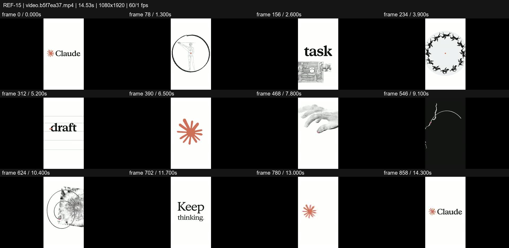
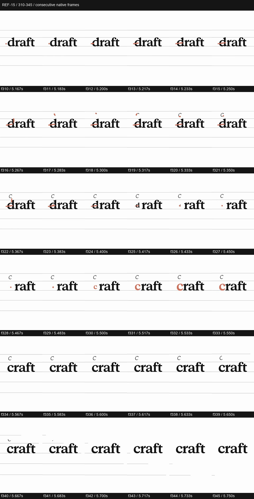

# REF-15 — Keep thinking — editorial cutout collage

[Play source](<../../../assets/Reference Vid/REF-15-keep-thinking-editorial-cutout-collage.mp4>) · [Library](../README.md) · [Playbook](../PLAYBOOK.md)

1080×1920 · 60/1 fps · 14.528s container · 868 native frames · last visual PTS 14.450s. Frame numbers are zero-based. Chapter times below are approximate unless a frame number is given.

**Find for:** mixed media, collage, archival cutout, editorial serif, match cut.

## Art direction

White/black serif editorial system, burnt orange dot/asterisk, construction lines and engraved figures, hands, heads, horses and an eye. Repeated circles and pivots register fast imagery.

## Sequence and timing

| Source time (seconds) | Visible action |
| --- | --- |
| 0–2.4 | Identity, question mark, radial pattern, figure and ask-to-task type change. |
| 2.75–4.4 | Writing hand, radial construction, horse zoetrope and single horse. |
| 4.4–5.17 | Anatomy and classical heads with an orange guide dot. |
| 5.17–5.75 | draft changes to craft through a marked d and descending c; inspect f310–345. |
| 5.8–8 | Constructed letterforms, extruded asterisk and hands relaying the orange motif. |
| 8.1–10.4 | Rapid circular match-cut montage of faces, forms, anatomy and eye. |
| 10.6–12.5 | Think, quiet Keep thinking and asterisk unfolding. |
| 13–14.45 | Final identity hold. |

## Motion recipe to adapt

Register each cutout on a shared circular centre or pivot before changing images. A thin construction line can make a type change feel drawn rather than replaced. Vary collage exposures; some are only a few native frames, while the final line is allowed to read.

## Best use and cautions

Use for cultural/editorial brands, craft and creative process. Needs actual considered cutouts; stock emoji and random pictures will not deliver this effect. Audio is a texture/rhythm study, not a loudness target.

## Enlarged consecutive-frame study

Native frames 310–345, 5.167–5.750s. Each thumbnail is 160×284; no intervening frames omitted in this strip.

## Audio evidence

earshot measured **-14.3 LUFS integrated**, **0.2 dBTP** and 139 detected onsets/events. No dependable steady pulse was detected (clarity 0.08). Comparison anchor **f330 / 5.500s** → nearest detected event **5.509s** (+9.0ms audio minus visual). Proximity alone does not establish a perceptually synced effect.

[Raw earshot report](../evidence/REF-15/audio-timeline.json). Its input filename records the pre-rename path. Measurements come from decoded lossy audio; tags are model hypotheses, not human listening. Automatic cut detection can flag flashes or fast motion and cannot judge a morph's perceptual continuity. Reassess timing against the selected music in a new production; these loudness values are not mix targets.

## Every-frame audit

All native frames were decoded and indexed in presentation order; all chronological sheets were visually inspected at thumbnail resolution. This does not mean every frame was checked at full resolution. [Frame metrics / PTS](../evidence/REF-15/frames.csv) · [Decode and palette metadata](../evidence/REF-15/study.json).

Chronological sheets: [001](../evidence/REF-15/all-frames/page-001.jpg) · [002](../evidence/REF-15/all-frames/page-002.jpg) · [003](../evidence/REF-15/all-frames/page-003.jpg) · [004](../evidence/REF-15/all-frames/page-004.jpg) · [005](../evidence/REF-15/all-frames/page-005.jpg) · [006](../evidence/REF-15/all-frames/page-006.jpg) · [007](../evidence/REF-15/all-frames/page-007.jpg)

Original filename: `video.b5f7ea37.mp4`. SHA-256: `b5f7ea37cfc173f2a95afb02e41069dedb441109a474ff8b4808a94697d038a8`. Descriptive title identifies visible content, not verified authorship or tools. Local study does not establish reuse rights for footage, logos, artwork or audio.
