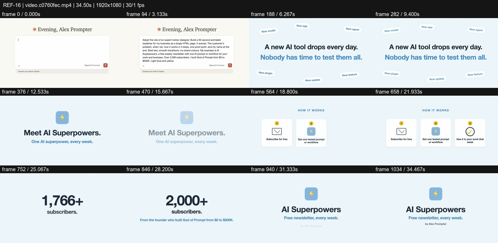
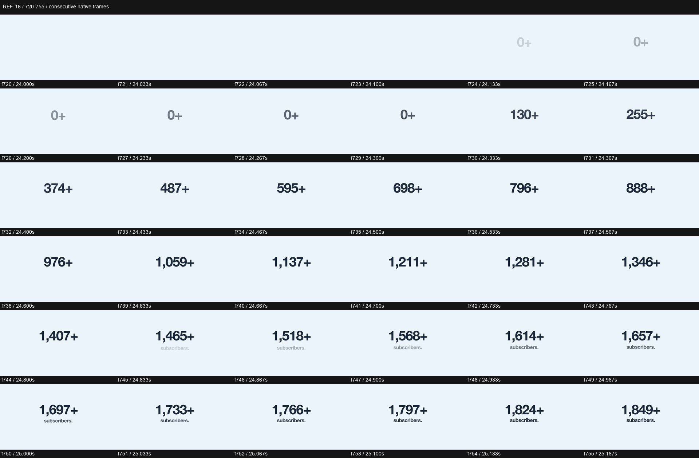

# REF-16 — AI Superpowers — calm newsletter explainer

[Play source](<../../../assets/Reference Vid/REF-16-ai-superpowers-calm-newsletter-explainer.mp4>) · [Library](../README.md) · [Playbook](../PLAYBOOK.md)

1920×1080 · 30/1 fps · 34.500s container · 1,035 native frames · last visual PTS 34.467s. Frame numbers are zero-based. Chapter times below are approximate unless a frame number is given.

**Find for:** minimal, newsletter, three-step explainer, social proof, calm.

## Art direction

Warm white and powder blue, dark type and a bolt identity. Stable centred hierarchy and orderly three-step cards favour comprehension over spectacle.

## Sequence and timing

| Source time (seconds) | Visible action |
| --- | --- |
| 0–3.8 | Example prompt types into a simple input. |
| 3.8–9.6 | Crossfade into pain statement and floating tool chips. |
| 10.2–15.6 | Identity and benefit line. |
| 16.3–23.6 | How it works; three cards arrive in sequence and settle. |
| 24.1–25.6 | Subscriber counter grows toward 2,000+; label arrives after the number starts. |
| 26–28 | Founder proof line. |
| 29–34.47 | Closing brand lockup. |

## Motion recipe to adapt

Keep one reading task at a time. In f720–755 the count first appears faint at zero, accelerates numerically and then adds the subscriber label. The number is primary and the explanation follows, so the viewer is not forced to read three competing arrivals.

## Best use and cautions

Use for calm explanatory content and information hierarchy. This is a secondary pacing reference for an energetic showreel, not its sole quality target. No audio stream is present; the subscriber figure is an unverified source claim.

## Enlarged consecutive-frame study

Native frames 720–755, 24.000–25.167s. Each thumbnail is 320×180; no intervening frames omitted in this strip.

## Audio evidence

No audio stream (ffprobe); this is a visual-only reference.

[Audio-stream absence record](../evidence/REF-16/audio-timeline.json). No audio analysis or sync inference was made for this silent source.

## Every-frame audit

All native frames were decoded and indexed in presentation order; all chronological sheets were visually inspected at thumbnail resolution. This does not mean every frame was checked at full resolution. [Frame metrics / PTS](../evidence/REF-16/frames.csv) · [Decode and palette metadata](../evidence/REF-16/study.json).

Chronological sheets: [001](../evidence/REF-16/all-frames/page-001.jpg) · [002](../evidence/REF-16/all-frames/page-002.jpg) · [003](../evidence/REF-16/all-frames/page-003.jpg) · [004](../evidence/REF-16/all-frames/page-004.jpg) · [005](../evidence/REF-16/all-frames/page-005.jpg)

Original filename: `video.c0760fec.mp4`. SHA-256: `c0760fec631745647bedba2be7e2e65a8a3433bfb2946e82bbacb7dec2179a3e`. Descriptive title identifies visible content, not verified authorship or tools. Local study does not establish reuse rights for footage, logos, artwork or audio.
