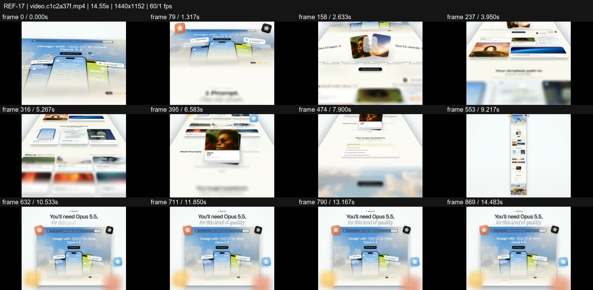
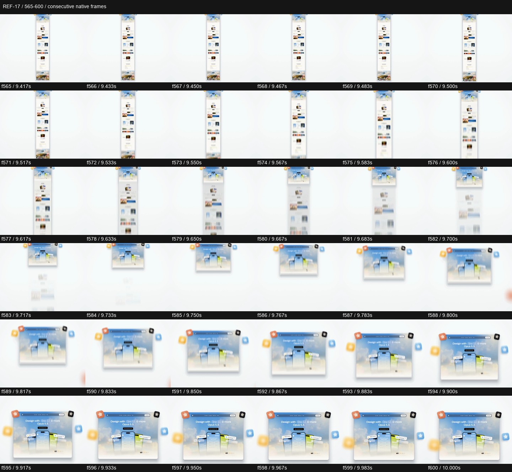

# REF-17 — Perspective website — flythrough and depth of field

[Play source](<../../../assets/Reference Vid/REF-17-perspective-website-flythrough-depth-of-field.mp4>) · [Library](../README.md) · [Playbook](../PLAYBOOK.md)

1440×1152 · 60/1 fps · 14.549s container · 870 native frames · last visual PTS 14.483s. Frame numbers are zero-based. Chapter times below are approximate unless a frame number is given.

**Find for:** website showcase, perspective, camera journey, depth of field, parallax.

## Art direction

White/sky blue website world, phones and art cards, small citrus/peach badges. A narrow focus band and soft depth blur turn a long page into a traversable object.

## Sequence and timing

| Source time (seconds) | Visible action |
| --- | --- |
| 0–1 | Hero pulls back and tilts into a page plane. |
| 1–5.5 | Travel past headline, phone cards and image grids. |
| 5.7–6.7 | Portrait card lifts above the page with a contact shadow. |
| 7–9.5 | Pass the form; pull away until the full page reads as a thin vertical strip. |
| 9.5–10 | Accelerated return to the hero with blur; f565–600 resolves the main panel. |
| 10.2–14.48 | Headline and hero settle; badges maintain small depth changes. |

## Motion recipe to adapt

Use camera distance, tilt and focus together, with an explicit legibility recovery at the end. A card lift needs a consistent shadow and depth relationship to the page. The long-page view makes the return to the hero feel like a journey rather than a generic zoom.

## Best use and cautions

Use for websites and portfolios with substantial authored content. Do not keep all proof too blurred to read. The onscreen model-quality claim is source advertising, not a tool requirement or verified comparison.

## Enlarged consecutive-frame study

Native frames 565–600, 9.417–10.000s. Each thumbnail is 240×192; no intervening frames omitted in this strip.

## Audio evidence

earshot measured **-13.9 LUFS integrated**, **-2.5 dBTP** and 79 detected onsets/events. Pulse estimate: 130.2 BPM, clarity 0.345 (clear); this is an estimate, not a recovered score. Comparison anchor **f583 / 9.717s** → nearest detected event **9.809s** (+92.3ms audio minus visual). Proximity alone does not establish a perceptually synced effect.

[Raw earshot report](../evidence/REF-17/audio-timeline.json). Its input filename records the pre-rename path. Measurements come from decoded lossy audio; tags are model hypotheses, not human listening. Automatic cut detection can flag flashes or fast motion and cannot judge a morph's perceptual continuity. Reassess timing against the selected music in a new production; these loudness values are not mix targets.

## Every-frame audit

All native frames were decoded and indexed in presentation order; all chronological sheets were visually inspected at thumbnail resolution. This does not mean every frame was checked at full resolution. [Frame metrics / PTS](../evidence/REF-17/frames.csv) · [Decode and palette metadata](../evidence/REF-17/study.json).

Chronological sheets: [001](../evidence/REF-17/all-frames/page-001.jpg) · [002](../evidence/REF-17/all-frames/page-002.jpg) · [003](../evidence/REF-17/all-frames/page-003.jpg) · [004](../evidence/REF-17/all-frames/page-004.jpg) · [005](../evidence/REF-17/all-frames/page-005.jpg) · [006](../evidence/REF-17/all-frames/page-006.jpg)

Original filename: `video.c1c2a37f.mp4`. SHA-256: `c1c2a37f72647cbb92643fbe0c2670215759702a0926c67a9efd1cb4d8920cd5`. Descriptive title identifies visible content, not verified authorship or tools. Local study does not establish reuse rights for footage, logos, artwork or audio.
