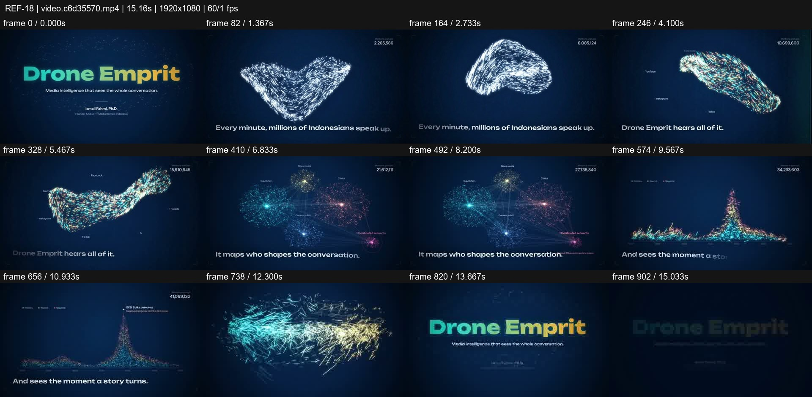
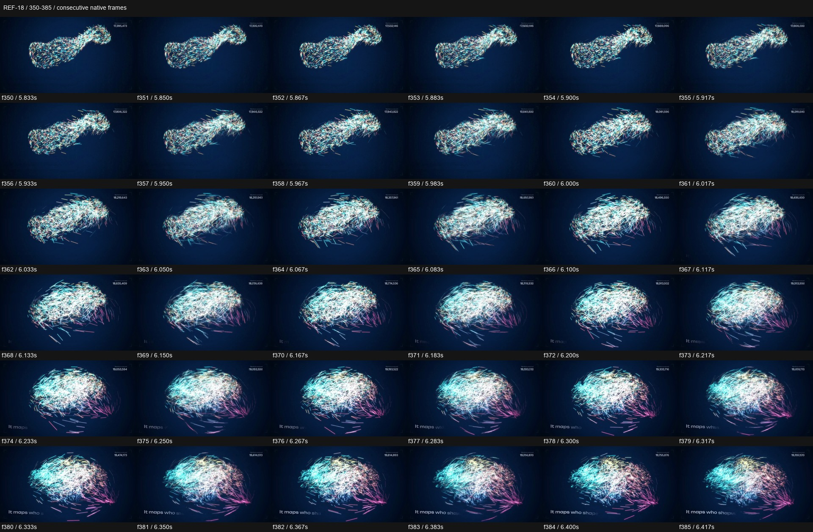

# REF-18 — Drone Emprit — swarm, network and data spike

[Play source](<../../../assets/Reference Vid/REF-18-drone-emprit-particles-swarm-network-spike.mp4>) · [Library](../README.md) · [Playbook](../PLAYBOOK.md)

1920×1080 · 60/1 fps · 15.162s container · 907 native frames · last visual PTS 15.100s. Frame numbers are zero-based. Chapter times below are approximate unless a frame number is given.

**Find for:** particles, data storytelling, network, swarm, logo formation.

## Art direction

Naval blue textured field, cyan/white and platform-coloured particles, yellow/teal identity. A persistent small counter and baseline subtitle orient abstract forms.

## Sequence and timing

| Source time (seconds) | Visible action |
| --- | --- |
| 0–3.2 | Brief title and a twisting ribbon/bird-like swarm. |
| 3.2–5.8 | Platform colours and labels appear in the flow. |
| 5.9–6.42 | Swarm opens and redistributes; enlarged f350–385 shows the change beginning. |
| 6.65–8.5 | Communities and connecting edges become a readable network. |
| 8.6–11.45 | Network reorganises into a time-series spike and callout. |
| 11.5–12.9 | Recoil into ribbon; particles lock into the wordmark. |
| 13–15.1 | Brand promise and credit resolve. |

## Motion recipe to adapt

Give particles semantic destinations: message flow, community structure, time-series event, then identity. Keep enough spatial correspondence during redistribution that each scene feels made from the same material. Allow the network to stabilise before turning it into a chart.

## Best use and cautions

Use for intelligence, analytics and data stories. Counter values are illustrative source content, not verified data. A random particle cloud under titles misses the central lesson.

## Enlarged consecutive-frame study

Native frames 350–385, 5.833–6.417s. Each thumbnail is 320×180; no intervening frames omitted in this strip.

## Audio evidence

earshot measured **-10.8 LUFS integrated**, **-0.1 dBTP** and 127 detected onsets/events. Pulse estimate: 120.0 BPM, clarity 0.672 (clear); this is an estimate, not a recovered score. Comparison anchor **f399 / 6.650s** → nearest detected event **6.632s** (-18.0ms audio minus visual). Proximity alone does not establish a perceptually synced effect.

[Raw earshot report](../evidence/REF-18/audio-timeline.json). Its input filename records the pre-rename path. Measurements come from decoded lossy audio; tags are model hypotheses, not human listening. Automatic cut detection can flag flashes or fast motion and cannot judge a morph's perceptual continuity. Reassess timing against the selected music in a new production; these loudness values are not mix targets.

## Every-frame audit

All native frames were decoded and indexed in presentation order; all chronological sheets were visually inspected at thumbnail resolution. This does not mean every frame was checked at full resolution. [Frame metrics / PTS](../evidence/REF-18/frames.csv) · [Decode and palette metadata](../evidence/REF-18/study.json).

Chronological sheets: [001](../evidence/REF-18/all-frames/page-001.jpg) · [002](../evidence/REF-18/all-frames/page-002.jpg) · [003](../evidence/REF-18/all-frames/page-003.jpg) · [004](../evidence/REF-18/all-frames/page-004.jpg)

Original filename: `video.c6d35570.mp4`. SHA-256: `c6d3557090198695c0ccdde45865d581f7ceddb56c164424259cad2946b7c9ae`. Descriptive title identifies visible content, not verified authorship or tools. Local study does not establish reuse rights for footage, logos, artwork or audio.
