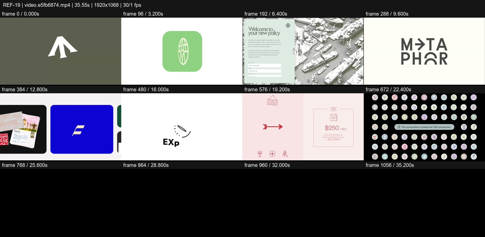
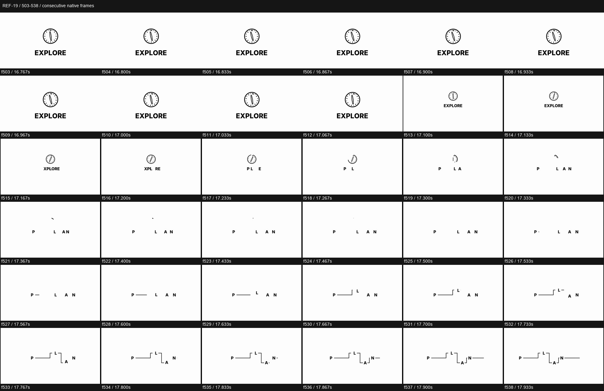

# REF-19 — Brand identity — logo to application montage

[Play source](<../../../assets/Reference Vid/REF-19-brand-identity-logo-to-application-montage.mp4>) · [Library](../README.md) · [Playbook](../PLAYBOOK.md)

1920×1068 · 30/1 fps · 35.549s container · 1,062 native frames · last visual PTS 35.367s. Frame numbers are zero-based. Chapter times below are approximate unless a frame number is given.

**Find for:** brand identity, logo morph, editorial application, typography, rapid montage.

## Art direction

Many distinct identity systems are shown through marks, photographs, packaging, print and type. Colour changes belong to actual project changes rather than arbitrary recolouring.

## Sequence and timing

| Source time (seconds) | Visible action |
| --- | --- |
| 0–3.8 | Arrow fans, pixel A, rounded icon, globe and landscape identity. |
| 3.8–8 | Print/policy applications, aerial image and search screen. |
| 8–13.3 | Liquid-stripe A, Metaphor work, architectural LH and flyer/cards. |
| 13.35–16 | Angular mark and photographic/typographic collage. |
| 16–18.6 | EXPLORE compass → PLAN → AND → BOOK; glyph pieces become linework. |
| 18.7–23.8 | Maxwell, yellow/green icon morphs, Iconic applications and Pager poster. |
| 24–24.867 | Yellow arrow ending. |
| 24.900–35.367 | Black frames through the end of the visual stream; source kept intact. |

## Motion recipe to adapt

Show a mark generating a usable identity system. At f513–538, EXPLORE contracts, letters selectively disappear into PLAN and the remaining glyphs start a stepped line drawing. Shape logic links the typographic states; applications prove the identity beyond a logo.

## Best use and cautions

Use for brand portfolios and identity films. Exclude the 10.5s black tail from creative pacing references; retain it in the source. Audio peaks/clipping also mean this is not a mastering target.

## Enlarged consecutive-frame study

Native frames 503–538, 16.767–17.933s. Each thumbnail is 320×178; no intervening frames omitted in this strip.

## Audio evidence

earshot measured **-9.6 LUFS integrated**, **1.0 dBTP** and 231 detected onsets/events. Pulse estimate: 96.9 BPM, clarity 0.283 (weak); this is an estimate, not a recovered score. Comparison anchor **f513 / 17.100s** → nearest detected event **17.068s** (-32.0ms audio minus visual). Proximity alone does not establish a perceptually synced effect.

[Raw earshot report](../evidence/REF-19/audio-timeline.json). Its input filename records the pre-rename path. Measurements come from decoded lossy audio; tags are model hypotheses, not human listening. Automatic cut detection can flag flashes or fast motion and cannot judge a morph's perceptual continuity. Reassess timing against the selected music in a new production; these loudness values are not mix targets.

## Every-frame audit

All native frames were decoded and indexed in presentation order; all chronological sheets were visually inspected at thumbnail resolution. This does not mean every frame was checked at full resolution. [Frame metrics / PTS](../evidence/REF-19/frames.csv) · [Decode and palette metadata](../evidence/REF-19/study.json).

Chronological sheets: [001](../evidence/REF-19/all-frames/page-001.jpg) · [002](../evidence/REF-19/all-frames/page-002.jpg) · [003](../evidence/REF-19/all-frames/page-003.jpg) · [004](../evidence/REF-19/all-frames/page-004.jpg) · [005](../evidence/REF-19/all-frames/page-005.jpg)

Original filename: `video.e5fb6874.mp4`. SHA-256: `e5fb68747bb7b2d5d1457d30923a1fe4b1c1f2fd2198f7b81d73fe5541ac84b2`. Descriptive title identifies visible content, not verified authorship or tools. Local study does not establish reuse rights for footage, logos, artwork or audio.
