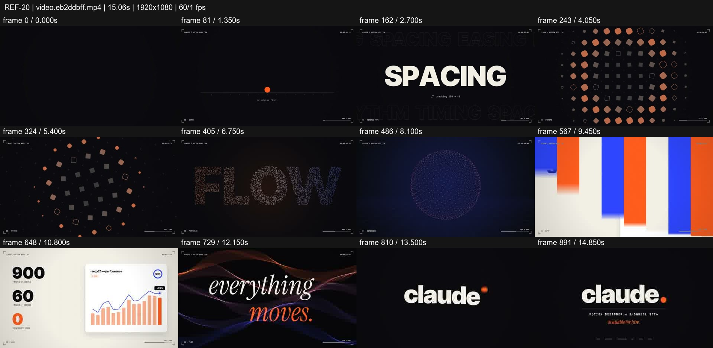
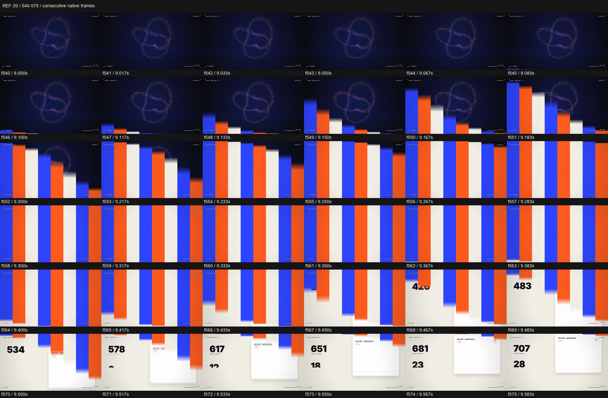

# REF-20 — Orange/blue — motion systems, particles and data

[Play source](<../../../assets/Reference Vid/REF-20-orange-blue-motion-systems-type-particles-data.mp4>) · [Library](../README.md) · [Playbook](../PLAYBOOK.md)

1920×1080 · 60/1 fps · 15.061s container · 900 native frames · last visual PTS 14.983s. Frame numbers are zero-based. Chapter times below are approximate unless a frame number is given.

**Find for:** showreel, kinetic type, procedural grid, particles, data, wipes.

## Art direction

Orange, cobalt, cream and dark chapters; ball, type, grid, particle volume, data proof and elegant italic ribbon. Small frame/timing overlays make a technical lab identity.

## Sequence and timing

| Source time (seconds) | Visible action |
| --- | --- |
| 0–1.85 | Squashed orange ball and full-frame expansion. |
| 1.9–3.9 | TIMING / SPACING / EASING / RHYTHM, then staggered bar wipe. |
| 4–5.4 | Orange and outlined cells perform a local wave/rotation. |
| 5.5–7.1 | Pin light, particle FLOW word and dispersion. |
| 7.4–9.1 | Sphere becomes a purple double-loop/knot. |
| 9.1–9.58 | Blue/orange/cream vertical strips rise, cover and leave upward to reveal metrics. |
| 9.6–10.9 | Numbers roll, charts draw and read. |
| 10.95–13.05 | Horizontal orange wipe, italic everything moves and brief inversion/glitch. |
| 13.1–15 | Identity assembles with orange period and final CTA. |

## Motion recipe to adapt

Treat transitions as full compositions. In f540–575, strip heights are staggered on entry, briefly cover the field, then reveal the new scene from below as they continue upward. Overlap incoming count animation with the clearing strips so the reveal has momentum.

## Best use and cautions

Use for a high-energy motion systems reel. Each chapter demonstrates an operation, not just a style name. The onscreen fps/frame/dropped metrics are source copy and are not validation results for our engine.

## Enlarged consecutive-frame study

Native frames 540–575, 9.000–9.583s. Each thumbnail is 320×180; no intervening frames omitted in this strip.

## Audio evidence

earshot measured **-11.4 LUFS integrated**, **-0.1 dBTP** and 89 detected onsets/events. Pulse estimate: 128.1 BPM, clarity 0.661 (clear); this is an estimate, not a recovered score. Comparison anchor **f547 / 9.117s** → nearest detected event **9.162s** (+45.3ms audio minus visual). Proximity alone does not establish a perceptually synced effect.

[Raw earshot report](../evidence/REF-20/audio-timeline.json). Its input filename records the pre-rename path. Measurements come from decoded lossy audio; tags are model hypotheses, not human listening. Automatic cut detection can flag flashes or fast motion and cannot judge a morph's perceptual continuity. Reassess timing against the selected music in a new production; these loudness values are not mix targets.

## Every-frame audit

All native frames were decoded and indexed in presentation order; all chronological sheets were visually inspected at thumbnail resolution. This does not mean every frame was checked at full resolution. [Frame metrics / PTS](../evidence/REF-20/frames.csv) · [Decode and palette metadata](../evidence/REF-20/study.json).

Chronological sheets: [001](../evidence/REF-20/all-frames/page-001.jpg) · [002](../evidence/REF-20/all-frames/page-002.jpg) · [003](../evidence/REF-20/all-frames/page-003.jpg) · [004](../evidence/REF-20/all-frames/page-004.jpg)

Original filename: `video.eb2ddbff.mp4`. SHA-256: `eb2ddbff09563c739d8b9681ddc59dc366cc9c185ec02fad70fb391659ba9397`. Descriptive title identifies visible content, not verified authorship or tools. Local study does not establish reuse rights for footage, logos, artwork or audio.
