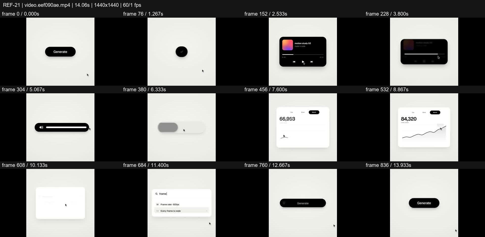
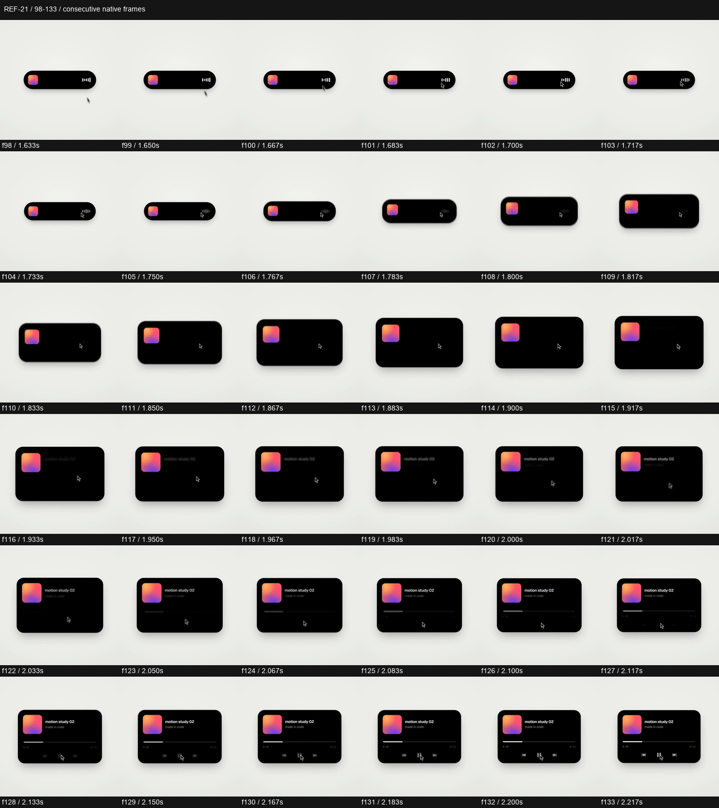

# REF-21 — Minimal light UI — generate, player, chart loop

[Play source](<../../../assets/Reference Vid/REF-21-minimal-light-ui-generate-player-chart-loop.mp4>) · [Library](../README.md) · [Playbook](../PLAYBOOK.md)

1440×1440 · 60/1 fps · 14.058s container · 840 native frames · last visual PTS 13.983s. Frame numbers are zero-based. Chapter times below are approximate unless a frame number is given.

**Find for:** UI morph, light mode, interaction, functional states, seamless loop.

## Art direction

Warm light ground, black pills/cards and soft contact shadows, with a small gradient album tile. Cursor action drives component transitions around a consistent stage.

## Sequence and timing

| Source time (seconds) | Visible action |
| --- | --- |
| 0–1.25 | Generate → compact loader → success tick. |
| 1.25–2.2 | Success pill expands into mini-player and then player card. |
| 2.2–4 | Player progresses then squeezes into the volume control. |
| 4.1–6.1 | Scrub slider, then toggle state changes. |
| 6.2–7.9 | Toggle stretches into tabs, then chart and growing metric. |
| 8–9.6 | Cursor tooltip and Week selection update the data. |
| 9.6–11.7 | Panel contracts, search grows, 'frame' is typed and a result chosen. |
| 11.8–13.98 | Result becomes a pill, then Generate returns and the loop rests. |

## Motion recipe to adapt

Animate the container dimensions/radius and the inner content on different offsets. At f107–119 the pill first gains height, the album tile grows, then title text resolves; transport controls enter after the card is established. Maintain the centre and shadow throughout.

## Best use and cautions

Use for elegant software microinteractions. Make selected tabs and search results visibly affect content. Do not replace the sequence with crossfaded screenshots or add camera drift that prevents reading.

## Enlarged consecutive-frame study

Native frames 98–133, 1.633–2.217s. Each thumbnail is 240×240; no intervening frames omitted in this strip.

## Audio evidence

earshot measured **-14.1 LUFS integrated**, **-0.6 dBTP** and 78 detected onsets/events. Pulse estimate: 119.9 BPM, clarity 0.439 (clear); this is an estimate, not a recovered score. Comparison anchor **f107 / 1.783s** → nearest detected event **1.870s** (+86.7ms audio minus visual). Proximity alone does not establish a perceptually synced effect.

[Raw earshot report](../evidence/REF-21/audio-timeline.json). Its input filename records the pre-rename path. Measurements come from decoded lossy audio; tags are model hypotheses, not human listening. Automatic cut detection can flag flashes or fast motion and cannot judge a morph's perceptual continuity. Reassess timing against the selected music in a new production; these loudness values are not mix targets.

## Every-frame audit

All native frames were decoded and indexed in presentation order; all chronological sheets were visually inspected at thumbnail resolution. This does not mean every frame was checked at full resolution. [Frame metrics / PTS](../evidence/REF-21/frames.csv) · [Decode and palette metadata](../evidence/REF-21/study.json).

Chronological sheets: [001](../evidence/REF-21/all-frames/page-001.jpg) · [002](../evidence/REF-21/all-frames/page-002.jpg) · [003](../evidence/REF-21/all-frames/page-003.jpg) · [004](../evidence/REF-21/all-frames/page-004.jpg) · [005](../evidence/REF-21/all-frames/page-005.jpg) · [006](../evidence/REF-21/all-frames/page-006.jpg)

Original filename: `video.eef090ae.mp4`. SHA-256: `eef090aef84667ee4b7a9d5ab56e290cbade8ad03db19b346a17bf31376ba333`. Descriptive title identifies visible content, not verified authorship or tools. Local study does not establish reuse rights for footage, logos, artwork or audio.
