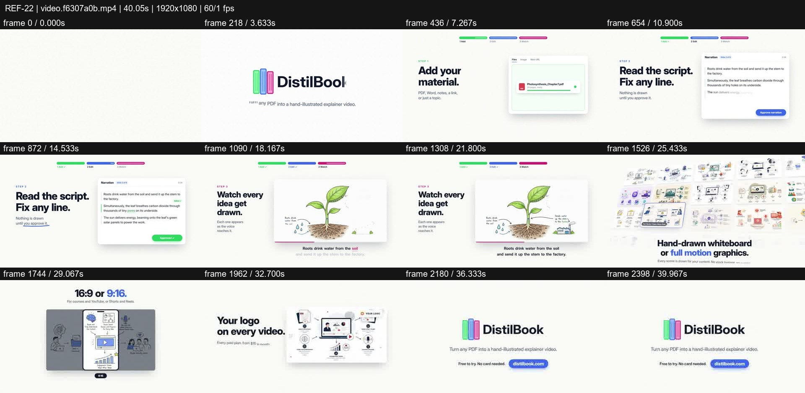
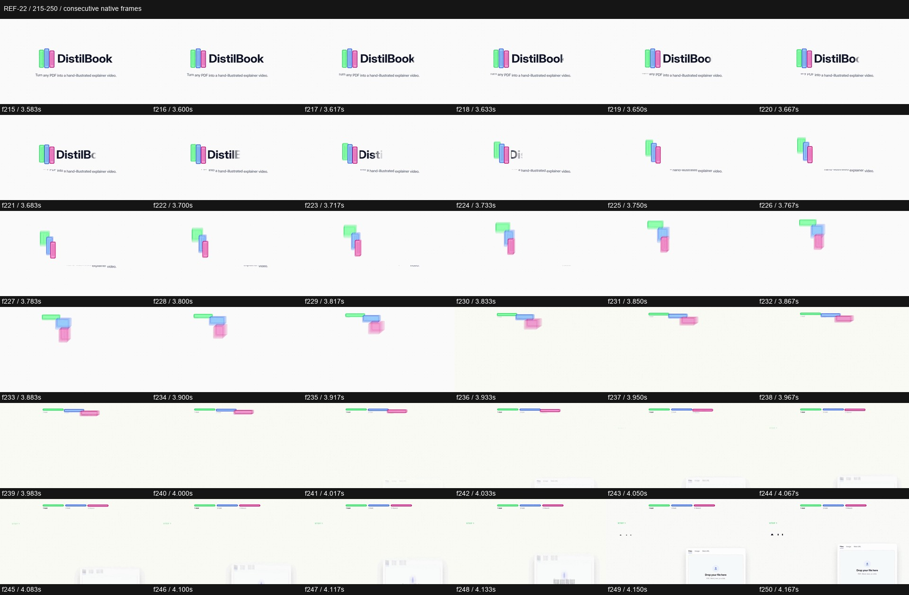

# REF-22 — DistilBook — illustrated SaaS workflow launch

[Play source](<../../../assets/Reference Vid/REF-22-distilbook-illustrated-saas-workflow-launch.mp4>) · [Library](../README.md) · [Playbook](../PLAYBOOK.md)

1920×1080 · 60/1 fps · 40.054s container · 2,400 native frames · last visual PTS 39.983s. Frame numbers are zero-based. Chapter times below are approximate unless a frame number is given.

**Find for:** SaaS launch, logo-to-navigation, hand drawn, workflow, product proof.

## Art direction

White/navy type and three book spines in green, blue and pink. The books become workflow progress strips; the product's hand-illustrated output supplies the richer visual proof.

## Sequence and timing

| Source time (seconds) | Visible action |
| --- | --- |
| 0–1.8 | Typographic promise about a teacher drawing the page. |
| 1.95–3.6 | Three books drop into the identity and tagline. |
| 3.6–4.17 | Wordmark clears, books separate, rotate and stretch into the top progress strips. |
| 4.1–9.5 | Add material: file enters upload box and completes. |
| 9.6–15.5 | Edit script: text changes, underline/highlight and approval state. |
| 15.7–21.8 | Watch: plant grows from soil; arrows, water and text animate in sequence. |
| 22–27.8 | Time promise, then real illustrated pages form a receding proof wall. |
| 28–33.9 | Landscape/portrait window, language count and customer-logo demonstration. |
| 34–39.98 | Spines reassemble identity; CTA lands and remains readable. |

## Motion recipe to adapt

Turn identity into functional navigation. In f215–250 the book group survives the disappearing wordmark, separates and flattens into chapter bars while upload UI enters. At the end reverse that relationship. Show working states and actual output before the CTA.

## Best use and cautions

Use for educational/SaaS launches and workflow explanation. Timing/language claims are unverified source marketing; use our own product evidence. The final reading hold is intentional and should not be mistaken for missing animation.

## Enlarged consecutive-frame study

Native frames 215–250, 3.583–4.167s. Each thumbnail is 320×180; no intervening frames omitted in this strip.

## Audio evidence

earshot measured **-12.2 LUFS integrated**, **-0.3 dBTP** and 242 detected onsets/events. Pulse estimate: 120.0 BPM, clarity 0.338 (clear); this is an estimate, not a recovered score. Comparison anchor **f238 / 3.967s** → nearest detected event **3.950s** (-16.7ms audio minus visual). Proximity alone does not establish a perceptually synced effect.

[Raw earshot report](../evidence/REF-22/audio-timeline.json). Its input filename records the pre-rename path. Measurements come from decoded lossy audio; tags are model hypotheses, not human listening. Automatic cut detection can flag flashes or fast motion and cannot judge a morph's perceptual continuity. Reassess timing against the selected music in a new production; these loudness values are not mix targets.

## Every-frame audit

All native frames were decoded and indexed in presentation order; all chronological sheets were visually inspected at thumbnail resolution. This does not mean every frame was checked at full resolution. [Frame metrics / PTS](../evidence/REF-22/frames.csv) · [Decode and palette metadata](../evidence/REF-22/study.json).

Chronological sheets: [001](../evidence/REF-22/all-frames/page-001.jpg) · [002](../evidence/REF-22/all-frames/page-002.jpg) · [003](../evidence/REF-22/all-frames/page-003.jpg) · [004](../evidence/REF-22/all-frames/page-004.jpg) · [005](../evidence/REF-22/all-frames/page-005.jpg) · [006](../evidence/REF-22/all-frames/page-006.jpg) · [007](../evidence/REF-22/all-frames/page-007.jpg) · [008](../evidence/REF-22/all-frames/page-008.jpg) · [009](../evidence/REF-22/all-frames/page-009.jpg) · [010](../evidence/REF-22/all-frames/page-010.jpg)

Original filename: `video.f6307a0b.mp4`. SHA-256: `f6307a0ba4f19bf17b85ca1e1789c45a196c9dbdf66e8fbc6d3dd5cb67cbc859`. Descriptive title identifies visible content, not verified authorship or tools. Local study does not establish reuse rights for footage, logos, artwork or audio.
